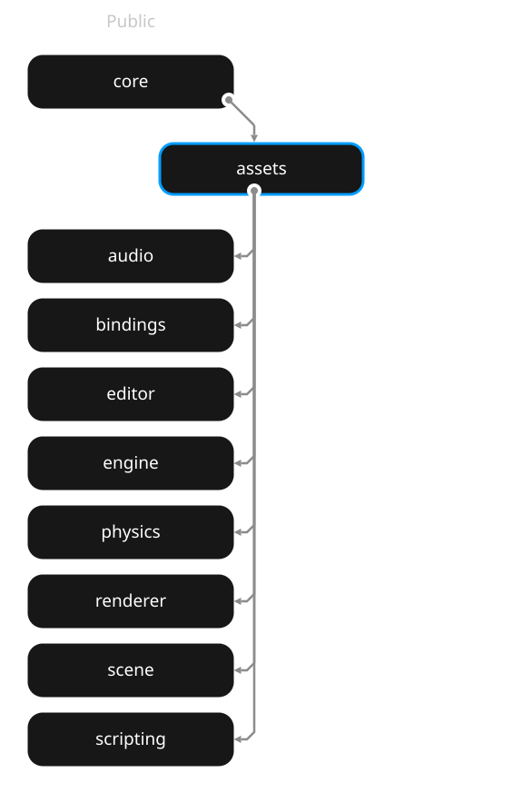

[Engine](../engine.md)

# Assets
<!-- doc-template:module -->

|---|---|
| Type | Module |
| Namespace | `conjure::assets` |
| Include Folder Path | `engine/include/conjure/assets` |
| Source Folder Path | `engine/src/assets` |

<!-- doc-content:purpose:start -->
`conjure::assets` (target `conjure_assets`) is the asset pipeline: stable uuid identity through
`.meta` sidecars, importers that cook sources into hash-validated blobs, an asynchronous loader with
main-thread finalisation, the non-owning `asset_ref<T>` and owning `asset_handle`, explicit unloading, hot
reload with dependency propagation and a deterministic export pack. It depends on `conjure::core` only and
knows no concrete asset type beyond `binary_asset`; renderer, audio, physics, scene, scripting and plugins
register theirs into it. This chapter is for people changing the module: layout, algorithms, threading, the
extension points and the tests.

See `engine/src/assets/README.md` for additional implementation notes.
<!-- doc-content:purpose:end -->

## Dependency Graph



## Headers

| File | Description | Provides |
|---|---|---|
| [asset_cache.h](assets/asset-cache.md) | Blob storage for one platform. | [`asset_cache`](assets/asset-cache/asset-cache.md)<br>[`cache_expectation`](assets/asset-cache/cache-expectation.md) |
| [asset_cooker.h](assets/asset-cooker.md) | Produces the export pack from the database and the cache. | [`asset_cooker`](assets/asset-cooker/asset-cooker.md)<br>[`cook_failure`](assets/asset-cooker/cook-failure.md)<br>[`cook_report`](assets/asset-cooker/cook-report.md)<br>[`cook_settings`](assets/asset-cooker/cook-settings.md) |
| [asset_database.h](assets/asset-database.md) | The project&#x27;s sources, their identities and their cooked state. | [`asset_database`](assets/asset-database/asset-database.md)<br>[`asset_database::entry`](assets/asset-database/asset-database-entry.md)<br>[`asset_mount`](assets/asset-database/asset-mount.md)<br>[`asset_path_parts`](assets/asset-database/asset-path-parts.md)<br>[`asset_record`](assets/asset-database/asset-record.md)<br>[`import_failure`](assets/asset-database/import-failure.md)<br>[`import_report`](assets/asset-database/import-report.md)<br>[`scan_report`](assets/asset-database/scan-report.md) |
| [asset_extension_desc.h](assets/asset-extension-desc.md) | Trivially copyable extension records a plugin module registers. | [`asset_type_extension_desc`](assets/asset-extension-desc/asset-type-extension-desc.md)<br>[`importer_extension_desc`](assets/asset-extension-desc/importer-extension-desc.md) |
| [asset_importer.h](assets/asset-importer.md) | Converts source bytes into cooked payloads. | [`asset_importer`](assets/asset-importer/asset-importer.md)<br>[`import_context`](assets/asset-importer/import-context.md)<br>[`import_output`](assets/asset-importer/import-output.md)<br>[`imported_asset`](assets/asset-importer/imported-asset.md)<br>[`importer_registry`](assets/asset-importer/importer-registry.md)<br>[`sub_asset_table`](assets/asset-importer/sub-asset-table.md) |
| [asset_loader.h](assets/asset-loader.md) | Type-erased loader interface. | [`asset_loader`](assets/asset-loader/asset-loader.md)<br>[`finalise_context`](assets/asset-loader/finalise-context.md)<br>[`load_context`](assets/asset-loader/load-context.md)<br>[`typed_asset_loader`](assets/asset-loader/typed-asset-loader.md) |
| [asset_manager.h](assets/asset-manager.md) | Owns every slot, payload and the load pipeline. | [`asset_event`](assets/asset-manager/asset-event.md)<br>[`asset_load_batch`](assets/asset-manager/asset-load-batch.md)<br>[`asset_manager`](assets/asset-manager/asset-manager.md)<br>[`asset_manager_desc`](assets/asset-manager/asset-manager-desc.md)<br>[`asset_manager_stats`](assets/asset-manager/asset-manager-stats.md)<br>[`asset_subscription`](assets/asset-manager/asset-subscription.md) |
| [asset_meta.h](assets/asset-meta.md) | The parsed sidecar. | [`asset_meta`](assets/asset-meta/asset-meta.md)<br>[`sub_asset_entry`](assets/asset-meta/sub-asset-entry.md) |
| [asset_pack.h](assets/asset-pack.md) | The export pack, <code>content.cpak</code>: a 64-<code><a href="core/types.html#symbol-byte">byte</a></code> header, a TOC sorted by uuid, a dependency table, a string table of asset paths and the payloads, each 16-<code><a href="core/types.html#symbol-byte">byte</a></code> aligned with identical payloads stored once. | [`pack_header`](assets/asset-pack/pack-header.md)<br>[`pack_reader`](assets/asset-pack/pack-reader.md)<br>[`pack_stats`](assets/asset-pack/pack-stats.md)<br>[`pack_toc_entry`](assets/asset-pack/pack-toc-entry.md)<br>[`pack_writer`](assets/asset-pack/pack-writer.md)<br>[`pack_writer::entry`](assets/asset-pack/pack-writer-entry.md) |
| [asset_payload.h](assets/asset-payload.md) | Type erasure for published payloads. |  |
| [asset_ref.h](assets/asset-ref.md) | Non-owning reference to an asset: the uuid plus the bound slot. | [`asset_handle`](assets/asset-ref/asset-handle.md)<br>[`asset_ref`](assets/asset-ref/asset-ref.md)<br>[`conjure::core::reflect::reflect_kind_override<conjure::assets::asset_ref<AssetType>>`](assets/asset-ref/conjure-core-reflect-reflect-kind-override-conjure-assets-asset-ref-assettype.md) |
| [asset_slot.h](assets/asset-slot.md) | Lock-free view of one asset&#x27;s residency. | [`asset_slot`](assets/asset-slot/asset-slot.md) |
| [asset_source.h](assets/asset-source.md) | <code>A</code> provider of validated cooked blobs. | [`asset_source`](assets/asset-source/asset-source.md)<br>[`cache_asset_source`](assets/asset-source/cache-asset-source.md)<br>[`composite_asset_source`](assets/asset-source/composite-asset-source.md)<br>[`memory_asset_source`](assets/asset-source/memory-asset-source.md)<br>[`memory_asset_source::entry`](assets/asset-source/memory-asset-source-entry.md)<br>[`pack_asset_source`](assets/asset-source/pack-asset-source.md) |
| [asset_type_registry.h](assets/asset-type-registry.md) | The set of registered asset types. | [`asset_type_desc`](assets/asset-type-registry/asset-type-desc.md)<br>[`asset_type_registry`](assets/asset-type-registry/asset-type-registry.md)<br>[`asset_type_registry_hooks`](assets/asset-type-registry/asset-type-registry-hooks.md) |
| [asset_types.h](assets/asset-types.md) | Identity, states and constants shared by every asset header. |  |
| [assets.h](assets/assets.md) | Umbrella header of the assets module (<code>conjure::assets</code>). |  |
| [assets_error.h](assets/assets-error.md) | The assets error category. |  |
| [binary_asset.h](assets/binary-asset.md) | The published payload: the source bytes as imported. | [`binary_asset`](assets/binary-asset/binary-asset.md)<br>[`binary_importer`](assets/binary-asset/binary-importer.md)<br>[`binary_loader`](assets/binary-asset/binary-loader.md) |
| [cooked_blob.h](assets/cooked-blob.md) | <code>A</code> blob with its bytes. | [`cooked_blob`](assets/cooked-blob/cooked-blob.md)<br>[`cooked_blob_header`](assets/cooked-blob/cooked-blob-header.md) |
| [file_watcher.h](assets/file-watcher.md) | Produces debounced file changes. | [`file_change`](assets/file-watcher/file-change.md)<br>[`file_watcher`](assets/file-watcher/file-watcher.md)<br>[`polling_file_watcher`](assets/file-watcher/polling-file-watcher.md)<br>[`polling_file_watcher::file_state`](assets/file-watcher/polling-file-watcher-file-state.md) |
| [hot_reload.h](assets/hot-reload.md) | Hot reload: watcher changes -&gt; dirty sources -&gt; re-import -&gt; reload dependents through the normal pipeline in dependency-depth order. | [`hot_reload_controller`](assets/hot-reload/hot-reload-controller.md)<br>[`hot_reload_report`](assets/hot-reload/hot-reload-report.md) |
| [log_category.h](assets/log-category.md) | Declarations for <code><a href="core/log/log-category.html">log_category</a>.h</code>. |  |

## Breakdown

<!-- doc-content:breakdown:start -->
### Contents

- [1. Shape of the module](#1-shape-of-the-module)
- [2. Identity and the slot table](#2-identity-and-the-slot-table)
- [3. Database: scan, hashing and import](#3-database-scan-hashing-and-import)
- [4. Cache layout and validation](#4-cache-layout-and-validation)
- [5. The load pipeline](#5-the-load-pipeline)
- [6. Publish, retire and collect](#6-publish-retire-and-collect)
- [7. Threading](#7-threading)
- [8. Hot reload and the watcher job](#8-hot-reload-and-the-watcher-job)
- [9. Cooker and pack determinism](#9-cooker-and-pack-determinism)
- [10. Extension points](#10-extension-points)
- [11. Failure handling](#11-failure-handling)
- [12. Tests](#12-tests)
- [13. Open items](#13-open-items)
- [Related](#related)

### Shape of the module

`engine/src/assets/CMakeLists.txt` declares the module with `conjure_add_module(assets... PUBLIC_DEPS
conjure::core)`; every public header also compiles alone through `conjure_header_check(conjure_assets)`.
Public headers live under `engine/include/conjure/assets/`, one `.cpp` per header under `engine/src/assets/`.

| Header | Main types | Area |
|---|---|---|
| `assets_error.h` | `asset_error_code`, `make_asset_error`, the `"assets"` category | shared |
| `asset_types.h` | `asset_id`, `asset_type_id`, `make_asset_type_id` (constexpr FNV-1a, same constants as `core::hash`), `asset_state`, `asset_load_priority`, `asset_type_flags`, `asset_type_traits`, `CONJURE_DECLARE_ASSET_TYPE`, constants | shared |
| `asset_payload.h`, `asset_slot.h`, `asset_ref.h` | `asset_payload`, `asset_slot`, `asset_ref<T>`, `asset_handle`, the `ASSET_REF` reflect override | runtime |
| `asset_loader.h`, `asset_type_registry.h` | `asset_loader`, `typed_asset_loader`, `asset_type_desc`, `asset_type_registry`, `asset_type_registry_hooks` | runtime |
| `asset_source.h`, `asset_manager.h` | the four sources, `asset_manager`, batches, events, stats | runtime |
| `asset_importer.h`, `asset_meta.h`, `asset_database.h`, `asset_cache.h`, `cooked_blob.h` | importers and `import_context`, the sidecar, the database, the blob cache, the blob format | editor and development |
| `file_watcher.h`, `hot_reload.h`, `asset_cooker.h`, `asset_pack.h` | `polling_file_watcher`, `hot_reload_controller`, `asset_cooker`, `pack_writer` / `pack_reader` | editor and export |
| `asset_extension_desc.h`, `binary_asset.h` | plugin records, the built-in type | integration |

Private: `asset_slot_table.{h,cpp}` (slots plus `slot_data`), `completion_queue.h`, `load_pipeline.{h,cpp}`
(`load_cpu_stage`, shared by jobs and `load_blocking`), `database_snapshot.{h,cpp}` (`db.bin`),
`binary_io.h` (little-endian field I/O for every on-disk format), `fnv1a.h`, `path_filters.h`
(`is_temporary_path`). Everything is compiled in every configuration; the runtime simply never
constructs the database, watcher, cooker or importers.

### Identity and the slot table

### 2.1 Data layout

| Structure | Where | Contents |
|---|---|---|
| `asset_slot` (public, 1 per uuid) | `core::stable_vector` in `detail::asset_slot_table` | atomics `object`, `version`, `state`, `strongRefs`, `type`; plain `id`, `index` |
| `detail::slot_data` (main thread only) | a parallel `stable_vector`, indexed by `slot.index` | `payload`, `cpuOutput`, `dependencyIds`, `dependencyHandles`, `pendingDependencyHandles`, `lastError`, `job`, `priority`, `sequence`, `payloadBytes`, `generation`, flags (`queued`, `jobOutstanding`, `awaitingFinalise`, `pinned`, `isReload`, `dependencyFailureWarned`, `notFoundLogged`) |
| `asset_ref<T>` | by value in components | `asset_id` first (16 bytes), `const asset_slot *` second; `static_assert`ed to 24 bytes and trivially copyable |
| `asset_handle` | by value in systems | `asset_slot *`; copy and move adjust `strongRefs` with atomics |

Slots are created on first `bind` / `load` (never for the null uuid), live in `stable_vector`s and are never
freed before the manager is destroyed, so refs and handles need no generation counter and `get()` is one
acquire load of `slot.object`. The field order of `asset_ref` is a contract: `core::reflect` serialises
an `ASSET_REF` field as its leading uuid and zeroes the rest on read, and the ECS serialiser records the same
offsets for the scene bind pass (`asset_manager::bind_slot`).

A slot's `type` is taken from the sources while it is still `INVALID` (`state::find_or_create`), so a slot bound
before its asset is imported or created learns its type later. The price: an untyped bind (`bind_slot`,
`make_handle`), `load` or `pin` of a uuid that no source can type asks the sources again on each call, until one
can (`bind<T>` records `T` instead). The 2026-11-12 sweep kept this (won't fix): only uuids no source knows
pay, and caching the miss would need a change signal on the public `asset_source` interface.

### 2.2 Type identity

`make_asset_type_id(name)` is a `constexpr` 64-bit FNV-1a implemented in the module so blob headers and pack
tables never depend on another module's hashing shape; `asset_type_traits<T>` (from `CONJURE_DECLARE_ASSET_TYPE`)
exposes `NAME` and `id()`, and the `declared_asset_type` concept gates every typed entry point. The registry
keeps each `asset_type_desc` in its own heap block (`vector<unique_ptr>` plus a `vector<const desc *>` view and
a `flat_hash_map` index), so a `find()` pointer survives the removal of any other type, which is why `types()`
returns `span<const asset_type_desc *const>`, a span of pointers to registered type descriptors.

### Database: scan, hashing and import

### 3.1 Scan

`asset_database::scan()` (main thread) loads `db.bin` if valid, then walks each mount in sorted path order.
For every regular file that is not a `.meta` and not an atomic-write temporary (`detail::is_temporary_path`:
`*.tmp` from the cache and pack, `*.tmp-<uuid>` from `core::vfs::write_file_atomic`) it reads or creates the
sidecar (new uuid, importer chosen by extension, `default_settings()`; `NO_IMPORTER` still gets a uuid). A
second meta declaring a uuid already owned becomes `DUPLICATE_UUID` and a corrupt meta `META_INVALID`; both
records carry a **transient** uuid that is never persisted, so they are browsable and loads of them fail with
their status. A meta that cannot be written (read-only file, folder or file system) degrades only its record
to `META_INVALID` (WARN; the next scan retries) and a failed write that would record a newly registered importer
leaves the record `NO_IMPORTER`; neither aborts the scan. A uuid edited in an existing meta is refused (ERROR,
in-memory uuid kept), with two exceptions that follow (the meta is the identity): a meta this scan created is
a new asset (it inherits nothing from the record that used the path before, which becomes `MISSING_SOURCE`;
unless that uuid turned up at another path, a WARN names both uuids, since a `.meta` lost through version control
breaks every reference this way), and the uuid of a known primary whose record is `MISSING_SOURCE`, whose
source is gone or whose old meta no longer declares it is that asset moved here. Removed sources become
`MISSING_SOURCE`; the record stays. A sub-asset the last import dropped gets no record back from its
(append-only) meta unless its blob exists; a primary never imported gets every one.

### 3.2 Hashing and the stale rule

`(size, mtime)` equal to the snapshot skips hashing, except for sources with side files, which are always
re-hashed because a side file's change is invisible in the owner's stat. Hashing runs through
`jobs->parallel_for` when a job system was given, inline otherwise: `sourceHash` = `hash_bytes` over the
source bytes followed by every side file sorted by path; `settingsHash` = `canonical_settings_hash`
(sorted keys, minified). A primary is **stale** when its blob header is missing or unreadable or any of
`sourceHash`, `settingsHash`, `importerVersion`, `typeVersion`, `type` or `formatVersion` differs from the
expectation (`asset_cache::is_valid`). A blob header names no importer, so an imported primary whose meta
switched to another importer (through `write_meta()`, or seen by `scan()` against the previous record) carries
the private `entry::importerSwitched` flag and is stale until an import runs its new importer; the flag is not
persisted. The scan then deletes leftover `*.tmp` blobs and saves the snapshot.

### 3.3 Import

`import(ids, jobs)` maps sub-asset ids to their primaries, skips records that cannot import (`MISSING_SOURCE`,
`META_INVALID`, `DUPLICATE_UUID`, `NO_IMPORTER`) and runs one `source_job` per source through
`jobs.parallel_for`, bracketed by `importer_registry::begin_imports()` / `end_imports()`. Each job builds an
`import_context` (settings from the meta, a `sub_asset_table` seeded with the meta's entries, a resolver into
the database), calls `importer.import()`, builds one blob per `imported_asset` (header from the record,
`make_cooked_blob`; its `sourceHash` is computed from the bytes the importer was handed, so a file rewritten
during the import stays stale), and writes it through `asset_cache::write`. The main thread then merges: new
sub-asset uuids into the meta (rewritten sorted; append-only, so a dropped sub-asset keeps its uuid for when it
returns, while its record and blob are removed), record types and display names, side-file owners,
`payloadHash` (the report's `changed` list is every asset whose hash differs or is new), then rebuilds the
indexes and graphs, writes `import_log.txt` and saves the snapshot. A failing source is recorded
`IMPORT_FAILED` with its previous blob kept and the side files its import asked for added to the known ones
(`read_side_file` records a path even when the read fails, so a missing side file is watched); the importer
named in the meta is authoritative, so a hand-edited importer id is honoured (unknown name: `NO_IMPORTER`).
`add_file`, `create_asset` and `move_asset` refuse a path that leaves its mount (`INVALID_ARGUMENT`), and
`create_asset` removes the source it wrote when its meta cannot be written. `create_asset` and `move_asset` also
check every name of the path with `path_utils::is_portable_name` first (`INVALID_ARGUMENT`): the
file system would refuse the source, but only after `move_asset` had moved the `.meta` (`rock..meta` is portable).

### 3.4 Graphs and snapshot

Dependencies are stored per entry (sorted, unique) and compiled into forward and reverse CSR arrays
(`firstEdge` / `edgeCount` per entry into `mForwardEdges`, likewise for `mReverseEdges`) after every import.
Cycle detection is Tarjan's strongly connected components in the **iterative** form (explicit stack), so depth
is not bounded by the C stack; every member of a non-trivial component is flagged `CYCLIC_DEPENDENCY`.
`dependency_closure` is a DFS over the forward graph returning uuid order; `collect_dependents` a BFS over the
reverse graph returning roots first, depth ascending, deduplicated. The snapshot (`detail::database_snapshot`:
mount names, records, dependency lists, side files, little-endian with a versioned header) is purely a cache:
missing, corrupt, another version or different mounts all log INFO and fall back to a full scan. The parser
reserves for no more records than the remaining bytes can hold (113 bytes at least per record), so a forged
count costs nothing before the truncation check rejects the file.

### Cache layout and validation

```
<project>/.conjure/cache/
  db.bin                               database snapshot (rebuildable)
  import_log.txt                       last import errors and warnings
  <platform>/blobs/<xx>/<uuid>.cab     one cooked blob per asset, xx = first two hex chars of the uuid
```

A `.cab` is the 80-byte `cooked_blob_header` (magic `CJAB`, written field by field through `binary_io.h`),
`dependencyCount` uuids, then the payload at `align_up(80 + 16 * n, 16)`. `parse_cooked_blob` validates magic,
format version, every declared range against the buffer **in subtraction form** (so a corrupt `payloadSize`
or `dependencyCount` cannot wrap the sum past the buffer and reach a 64 GiB reserve or a wild read; the
regression tests pin this) and the payload hash. `asset_cache::read` hands the buffer it read to the
`parse_cooked_blob(std::vector<std::byte> &&)` overload, which shifts the payload to the front in place, so a
load holds one copy of the blob, not two; it additionally rejects a header whose `id` is not the uuid of the
path. Every write is `<path>.tmp` + rename; `remove_temporaries()` clears what a crash left behind and `scan()`
calls it.

### The load pipeline

### 5.1 States

`UNLOADED -> QUEUED -> LOADING -> FINALISING -> LOADED | FAILED`; `LOADED -> RELOADING -> LOADED` (or back to
`LOADED` with the old payload on failure). `LOADED` and `FAILED` are terminal (`is_terminal`); `RELOADING` is
not, which gives hot reload its dependencies-first order for free.

### 5.2 `update()`

1. **Dispatch**: while `jobsInFlight < maxJobsInFlight`, pop the highest-priority queue (three FIFO queues,
   `slot_data::sequence` breaks ties; `load()` on a queued slot with a higher priority moves it), set
   `LOADING`, bump `slot_data::generation`, schedule a job. The job takes the source lock (shared) for the
   `asset_source::read`, then runs `detail::load_cpu_stage` (type check against the slot's type when it is
   not `INVALID`, `find_loader`, `load_cpu`) and pushes a `load_completion {slotIndex, generation, header,
   dependencies, output}` to the `completion_queue`.
2. **Drain completions**: one mutex-guarded vector swapped out once. Every scheduled job produces exactly one
   completion and `drain_completions()` alone decrements `jobsInFlight`, whatever became of the slot; a
   completion whose `generation` no longer matches (the slot was reset by `shutdown()` or taken over by
   `load_blocking`) is dropped. On success the CPU output and header dependencies are stored, a handle is
   acquired for each dependency (`load(dep, same priority)` into `pendingDependencyHandles`), the load-time
   cycle check runs (iterative DFS that follows only slots whose stage has completed, so their dependency
   list is the one from the new blob, never slots still queued or in flight) and the slot becomes
   `FINALISING` with `awaitingFinalise`.
3. **Finalise** under `finaliseBudget`, at least one slot per call, `HIGH` first and FIFO within a level: a
   slot whose dependencies are all terminal gets `loader.finalise(finalise_context {id, dependencies,
   frameIndex, isReload}, cpuOutput)`; success publishes (6), failure fails the slot (or, on a reload, keeps
   the old payload, returns to `LOADED` and queues `RELOAD_FAILED`).
4. **Retire pass** (6).
5. **Events**: the queued `asset_event`s are delivered to subscribers in order. The subscriber list is copied
   (a callback may unsubscribe itself) but each call checks the live list, so an `unsubscribe()` made during
   delivery takes effect for the remaining events; a subscriber added during delivery starts next `update()`.

`load_blocking` runs the same stages inline, dependencies first (depth first, cycle guarded), takes over a
`QUEUED` slot, waits up to `blockingTimeout` for a job that already owns the slot (`TIMEOUT`) and logs one WARN
per frame when called inside a frame. A `TIMEOUT` on a dependency puts every dependent it took out of the
`finalising` list on the way down back into it, so the async pipeline finalises them once the dependency lands.
A FAILED dependency never fails its dependent: the dependent finalises, reads the fallback through its ref and
one WARN is logged per slot. `fail()` also lists the slot in `failedSlots` (once, `slot_data::inFailedList`);
`failed_ids()` drops the slots that left `FAILED` and answers from that list, so the hot reload controller's
per-frame query does not walk every slot.

### Publish, retire and collect

`publish(slot, data, payload)`: move the payload into `slot_data::payload`, `object.store(ptr, release)`,
`version++`, state `LOADED`, swap `pendingDependencyHandles` into `dependencyHandles`, commit
`pendingPayloadBytes` (set by the stage) to `payloadBytes`, push the previous payload (if any) onto `retired`
with the current `frameIndex`, queue `LOADED` or `RELOADED`. A reload that fails or is discarded restores
`dependencyIds` from the published `dependencyHandles`, so `stats().bytesResident` and the dependency list keep
describing the payload that is still published. The retire pass destroys
entries with `retireFrame + RETIRE_FRAMES <= frameIndex`, so a pointer from `get()` is valid until the end of
the next frame and the test with `counted_asset` pins the exact frame.

`collect()` loops until no change: every `LOADED` slot with `strongRefs == 0` and not `pinned` gets
`object = nullptr`, `version++`, `UNLOADED`, its payload retired, its dependency handles released (which can
make the dependencies collectable in the next iteration) and the error of an earlier failed reload cleared.
`UNLOADED` events fire on the following `update()`. Fallbacks are created lazily from
`loader.create_fallback()` (or at registration with `PINNED_FALLBACK` through
`asset_type_registry_hooks::onRegistered`), live outside the slot table and die with the type; a request made
while the type has no loader records nothing, so the fallback is created once the type is registered.
`asset_load_batch` counts a `RELOADING` member as settled (its old payload stays published), unlike
`is_terminal()`, which dependency gating keeps using. The type-mismatch log (`detail::report_type_mismatch`) is
process-wide because an `asset_ref` has no manager; `~asset_manager` clears it (`forget_type_mismatches`).
`shutdown()` refuses new work (`SHUTTING_DOWN`), waits for jobs in flight, discards their completions and
returns queued slots to `UNLOADED`; the destructor asserts that no external handle is alive (debug) and logs
and continues in Distribution.

### Hot reload and the watcher job

`polling_file_watcher::poll()` schedules one stat pass on the job system when `interval` has elapsed since the
last pass started (interval 0 means every poll) and applies the previous pass's table: a path whose
`(size, writeTime)` differs from the snapshot is moved to `mPending`; it is reported `MODIFIED` / `ADDED` only
when the **next** pass sees the same pending value (one stable interval of debounce), and a pending value that
changes again restarts the wait. Removals go through `mPendingRemoval` the same way, and a change reverted
before it is stable is never reported. The first `poll()` without a `snapshot()` only records the baseline.
Temporaries (`path_filters.h`) are never tracked. `scan_now()` runs a pass synchronously for tests. A failing
pass (a root deleted) logs one WARN; `mLastPassFailure` (guarded by `mMutex`) suppresses repeats of the same
message, and the first pass that succeeds again logs INFO and re-arms the WARN.

`hot_reload_controller::update()` (after `asset_manager::update()`): `poll()`, classify each change (a `.meta`
change re-reads the meta and marks the owner dirty only when the importer or the settings hash differ from the
record's, the record is not `OK` or the owner is stale, so the metas `add_file` and an import write cause no
second import while an inspector `write_meta()` that changes the importer or the settings leaves the owner
stale and re-imports it; a source change marks it dirty; a side file change marks every owner through
`owners_of_side_file`; `ADDED` calls `add_file`; `REMOVED` calls `mark_source_missing`, and a later `ADDED` of
the same path calls `mark_source_present`), add the slots
`FAILED` with `CACHE_MISS` (`asset_manager::failed_ids`) whose record is `OK` (an `IMPORT_FAILED` source waits
for a change), `database.import(dirty)` synchronously, then `collect_dependents(changed)` (plus those failed
slots whose record is `OK` after the import) and, in that depth order, `manager.reload(id)` for every `LOADED`
slot that changed or whose type has `RELOAD_WITH_DEPENDENCIES`. A changed asset whose slot is still in flight
is deferred (`hot_reload_report::deferred`) and reloaded by a later `update()` once it is `LOADED`.

### Cooker and pack determinism

`asset_cooker::cook`: validate settings (`INVALID_ARGUMENT` for an empty output directory, `NOT_FOUND` for an
unknown root), `scan()`, roots = `roots` + `alwaysInclude` + every `engine://` record (or all records with
`includeAll`, minus the `NO_IMPORTER` and `MISSING_SOURCE` strays that `roots` and `alwaysInclude` do not name;
a skipped stray outside the final closure becomes a `cook_report::warnings` entry and a WARN, one a member
depends on gets the usual non-cookable failure; sweep ), then **alternate** `dependency_closure` and
`import` until no member of the closure is left to import (each source at most once per cook,
`importedThisCook`), because a source's dependencies are only known once it has been imported; only members of
the final closure are reported as non-cookable. Drop `EXCLUDE_FROM_PACK` types, fail with `IMPORT_FAILED` and
write nothing if any member failed (every failure in the report; the good imports stay in the cache), otherwise
`pack_writer::add` every blob (re-verifying `payloadHash`), `write` the pack and the manifest, both `tmp + rename`.

`pack_writer::build` sorts entries by uuid, deduplicates payloads by `(payloadHash, payloadSize, bytes)`,
aligns each payload to 16 bytes and writes the 64-byte header, the 72-byte TOC entries, the dependency table,
the string table and the payloads; `contentHash` covers every byte after the header. There are no timestamps
and no absolute paths, so two cooks of the same content are byte-identical (`test_asset_cooker`,
`test_asset_pack`). `pack_reader::open` validates magic, format version, every table range in subtraction form,
TOC order and the content hash before serving anything; payloads are then read positionally from the file (or
from the buffer after `open_bytes`) and hash-checked per `read`.

### Failure handling

Nothing throws and no failure crashes a frame. The full table is in; the
cases that shape the code:

| Situation | Behaviour |
|---|---|
| unknown uuid | `FAILED(NOT_FOUND)`, one ERROR per uuid (`notFoundLogged`) |
| blob missing in the editor | `FAILED(CACHE_MISS)`; the controller re-imports and reloads on its next update |
| blob or pack corrupt | cache: stale, re-imported, WARN; pack: `open()` fails `PACK_CORRUPT`, the runtime refuses to start |
| `bind<T>` vs recorded type, or blob type vs slot type | unbound ref + ERROR once per `(uuid, type)`; or `FAILED(TYPE_MISMATCH)` |
| loader failure | `FAILED(LOAD_FAILED` / `FINALISE_FAILED)`, WARN, event `FAILED`; `get_or_fallback` serves the fallback |
| failed dependency | dependent still finalises; WARN once |
| cycle | every member `CYCLIC_DEPENDENCY` at import (Tarjan) and again at load (DFS) |
| reload failure | old payload stays, `LOADED`, `RELOAD_FAILED` |
| meta cannot be written | record `META_INVALID` (or `NO_IMPORTER` when only the importer could not be recorded), WARN, scan continues; `create_asset` removes its source |
| asset path leaving its mount | `INVALID_ARGUMENT` from `add_file` / `create_asset` / `move_asset`, nothing touched |
| asset path with a name that is not portable | `INVALID_ARGUMENT` from `create_asset` / `move_asset`, nothing touched |
| watcher pass failing | one WARN per distinct failure, INFO once it recovers |
| crash mid-write | `*.tmp` ignored by scan and watcher, removed on the next `scan()` |
| handles alive at manager destruction | assert in Debug / Development, ERROR log in Distribution |

### Open items

Native OS watchers behind `file_watcher` (for projects above ~50k files); zero-copy payload aliasing and
memory-mapped packs; LRU eviction (today `collect()` is explicit); stripping database, importer and cooker
sources from Distribution builds; streaming loads; several packs per export; the editor commands
"regenerate uuid" / "repair meta" over the functions this module exposes. The integration suites are implemented in `tests/integration/test_assets_renderer_headless.cpp`,
`tests/integration/test_assets_scene.cpp`; the benchmarks `bench_asset_ref_get`, `bench_asset_load` and
`bench_pack_lookup` are still owed (`tests/benchmarks/` has no assets scenario yet).

### Related

- README: `engine/src/assets/README.md`
- 📘 API: [Assets](../../api/assets/index.md), [Referencing and loading](../../api/assets/referencing-and-loading.md),
  [Database, importers and hot reload](../../api/assets/database-and-import.md),
  [Cooking, caches and packs](../../api/assets/cooking-and-packs.md)
- handbook: [Core module](core.md) (`stable_vector`, `flat_hash_map`, jobs, vfs, reflect),
  [Module system](../extensions/module-system.md) (extension records), Architecture,
  [Testing and Benchmarks](../development/testing-and-benchmarks.md)
<!-- doc-content:breakdown:end -->

## Threading Model

<!-- doc-content:threading:start -->
One rule: every mutating call on `asset_manager`, `asset_database`, `hot_reload_controller`,
`asset_cooker`, the registries and the watcher is main-thread only (asserted).

| Shared state | Guard |
|---|---|
| slot table | stable addresses; creation main thread only; reads lock-free through the atomics in `asset_slot` |
| completion vector | one `std::mutex`, swapped once per `update()` |
| source list | `std::shared_mutex` held shared for the whole `asset_source::read`, exclusive by `swap_source` / `add_source`, so a source is never destroyed under a running read (a job that has not started resolves the new source) |
| database | `std::shared_mutex`; lookups anywhere, mutations main thread; the stale check reads blob headers outside the lock |
| `sub_asset_table` | `std::mutex`; new uuids allocated by importer jobs, merged on the main thread |
| watcher result table and ready list | `std::mutex`; `add_root` waits for a pass in flight |
| `importer_registry::mImportsInFlight` | atomic; `unregister_importer` refused while non-zero |

Safe from any thread: `asset_ref` copy / `get()` / `state()` / `version()`, `asset_handle` copy / move /
destroy, `asset_type_registry::find*` and `importer_registry::find*` between registrations,
`asset_source::read`, `asset_database` lookups, `asset_cache` reads and writes. Jobs run the blob read plus
`load_cpu_stage`, importer `import()`, source hashing and the watcher stat pass. No `std::thread` is created
here; everything goes through `core::jobs::job_system` (0 workers = inline, which most tests use).
<!-- doc-content:threading:end -->

## Extension Points

<!-- doc-content:extensions:start -->
| Point | How |
|---|---|
| New asset type | `CONJURE_DECLARE_ASSET_TYPE` + a `typed_asset_loader` + `register_type(make_asset_type_desc<T>(...))`; see 📘 API: [Database, importers and hot reload](../../api/assets/database-and-import.md) |
| New source format | an `asset_importer`; declare dependencies through `find_asset_by_path` / `sub_asset_id`, side files through `read_side_file` |
| New blob provider | derive `asset_source` (`contains`, `type_of`, `find_by_path`, `read`; `read` must be thread-safe) and pass it to `swap_source` / `add_source` |
| Native file watching | derive `file_watcher` (`add_root`, `snapshot`, `poll`); the controller only needs debounced changes |
| Plugin modules | `importer_extension_desc` / `asset_type_extension_desc` records instantiated by the engine's assets consumer through `register_*_extension` |
| Manager plumbing | `asset_type_registry::set_hooks` (`isInUse`, `onRegistered`, `onUnregistered`) is installed by the manager; not for general use |
<!-- doc-content:extensions:end -->

## Testing

<!-- doc-content:testing:start -->
```
python tools/build.py --build-dir build/mod_assets --target conjure_assets_tests --test -R assets
```

`tests/assets/` builds `conjure_assets_tests` (`conjure_add_test_module(assets)`); one `test_<header>.cpp`
mirrors every public header and `test_asset_handle_lifetime`, `test_asset_manager_load`, `test_import_cache`
and `test_export_roundtrip` cover the cross-cutting topics. Everything is headless over
`core::vfs::memory_file_system` with a 0-worker (inline) job system and, for the cases tagged `[parallel]`,
4 workers. `assets_test_support.h` provides the deterministic `test_asset` type (a line-based text format:
`dep <uuid>`, `dep-path <asset path>`, `sub <name>`, `side <relative path>`, `fail`, `warn <text>`),
`test_importer`, `failing_importer`, loaders that can be told to fail or block (`controls()`), a
`counted_asset` that counts live instances so retirement can be observed, `make_test_blob`, `test_id`,
`settle` and the `pipeline_fixture` (file system, registries, database, cache, manager over a
`cache_asset_source`).

| File | Proves |
|---|---|
| `test_asset_ref`, `test_asset_handle_lifetime`, `test_asset_slot` | 24-byte layout and the reflect contract, strong count exactness, unbound behaviour, the destructor assert |
| `test_asset_manager`, `test_asset_manager_load` | bind rules, priorities, budget (`finaliseBudget = 0` finalises exactly one per update), dependency order, failed dependency, cycles (both paths), batches (complete while a member reloads), collect, retirement after exactly `RETIRE_FRAMES`, events (unsubscribe during delivery), `flush`, `shutdown`, 1,000 blobs through 4 workers; regressions on reversed-dependency reloads, a `load_blocking` dependency timeout, failed-reload statistics, `failed_ids`, late fallbacks and mismatch logging re-armed by a new manager |
| `test_asset_database`, `test_import_cache` | scan, duplicate policy, moves, `MISSING_SOURCE`, refused uuid change (and the re-created and moved-here exceptions, with the WARN for a lost meta), CSR graphs, a 200-member Tarjan component, side files, snapshot round trip and a forged record count, parallel import of 1,000 sources equal to serial byte for byte, staleness on each input, dropped sub-assets, a source rewritten mid-import, unwritable metas, paths leaving the mount |
| `test_asset_cache`, `test_cooked_blob` | path layout, `is_valid` per field, truncation, flipped bytes, mislabelled uuid, the wrap-around regressions, the owning parse overload |
| `test_file_watcher`, `test_hot_reload` | debounce, temporaries, `add_root` during a pass, one WARN for a failing pass; leaf / flagged / unflagged propagation, settings and importer changes (a same-version switch through `write_meta()` too), no second import for a database-written meta, side files (including one missing at import), removal and return, deferral while in flight, `CACHE_MISS` self-heal and no retry loop after a failed repair |
| `test_asset_source`, `test_asset_pack`, `test_asset_cooker`, `test_export_roundtrip` | the source contract over all four sources, `swap_source` under a parked read, pack validation and dedup, closure rules (a dependency swapped or deleted before the cook), all-or-nothing, byte-identical cooks, pack loads equal to cache loads |
| `test_asset_extension_desc`, `test_binary_asset`, `test_asset_type_registry`, `test_asset_importer`, `test_asset_loader`, `test_asset_meta`, `test_asset_payload`, `test_asset_types`, `test_assets_error` | the remaining headers |
<!-- doc-content:testing:end -->

<!-- doc-legacy-anchors:start -->
<a id="1-shape-of-the-module"></a>
<a id="10-extension-points"></a>
<a id="11-failure-handling"></a>
<a id="12-tests"></a>
<a id="13-open-items"></a>
<a id="2-identity-and-the-slot-table"></a>
<a id="3-database-scan-hashing-and-import"></a>
<a id="4-cache-layout-and-validation"></a>
<a id="5-the-load-pipeline"></a>
<a id="6-publish-retire-and-collect"></a>
<a id="7-threading"></a>
<a id="8-hot-reload-and-the-watcher-job"></a>
<a id="9-cooker-and-pack-determinism"></a>
<a id="assets-module"></a>
<!-- doc-legacy-anchors:end -->
