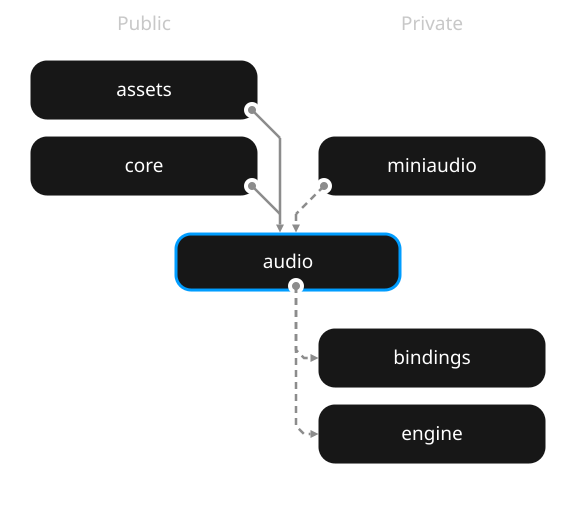

[Engine](../engine.md)

# Audio
<!-- doc-template:module -->

|---|---|
| Type | Module |
| Namespace | `conjure::audio` |
| Include Folder Path | `engine/include/conjure/audio` |
| Source Folder Path | `engine/src/audio` |

<!-- doc-content:purpose:start -->
The audio module mixes voices, routes them through a hierarchy of groups, spatialises them against a listener, and sends the resulting samples to a playback backend. It also supplies clip decoding, the audio clip asset type, and a deterministic null backend for headless applications and tests.
<!-- doc-content:purpose:end -->

## Dependency Graph



## Headers

| File | Description | Provides |
|---|---|---|
| [audio.h](audio/audio.md) | Umbrella header of the audio module. |  |
| [audio_backend.h](audio/audio-backend.md) | The backend interface: the piece that owns a device (or a virtual clock) and drives the mix callback. | [`audio_backend`](audio/audio-backend/audio-backend.md) |
| [audio_device.h](audio/audio-device.md) | Device descriptions shared by every backend. | [`audio_device_info`](audio/audio-device/audio-device-info.md)<br>[`backend_desc`](audio/audio-device/backend-desc.md) |
| [audio_engine.h](audio/audio-engine.md) | Construction settings, batched voice transforms, diagnostic counters, and the audio engine facade. | [`audio_engine`](audio/audio-engine/audio-engine.md)<br>[`audio_engine_stats`](audio/audio-engine/audio-engine-stats.md)<br>[`audio_settings`](audio/audio-engine/audio-settings.md)<br>[`voice_transform`](audio/audio-engine/voice-transform.md) |
| [audio_error.h](audio/audio-error.md) | Error codes of the audio module. |  |
| [audio_types.h](audio/audio-types.md) | Formats, identifiers and constants shared by every audio header. | [`audio_format`](audio/audio-types/audio-format.md) |
| [clip.h](audio/clip.md) | Clips. | [`audio_clip`](audio/clip/audio-clip.md)<br>[`clip_info`](audio/clip/clip-info.md)<br>[`pcm_buffer`](audio/clip/pcm-buffer.md) |
| [clip_asset.h](audio/clip-asset.md) | The <code>conjure.audio.clip</code> cooked blob, import settings, importer and loader. | [`audio_clip_importer`](audio/clip-asset/audio-clip-importer.md)<br>[`audio_clip_loader`](audio/clip-asset/audio-clip-loader.md)<br>[`clip_blob_header`](audio/clip-asset/clip-blob-header.md)<br>[`clip_import_settings`](audio/clip-asset/clip-import-settings.md) |
| [components.h](audio/components.md) | Component data the engine&#x27;s <code>audio_subsystem</code> registers into the ECS. | [`audio_listener`](audio/components/audio-listener.md)<br>[`audio_source`](audio/components/audio-source.md)<br>[`source_handle`](audio/components/source-handle.md) |
| [decoder.h](audio/decoder.md) | Decoding. | [`decode_options`](audio/decoder/decode-options.md)<br>[`streaming_decoder`](audio/decoder/streaming-decoder.md) |
| [log_category.h](audio/log-category.md) | The audio module&#x27;s log category (&quot;audio&quot;); defined in engine/src/audio/<code><a href="core/log/log-category.html">log_category</a>.cpp</code>. |  |
| [mix_groups.h](audio/mix-groups.md) | Mix groups: a gain tree rooted at <code>MASTER_GROUP</code>. | [`group_desc`](audio/mix-groups/group-desc.md)<br>[`group_id`](audio/mix-groups/group-id.md)<br>[`group_info`](audio/mix-groups/group-info.md) |
| [null_backend.h](audio/null-backend.md) | The headless backend: no device, no thread, no OS calls. | [`null_backend`](audio/null-backend/null-backend.md)<br>[`null_backend_stats`](audio/null-backend/null-backend-stats.md)<br>[`null_group_stats`](audio/null-backend/null-group-stats.md)<br>[`null_voice_stats`](audio/null-backend/null-voice-stats.md) |
| [spatialisation.h](audio/spatialisation.md) | Listener and spatial maths. | [`attenuation_params`](audio/spatialisation/attenuation-params.md)<br>[`listener_state`](audio/spatialisation/listener-state.md)<br>[`spatial_result`](audio/spatialisation/spatial-result.md) |
| [voice.h](audio/voice.md) | Voice identity and parameters. | [`play_params`](audio/voice/play-params.md)<br>[`voice_id`](audio/voice/voice-id.md)<br>[`voice_info`](audio/voice/voice-info.md) |

## Breakdown

<!-- doc-content:breakdown:start -->
### Frame coordination

The [`audio_engine`](audio/audio-engine/audio-engine.md) owns the backend and keeps the main-thread voice and
group state separate from the mixer. Its private implementation lives in `engine/src/audio/audio_engine.cpp`.
The application's audio subsystem connects it to scene components; the audio library itself does not depend on ECS.

Call `update()` once per frame to advance the backend, drain events, reconcile voice state, compute spatial
parameters, and service streaming. `end_frame()` releases completed one-shots and publishes the finished-voice
list. The following helper is a complete, compilable example for an already-created engine; call it on the main thread.

```cpp
#include "conjure/audio/audio_engine.h"

void advance_audio_frame(conjure::audio::audio_engine &audio, conjure::f32 deltaSeconds) {
    audio.update(deltaSeconds);
    audio.end_frame();
}
```

### One mixer, two drivers

`engine/src/audio/mixer.cpp` renders interleaved floating-point samples without allocating, locking, or logging
inside the callback. The miniaudio backend drives the callback from its device thread.

> [!NOTE]
> The [`null_backend`](audio/null-backend.md) drives the same mixer on the main
> thread using a virtual clock, so headless tests can inspect the output without opening a real device.

### Memory and voice lifetime

Voice handles pair an index with a generation, so a reused slot does not make an old handle valid again.
The main thread owns a table of 512 voice entries; the mixer has 256 voice slots. The additional entries let a
new voice retain its own identity while it waits for a stolen slot to finish fading out.

One-shots are reclaimed by `end_frame()` after the mixer acknowledges completion. Retained voices stay owned
until `release()` is called. Per-entry atomic state and seqlock snapshots support the documented read-only queries.

### Commands, events, and recovery

A single-producer/single-consumer ring sends commands to the mixer. When that ring fills, commands spill into
a main-thread vector and are flushed later. Mixer events travel through a second ring; if it overflows, the
main thread reconciles terminal states from per-slot atomics. Both directions carry generations to reject stale work.

Device loss freezes progress while the engine retries the device using the configured backoff and attempt count.
If recovery cannot restore it, playback continues on the null backend. Counters and the mirrored device state are
available through [`audio_engine_stats`](audio/audio-engine/audio-engine-stats.md).

### Gain, spatialisation, and streaming

The main thread combines voice volume, attenuation, and listener gain. The mixer applies the group's effective
gain and ramps changes to avoid discontinuities. Mono spatial sources use constant-power panning; pitch combines
the clip-to-mix sample-rate ratio, requested pitch, and Doppler ratio.

Streaming voices decode into bounded SPSC rings. An optional job system performs decode work; without it,
`update()` performs that work inline. Seeking coordinates the decoder and mixer through pause, reset, and prime
states so a ring is not reset while either side is using it.
<!-- doc-content:breakdown:end -->

## Threading Model

<!-- doc-content:threading:start -->
> [!IMPORTANT]
> The [`audio_engine`](audio/audio-engine/audio-engine.md) is main-thread owned. Construction, destruction,
> mutators, device selection, group changes, `update()`, and `end_frame()` must run there.

`is_valid()`, `is_playing()`, `voice()`, `stats()`, and `output_format()` are the documented read-only exceptions.

The real device callback runs on the miniaudio thread. The null backend invokes the same callback on the main
thread. Streaming decode jobs finish before their state is released; only one job may produce into a stream's
ring at a time.

> [!WARNING]
> Callback work must not allocate, acquire locks, or log. The real device callback runs independently of the
> main thread, so main-thread-only operations must not be called from it.

Group pause changes are sent as individual commands. A subtree is therefore not paused atomically across
different groups; voices requiring sample synchronisation should share a group or use the whole-mixer pause.
<!-- doc-content:threading:end -->

## Extension Points

<!-- doc-content:extensions:start -->
Implement [`audio_backend`](audio/audio-backend.md) to supply another playback driver.
Keep device handling behind that interface and preserve the callback's format and threading contract.

> [!CAUTION]
> A custom backend must stop its callback thread before the engine state is destroyed. Calling the callback
> with a dangling user pointer has undefined behaviour.

Clip import and loading integrate with the asset database through the audio clip asset type. Scene integration
uses [`audio_source`](audio/components.md) and audio listeners, while the engine's
audio subsystem owns the ECS scheduling. Applications can provide a job system through
[`audio_settings`](audio/audio-engine/audio-settings.md) to move streaming decode work off the main thread.
<!-- doc-content:extensions:end -->

## Testing

<!-- doc-content:testing:start -->
`tests/audio/` exercises construction, settings validation, voice and group lifetimes, spatialisation, decoding,
streaming, device recovery, and the null backend. Most cases are headless; real-device checks are separately gated.

> [!TIP]
> For this header, start with `tests/audio/test_audio_engine.cpp`. It covers backend selection, invalid settings,
> playback state, bulk updates, and diagnostics.

Structs without a dedicated test file are also exercised by the engine and integration suites; do not infer a
test file solely from a type name.

```bash
python tools/build.py --target conjure_audio_tests --test -L audio
```
<!-- doc-content:testing:end -->

<!-- doc-legacy-anchors:start -->
<a id="1-shape-of-the-module"></a>
<a id="10-failure-handling"></a>
<a id="11-threading-model"></a>
<a id="12-extension-points"></a>
<a id="13-tests"></a>
<a id="14-open-items"></a>
<a id="2-mixer-architecture-and-callback-rules"></a>
<a id="21-render-loop"></a>
<a id="22-rules-inside-render"></a>
<a id="3-command-and-event-rings"></a>
<a id="4-voices-table-slots-and-lifecycle"></a>
<a id="41-two-tables"></a>
<a id="42-play"></a>
<a id="43-end-of-life"></a>
<a id="44-updatedt"></a>
<a id="5-group-gain-tree"></a>
<a id="6-spatialisation"></a>
<a id="7-streaming"></a>
<a id="8-null-backend-and-the-virtual-clock"></a>
<a id="9-device-loss-and-recovery"></a>
<a id="audio-module"></a>
<a id="contents"></a>
<a id="related"></a>
<!-- doc-legacy-anchors:end -->
