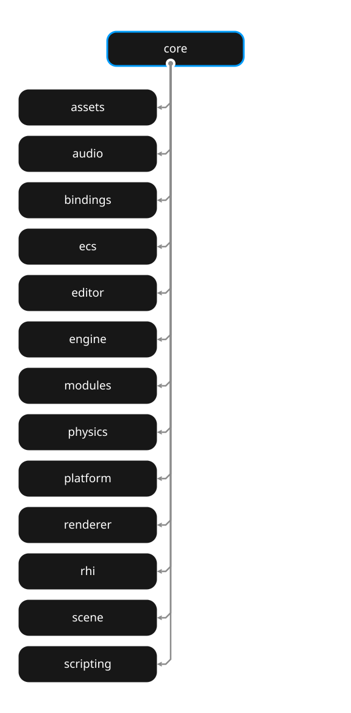

[Engine](../engine.md)

# Core
<!-- doc-template:module -->

|---|---|
| Type | Module |
| Namespace | `conjure::core` |
| Include Folder Path | `engine/include/conjure/core` |
| Source Folder Path | `engine/src/core` |

<!-- doc-content:purpose:start -->
`conjure::core` is the foundation every other module links: the error model, logging and asserts, math,
containers, strings, memory, time, jobs, JSON, the virtual file system, OS services and reflection. This chapter
describes the shape of the module, the conventions every area shares, an index of the areas and how the module
is built and tested. The areas themselves (purpose, headers, algorithms, threading guarantees, extension points,
tests) are documented on two sub-pages:

- [Core areas: foundation to memory](core/foundation-to-memory.md): foundation, math, containers, strings, memory
- [Core areas: time to reflect](core/time-to-reflect.md): time, jobs, json, vfs, system, reflect

Public headers live under `engine/include/conjure/core/`, sources under `engine/src/core/<area>/`, tests under
`tests/core/<area>/`; every area has a README at `engine/src/core/<area>/README.md` with the finer behavioural
notes, and.

See `engine/src/core/README.md` for additional implementation notes.
<!-- doc-content:purpose:end -->

## Dependency Graph



## Headers

| File | Description | Provides |
|---|---|---|
| [aabb.h](core/math/aabb.md) | Axis-aligned bounding box. | [`aabb`](core/math/aabb/aabb.md)<br>[`std::formatter<conjure::math::aabb>`](core/math/aabb/std-formatter-conjure-math-aabb.md) |
| [allocation_counters.h](core/memory/allocation-counters.md) | Process-wide allocation counters. | [`memory::allocation_counters`](core/memory/allocation-counters/memory-allocation-counters.md)<br>[`memory::memory_snapshot`](core/memory/allocation-counters/memory-memory-snapshot.md) |
| [api.h](core/api.md) | Symbol visibility for the engine&#x27;s public API. |  |
| [arena.h](core/memory/arena.md) | Declarations for <code>arena.h</code>. | [`memory::arena`](core/memory/arena/memory-arena.md) |
| [assert.h](core/assert.md) | Assertions. | [`assert_info`](core/assert/assert-info.md) |
| [bit_vector.h](core/bit-vector.md) | <code>A</code> dynamically sized set of bits packed into 64-bit words. | [`bit_vector`](core/bit-vector/bit-vector.md)<br>[`bit_vector::set_bit_iterator`](core/bit-vector/bit-vector-set-bit-iterator.md)<br>[`bit_vector::set_bit_range`](core/bit-vector/bit-vector-set-bit-range.md) |
| [clock.h](core/clock.md) | <code>A</code> monotonic time source measured in seconds. | [`clock`](core/clock/clock.md)<br>[`manual_clock`](core/clock/manual-clock.md)<br>[`steady_clock`](core/clock/steady-clock.md)<br>[`stopwatch`](core/clock/stopwatch.md) |
| [containers.h](core/containers/containers.md) | Umbrella header for the core containers area. |  |
| [dedicated_thread.h](core/jobs/dedicated-thread.md) | Declarations for <code><a href="core/jobs/dedicated-thread/jobs-dedicated-thread.html">dedicated_thread</a>.h</code>. | [`jobs::dedicated_thread`](core/jobs/dedicated-thread/jobs-dedicated-thread.md) |
| [delegate.h](core/delegate.md) | Single-target callbacks without allocation. | [`delegate<Return(Args...)>`](core/delegate/delegate-return-args.md) |
| [detail.h](core/containers/detail.md) | Helpers shared by the container headers. |  |
| [document.h](core/json/document.md) | JSON documents. | [`json::document`](core/json/document/json-document.md)<br>[`json::init_member`](core/json/document/json-init-member.md)<br>[`json::init_value`](core/json/document/json-init-value.md) |
| [dynamic_library.h](core/dynamic-library.md) | RAII handle to a loaded shared library. | [`dynamic_library`](core/dynamic-library/dynamic-library.md) |
| [enum_flags.h](core/enum-flags.md) | Bitwise operators and helpers for enumerations used as flag sets. |  |
| [error.h](core/error.md) | <code>A</code> recoverable failure: category, code and a human readable message. | [`error`](core/error/error.md)<br>[`error_category_traits<error_code>`](core/error/error-category-traits-error-code.md)<br>[`std::formatter<conjure::core::error>`](core/error/std-formatter-conjure-core-error.md)<br>[`std::formatter<conjure::core::error_code>`](core/error/std-formatter-conjure-core-error-code.md) |
| [event.h](core/event.md) | <code>A</code> multicast callback list. | [`detail::subscription_target`](core/event/detail-subscription-target.md)<br>[`event`](core/event/event.md)<br>[`event::slot`](core/event/event-slot.md)<br>[`event::state`](core/event/event-state.md)<br>[`event_subscription`](core/event/event-subscription.md) |
| [event_bus.h](core/event-bus.md) | Engine-wide typed publish/subscribe. | [`event_bus`](core/event-bus/event-bus.md)<br>[`event_bus::channel`](core/event-bus/event-bus-channel.md)<br>[`event_bus::channel_base`](core/event-bus/event-bus-channel-base.md) |
| [field_info.h](core/reflect/field-info.md) | Field descriptions. | [`reflect::detail::std_array_traits`](core/reflect/field-info/reflect-detail-std-array-traits.md)<br>[`reflect::detail::std_array_traits<std::array<ElementType, N>>`](core/reflect/field-info/reflect-detail-std-array-traits-std-array-elementtype-n.md)<br>[`reflect::enum_info`](core/reflect/field-info/reflect-enum-info.md)<br>[`reflect::field_attributes`](core/reflect/field-info/reflect-field-attributes.md)<br>[`reflect::field_info`](core/reflect/field-info/reflect-field-info.md)<br>[`reflect::reflect_traits<bool>`](core/reflect/field-info/reflect-reflect-traits-bool.md)<br>[`reflect::reflect_traits<f32>`](core/reflect/field-info/reflect-reflect-traits-f32.md)<br>[`reflect::reflect_traits<f64>`](core/reflect/field-info/reflect-reflect-traits-f64.md)<br>[`reflect::reflect_traits<i16>`](core/reflect/field-info/reflect-reflect-traits-i16.md)<br>[`reflect::reflect_traits<i32>`](core/reflect/field-info/reflect-reflect-traits-i32.md)<br>[`reflect::reflect_traits<i64>`](core/reflect/field-info/reflect-reflect-traits-i64.md)<br>[`reflect::reflect_traits<i8>`](core/reflect/field-info/reflect-reflect-traits-i8.md)<br>[`reflect::reflect_traits<math::mat4>`](core/reflect/field-info/reflect-reflect-traits-math-mat4.md)<br>[`reflect::reflect_traits<math::quat>`](core/reflect/field-info/reflect-reflect-traits-math-quat.md)<br>[`reflect::reflect_traits<math::transform>`](core/reflect/field-info/reflect-reflect-traits-math-transform.md)<br>[`reflect::reflect_traits<math::vec2>`](core/reflect/field-info/reflect-reflect-traits-math-vec2.md)<br>[`reflect::reflect_traits<math::vec3>`](core/reflect/field-info/reflect-reflect-traits-math-vec3.md)<br>[`reflect::reflect_traits<math::vec4>`](core/reflect/field-info/reflect-reflect-traits-math-vec4.md)<br>[`reflect::reflect_traits<std::string>`](core/reflect/field-info/reflect-reflect-traits-std-string.md)<br>[`reflect::reflect_traits<string_id>`](core/reflect/field-info/reflect-reflect-traits-string-id.md)<br>[`reflect::reflect_traits<T>`](core/reflect/field-info/reflect-reflect-traits-t.md)<br>[`reflect::reflect_traits<u16>`](core/reflect/field-info/reflect-reflect-traits-u16.md)<br>[`reflect::reflect_traits<u32>`](core/reflect/field-info/reflect-reflect-traits-u32.md)<br>[`reflect::reflect_traits<u64>`](core/reflect/field-info/reflect-reflect-traits-u64.md)<br>[`reflect::reflect_traits<u8>`](core/reflect/field-info/reflect-reflect-traits-u8.md)<br>[`reflect::reflect_traits<uuid>`](core/reflect/field-info/reflect-reflect-traits-uuid.md)<br>[`std::formatter<conjure::core::reflect::field_kind>`](core/reflect/field-info/std-formatter-conjure-core-reflect-field-kind.md) |
| [file_system.h](core/vfs/file-system.md) | The virtual file system interface. | [`vfs::file`](core/vfs/file-system/vfs-file.md)<br>[`vfs::file_stat`](core/vfs/file-system/vfs-file-stat.md)<br>[`vfs::file_system`](core/vfs/file-system/vfs-file-system.md) |
| [flat_hash_map.h](core/containers/flat-hash-map.md) | Open-addressing hash map storing <code>std::pair&lt;const K, V&gt;</code> in place. | [`detail::hash_table`](core/containers/flat-hash-map/detail-hash-table.md)<br>[`detail::hash_table::basic_iterator`](core/containers/flat-hash-map/detail-hash-table-basic-iterator.md)<br>[`detail::identity_key_of`](core/containers/flat-hash-map/detail-identity-key-of.md)<br>[`detail::pair_key_of`](core/containers/flat-hash-map/detail-pair-key-of.md)<br>[`flat_hash_map`](core/containers/flat-hash-map/flat-hash-map.md)<br>[`flat_hash_set`](core/containers/flat-hash-map/flat-hash-set.md) |
| [flat_map.h](core/containers/flat-map.md) | <code><a href="core/containers/flat-map/flat-map.html">flat_map</a></code>: a sorted vector of key/value pairs with binary search. | [`flat_map`](core/containers/flat-map/flat-map.md) |
| [frame_allocator.h](core/memory/frame-allocator.md) | Declarations for <code><a href="core/memory/frame-allocator/memory-frame-allocator.html">frame_allocator</a>.h</code>. | [`memory::frame_allocator`](core/memory/frame-allocator/memory-frame-allocator.md) |
| [frustum.h](core/math/frustum.md) | Six inward-facing, normalised planes describing a view volume. | [`frustum`](core/math/frustum/frustum.md) |
| [glm_types.h](core/math/glm-types.md) | The engine&#x27;s vector, quaternion and matrix types are glm&#x27;s. | [`std::formatter<conjure::math::ivec2>`](core/math/glm-types/std-formatter-conjure-math-ivec2.md)<br>[`std::formatter<conjure::math::ivec3>`](core/math/glm-types/std-formatter-conjure-math-ivec3.md)<br>[`std::formatter<conjure::math::ivec4>`](core/math/glm-types/std-formatter-conjure-math-ivec4.md)<br>[`std::formatter<conjure::math::mat3>`](core/math/glm-types/std-formatter-conjure-math-mat3.md)<br>[`std::formatter<conjure::math::mat4>`](core/math/glm-types/std-formatter-conjure-math-mat4.md)<br>[`std::formatter<conjure::math::quat>`](core/math/glm-types/std-formatter-conjure-math-quat.md)<br>[`std::formatter<conjure::math::uvec2>`](core/math/glm-types/std-formatter-conjure-math-uvec2.md)<br>[`std::formatter<conjure::math::uvec3>`](core/math/glm-types/std-formatter-conjure-math-uvec3.md)<br>[`std::formatter<conjure::math::uvec4>`](core/math/glm-types/std-formatter-conjure-math-uvec4.md)<br>[`std::formatter<conjure::math::vec2>`](core/math/glm-types/std-formatter-conjure-math-vec2.md)<br>[`std::formatter<conjure::math::vec3>`](core/math/glm-types/std-formatter-conjure-math-vec3.md)<br>[`std::formatter<conjure::math::vec4>`](core/math/glm-types/std-formatter-conjure-math-vec4.md) |
| [hash.h](core/hash.md) | FNV-1a hashing. |  |
| [image.h](core/image.md) | <code>A</code> row-major RGBA8 <code><a href="core/image/image.html">image</a></code>, 4 bytes per pixel, rows top to bottom and no row padding. | [`image`](core/image/image.md)<br>[`rgba8`](core/image/rgba8.md) |
| [job_handle.h](core/jobs/job-handle.md) | Declarations for <code><a href="core/jobs/job-handle/jobs-job-handle.html">job_handle</a>.h</code>. | [`jobs::detail::job_counter`](core/jobs/job-handle/jobs-detail-job-counter.md)<br>[`jobs::job_fence`](core/jobs/job-handle/jobs-job-fence.md)<br>[`jobs::job_handle`](core/jobs/job-handle/jobs-job-handle.md) |
| [job_system.h](core/jobs/job-system.md) | Declarations for <code><a href="core/jobs/job-system/jobs-job-system.html">job_system</a>.h</code>. | [`jobs::job_system`](core/jobs/job-system/jobs-job-system.md)<br>[`jobs::job_system_desc`](core/jobs/job-system/jobs-job-system-desc.md)<br>[`jobs::job_system_stats`](core/jobs/job-system/jobs-job-system-stats.md) |
| [jobs.h](core/jobs/jobs.md) | Umbrella header for the jobs area: job system, handles, <code>parallel_for</code> helpers, the main-thread queue and dedicated threads. |  |
| [json.h](core/json/json.md) | Umbrella header for the json area. |  |
| [json_conversion.h](core/reflect/json-conversion.md) | JSON conversion driven by <code><a href="core/reflect/type-info/reflect-type-info.html">type_info</a></code>. | [`json::json_converter<math::mat4>`](core/reflect/json-conversion/json-json-converter-math-mat4.md)<br>[`json::json_converter<math::quat>`](core/reflect/json-conversion/json-json-converter-math-quat.md)<br>[`json::json_converter<math::transform>`](core/reflect/json-conversion/json-json-converter-math-transform.md)<br>[`json::json_converter<math::vec2>`](core/reflect/json-conversion/json-json-converter-math-vec2.md)<br>[`json::json_converter<math::vec3>`](core/reflect/json-conversion/json-json-converter-math-vec3.md)<br>[`json::json_converter<math::vec4>`](core/reflect/json-conversion/json-json-converter-math-vec4.md)<br>[`json::json_converter<string_id>`](core/reflect/json-conversion/json-json-converter-string-id.md)<br>[`reflect::field_ref`](core/reflect/json-conversion/reflect-field-ref.md) |
| [log.h](core/log.md) | Logging. | [`callback_log_sink`](core/log/callback-log-sink.md)<br>[`console_log_sink`](core/log/console-log-sink.md)<br>[`file_log_sink`](core/log/file-log-sink.md)<br>[`log_category`](core/log/log-category.md)<br>[`log_message`](core/log/log-message.md)<br>[`log_sink`](core/log/log-sink.md) |
| [main_thread.h](core/jobs/main-thread.md) | The main thread and its task queue. |  |
| [math.h](core/math/math.md) | Umbrella header of the math area: glm aliases and formatters, scalar utilities, transform, aabb, plane, frustum, ray, rect and the projection helpers below. |  |
| [math.h](core/math.md) | Convenience include for the whole math area (<code>conjure::math</code>): glm aliases, transform, aabb, plane, frustum, ray, rect, scalar utilities and projection helpers. |  |
| [math_utils.h](core/math/math-utils.md) | Scalar helpers that need no glm: constants, angle conversion, approximate comparison, interpolation and integer alignment / power-of-two utilities. |  |
| [memory.h](core/memory/memory.md) | Umbrella header for the core memory area: counted heap allocation and the engine&#x27;s allocators. |  |
| [memory_file_system.h](core/vfs/memory-file-system.md) | Declarations for <code><a href="core/vfs/memory-file-system/vfs-memory-file-system.html">memory_file_system</a>.h</code>. | [`vfs::memory_file_system`](core/vfs/memory-file-system/vfs-memory-file-system.md) |
| [mount_table.h](core/vfs/mount-table.md) | Declarations for <code><a href="core/vfs/mount-table/vfs-mount-table.html">mount_table</a>.h</code>. | [`vfs::mount_table`](core/vfs/mount-table/vfs-mount-table.md)<br>[`vfs::mount_table::route_target`](core/vfs/mount-table/vfs-mount-table-route-target.md) |
| [native_file_system.h](core/vfs/native-file-system.md) | Declarations for <code><a href="core/vfs/native-file-system/vfs-native-file-system.html">native_file_system</a>.h</code>. | [`vfs::native_file_system`](core/vfs/native-file-system/vfs-native-file-system.md) |
| [parallel_for.h](core/jobs/parallel-for.md) | Convenience wrappers around <code>job_system::parallel_for</code> that accept any callable instead of a <code>std::function</code>. |  |
| [path_utils.h](core/vfs/path-utils.md) | Lexical helpers for the &#x27;/&#x27;-separated UTF-8 paths used by the virtual file system. |  |
| [plane.h](core/math/plane.md) | An infinite <code><a href="core/math/plane/plane.html">plane</a></code> in the form <code>dot(normal, point)</code> + distance = 0. | [`plane`](core/math/plane/plane.md)<br>[`std::formatter<conjure::math::plane>`](core/math/plane/std-formatter-conjure-math-plane.md) |
| [platform_detect.h](core/platform-detect.md) | Compile-time platform, compiler and build-configuration detection. |  |
| [pool_allocator.h](core/memory/pool-allocator.md) | Declarations for <code><a href="core/memory/pool-allocator/memory-pool-allocator.html">pool_allocator</a>.h</code>. | [`memory::pool_allocator`](core/memory/pool-allocator/memory-pool-allocator.md)<br>[`memory::pool_allocator::free_block`](core/memory/pool-allocator/memory-pool-allocator-free-block.md)<br>[`memory::pool_allocator::slab`](core/memory/pool-allocator/memory-pool-allocator-slab.md) |
| [process.h](core/process.md) | <code>A</code> child <code><a href="core/process/process.html">process</a></code> started by <code>start()</code>, or run to completion by <code>run()</code>. | [`process`](core/process/process.md)<br>[`process_desc`](core/process/process-desc.md)<br>[`process_result`](core/process/process-result.md) |
| [radix_sort.h](core/radix-sort.md) | Stable least-significant-digit radix sort for unsigned keys with optional 32-bit payloads. |  |
| [random.h](core/random.md) | Pseudo-random numbers. | [`random::random_engine`](core/random/random-random-engine.md) |
| [ray.h](core/math/ray.md) | <code>A</code> half-line origin + t * direction for t &gt;= 0. | [`ray`](core/math/ray/ray.md) |
| [rect.h](core/math/rect.md) | <code>A</code> float rectangle given by its min and max corners (y may point either way; the struct only assumes min &lt;= max). | [`rect`](core/math/rect/rect.md)<br>[`std::formatter<conjure::math::rect>`](core/math/rect/std-formatter-conjure-math-rect.md)<br>[`std::formatter<conjure::math::urect>`](core/math/rect/std-formatter-conjure-math-urect.md)<br>[`urect`](core/math/rect/urect.md) |
| [reflect.h](core/reflect/reflect.md) | Umbrella header of the reflect area plus the description macros. |  |
| [result.h](core/result.md) | Either a value or an error. | [`result`](core/result/result.md)<br>[`result<void>`](core/result/result-void.md) |
| [slot_key_format.h](core/containers/slot-key-format.md) | Text form of <code><a href="core/containers/slot-map/slot-key.html">slot_key</a></code>: <code>to_string</code>, <code>parse_slot_key</code> and the <code><a href="core/containers/slot-key-format/std-formatter-conjure-core-slot-key.html">std::formatter</a></code> specialisation. | [`std::formatter<conjure::core::slot_key>`](core/containers/slot-key-format/std-formatter-conjure-core-slot-key.md) |
| [slot_map.h](core/containers/slot-map.md) | Dense storage addressed by generational keys. | [`slot_key`](core/containers/slot-map/slot-key.md)<br>[`slot_map`](core/containers/slot-map/slot-map.md)<br>[`slot_map::slot_entry`](core/containers/slot-map/slot-map-slot-entry.md)<br>[`slot_map_entry`](core/containers/slot-map/slot-map-entry.md)<br>[`std::hash<conjure::core::slot_key>`](core/containers/slot-map/std-hash-conjure-core-slot-key.md)<br>[`std::tuple_element<0, conjure::core::slot_map_entry<Key, T>>`](core/containers/slot-map/std-tuple-element-0-conjure-core-slot-map-entry-key-t.md)<br>[`std::tuple_element<1, conjure::core::slot_map_entry<Key, T>>`](core/containers/slot-map/std-tuple-element-1-conjure-core-slot-map-entry-key-t.md)<br>[`std::tuple_size<conjure::core::slot_map_entry<Key, T>>`](core/containers/slot-map/std-tuple-size-conjure-core-slot-map-entry-key-t.md) |
| [small_vector.h](core/containers/small-vector.md) | <code><a href="core/containers/small-vector/small-vector.html">small_vector</a></code>: a <code>std::vector</code> with inline storage for the first <code>N</code> elements. | [`small_vector`](core/containers/small-vector/small-vector.md) |
| [stable_vector.h](core/containers/stable-vector.md) | <code><a href="core/containers/stable-vector/stable-vector.html">stable_vector</a></code>: a growable sequence whose elements never move. | [`stable_vector`](core/containers/stable-vector/stable-vector.md)<br>[`stable_vector::basic_iterator`](core/containers/stable-vector/stable-vector-basic-iterator.md) |
| [string_id.h](core/string-id.md) | <code>A</code> string reduced to its 64-bit FNV-1a hash. | [`std::formatter<conjure::core::string_id>`](core/string-id/std-formatter-conjure-core-string-id.md)<br>[`std::hash<conjure::core::string_id>`](core/string-id/std-hash-conjure-core-string-id.md)<br>[`string_id`](core/string-id/string-id.md) |
| [string_utils.h](core/string-utils.md) | ASCII-oriented string helpers used throughout the engine for identifiers, paths, config values and log output. |  |
| [tracked_allocation.h](core/memory/tracked-allocation.md) | Counted, aligned heap allocation. |  |
| [transform.h](core/math/transform.md) | Position, rotation and scale (TRS). | [`std::formatter<conjure::math::transform>`](core/math/transform/std-formatter-conjure-math-transform.md)<br>[`transform`](core/math/transform/transform.md) |
| [type_id.h](core/reflect/type-id.md) | Type identifiers. | [`reflect::type_id`](core/reflect/type-id/reflect-type-id.md)<br>[`std::formatter<conjure::core::reflect::type_id>`](core/reflect/type-id/std-formatter-conjure-core-reflect-type-id.md)<br>[`std::hash<conjure::core::reflect::type_id>`](core/reflect/type-id/std-hash-conjure-core-reflect-type-id.md) |
| [type_info.h](core/reflect/type-info.md) | Struct descriptions. | [`reflect::type_info`](core/reflect/type-info/reflect-type-info.md) |
| [type_registry.h](core/reflect/type-registry.md) | The type registry. | [`reflect::type_registry`](core/reflect/type-registry/reflect-type-registry.md) |
| [types.h](core/types.md) | Declarations for <code>types.h</code>. |  |
| [uuid.h](core/uuid.md) | 128-bit universally unique identifier (RFC 4122 version 4 when generated). | [`std::formatter<conjure::core::uuid>`](core/uuid/std-formatter-conjure-core-uuid.md)<br>[`std::hash<conjure::core::uuid>`](core/uuid/std-hash-conjure-core-uuid.md)<br>[`uuid`](core/uuid/uuid.md) |
| [value.h](core/json/value.md) | JSON values. | [`json::detail::value_access`](core/json/value/json-detail-value-access.md)<br>[`json::json_converter<bool>`](core/json/value/json-json-converter-bool.md)<br>[`json::json_converter<f32>`](core/json/value/json-json-converter-f32.md)<br>[`json::json_converter<f64>`](core/json/value/json-json-converter-f64.md)<br>[`json::json_converter<i16>`](core/json/value/json-json-converter-i16.md)<br>[`json::json_converter<i32>`](core/json/value/json-json-converter-i32.md)<br>[`json::json_converter<i64>`](core/json/value/json-json-converter-i64.md)<br>[`json::json_converter<i8>`](core/json/value/json-json-converter-i8.md)<br>[`json::json_converter<std::string>`](core/json/value/json-json-converter-std-string.md)<br>[`json::json_converter<std::vector<T>>`](core/json/value/json-json-converter-std-vector-t.md)<br>[`json::json_converter<u16>`](core/json/value/json-json-converter-u16.md)<br>[`json::json_converter<u32>`](core/json/value/json-json-converter-u32.md)<br>[`json::json_converter<u64>`](core/json/value/json-json-converter-u64.md)<br>[`json::json_converter<u8>`](core/json/value/json-json-converter-u8.md)<br>[`json::json_converter<uuid>`](core/json/value/json-json-converter-uuid.md)<br>[`json::member`](core/json/value/json-member.md)<br>[`json::value`](core/json/value/json-value.md)<br>[`json::value::array_iterator`](core/json/value/json-value-array-iterator.md)<br>[`json::value::object_iterator`](core/json/value/json-value-object-iterator.md)<br>[`json::value::object_range`](core/json/value/json-value-object-range.md)<br>[`std::formatter<conjure::core::json::json_type>`](core/json/value/std-formatter-conjure-core-json-json-type.md) |
| [vfs.h](core/vfs/vfs.md) | Umbrella header for the virtual file system area of core. |  |
| [writer.h](core/json/writer.md) | Streaming JSON writer. | [`json::writer`](core/json/writer/json-writer.md)<br>[`json::writer::frame`](core/json/writer/json-writer-frame.md) |

## Breakdown

<!-- doc-content:breakdown:start -->
### Contents

- [1. Shape of the module](#1-shape-of-the-module)
- [2. Conventions shared by every area](#2-conventions-shared-by-every-area)
- [3. Areas at a glance](#3-areas-at-a-glance)
- [4. Building and testing](#4-building-and-testing)
- [Related](#related)

### Shape of the module

Core is one module made of eleven independently buildable **areas**. `engine/src/core/CMakeLists.txt` creates
the umbrella `conjure_core` (an `INTERFACE` target, alias `conjure::core`) that adds `engine/include` and the
generated include directory, then adds each area directory; every area declares a static library
`conjure_core_<area>` (alias `conjure::core_<area>`) with `conjure_add_core_area(<area> PUBLIC_HEADERS...
SOURCES... PUBLIC_DEPS...)` from `cmake/ConjureModule.cmake` and a test executable `conjure_core_<area>_tests`.
Other modules link `conjure::core`; a core area links only the areas it needs:

| Area | Library | Headers under `conjure/core/` | Public deps beyond `foundation` |
|---|---|---|---|
| foundation | `conjure::core_foundation` | flat | - (`Threads::Threads`) |
| math | `conjure::core_math` | `math.h`, `math/` | glm |
| containers | `conjure::core_containers` | `containers/` | - |
| strings | `conjure::core_strings` | flat | - |
| memory | `conjure::core_memory` | `memory/` | - |
| time | `conjure::core_time` | flat | - |
| jobs | `conjure::core_jobs` | `jobs/` | - |
| json | `conjure::core_json` | `json/` | yyjson (private) |
| vfs | `conjure::core_vfs` | `vfs/` | - |
| system | `conjure::core_system` | flat | jobs (private), stb (private) |
| reflect | `conjure::core_reflect` | `reflect/` | json, strings, math, containers, time |

Each area library is registered with `conjure_register_static_library()`, so the whole of core is
whole-archived into the umbrella shared library `conjure_shared` by `conjure_finalize_engine()`
([Module system](../extensions/module-system.md) 2, [Modules module](modules.md) 7).

### Areas at a glance

| Area | Purpose | Namespace | Details |
|---|---|---|---|
| foundation | platform detection, fundamental types, hashing, errors and results, asserts, logging, uuid, enum flags | `conjure`, `conjure::core` | [foundation](core/foundation-to-memory.md#1-foundation) |
| math | glm behind one header, geometry value types (`transform`, `aabb`, `plane`, `frustum`, `ray`, `rect`) | `conjure::math` | [math](core/foundation-to-memory.md#2-math) |
| containers | `slot_map`, `small_vector`, `stable_vector`, `flat_hash_map`, `flat_map` | `conjure::core` | [containers](core/foundation-to-memory.md#3-containers) |
| strings | `string_id`, ASCII and UTF helpers, `bit_vector`, radix sort | `conjure::core`, `conjure::core::str` | [strings](core/foundation-to-memory.md#4-strings) |
| memory | counted allocation, `arena`, `pool_allocator`, `frame_allocator` | `conjure::core::memory` | [memory](core/foundation-to-memory.md#5-memory) |
| time | clocks, randomness, `event`, `delegate`, `event_bus` | `conjure::core`, `conjure::core::random` | [time](core/time-to-reflect.md#1-time) |
| jobs | `job_system`, `parallel_for`, the main-thread queue, `dedicated_thread` | `conjure::core::jobs` | [jobs](core/time-to-reflect.md#2-jobs) |
| json | `value`, `document`, `writer`; canonical JSON | `conjure::core::json` | [json](core/time-to-reflect.md#3-json) |
| vfs | `file_system` backends, `mount_table`, path helpers | `conjure::core::vfs` | [vfs](core/time-to-reflect.md#4-vfs) |
| system | `process`, `dynamic_library`, `image` | `conjure::core` | [system](core/time-to-reflect.md#5-system) |
| reflect | `type_info`, `type_registry`, `CONJURE_REFLECT_*`, JSON conversion | `conjure::core::reflect` | [reflect](core/time-to-reflect.md#6-reflect) |

Each area section on the sub-pages has the same subheadings: *Headers* (a table of every public header),
*Algorithms*, *Threading*, *Extension points* where the area has any, and *Tests*.

### Related

- area pages: [Core areas: foundation to memory](core/foundation-to-memory.md),
  [Core areas: time to reflect](core/time-to-reflect.md)
- area READMEs: `engine/src/core/README.md` and `engine/src/core/<area>/README.md`
- handbook: Architecture, [Coding standards](../development/coding-standards.md),
  [Data-oriented design](../architecture-and-design/data-oriented-design.md), [Module system](../extensions/module-system.md)
<!-- doc-content:breakdown:end -->

<!-- doc-content:threading:start -->

<!-- doc-content:threading:end -->

## Extension Points

<!-- doc-content:extensions:start -->
| Convention | Rule |
|---|---|
| Errors | fallible calls return `result<T>` / `status` with a generic `core::error_code`; core declares no category of its own; programmer errors assert |
| Allocation | `new`/`delete`/`malloc` are confined to `memory` |
| Threads | `std::thread` / `std::jthread` are confined to `jobs`; every other thread is a `jobs::dedicated_thread`, the `system::process` pipe readers included (`system` links `jobs` for them) |
| Platform code | per-platform translation units (`*_windows.cpp`, `*_posix.cpp`) selected by CMake; only `conjure/core/platform_detect.h` reads compiler macros |
| Third-party headers | never in public headers; glm is the single exception, through `conjure/core/math/glm_types.h` |
| Determinism | everything is headless and deterministic given the same inputs |

Two names need qualifying after a `using namespace`: write `core::clock` (ambiguous with the C library's
`::clock()`) and `reflect::type_info` (ambiguous with `::type_info` from `<typeinfo>` on MSVC).
<!-- doc-content:extensions:end -->

## Testing

<!-- doc-content:testing:start -->
```
python tools/build.py --build-dir build/core --test -R core_                               # every core area
python tools/build.py --build-dir build/core_jobs --target conjure_core_jobs_tests --test -R core_jobs
```

`tests/core/<area>/test_<header>.cpp` mirrors every public header (`tools/check_style.py --tests-mirror-headers`,
CTest entry `style.check`); `conjure_core_<area>_tests` is one CTest entry per `TEST_CASE`. Every public header
also compiles alone through `conjure_header_check` (part of the default build). Everything is headless and
deterministic: `manual_clock`, seeded `random`, 0-worker job systems, `memory_file_system` or a
`conjure::testing::temp_directory`. The exit gates are listed in.

> [!TIP]
> Build and test one area at a time while working in it (`--target conjure_core_<area>_tests --test -R
> core_<area>`); the whole module is only needed before the review checklist.
<!-- doc-content:testing:end -->

<!-- doc-legacy-anchors:start -->
<a id="1-shape-of-the-module"></a>
<a id="2-conventions-shared-by-every-area"></a>
<a id="3-areas-at-a-glance"></a>
<a id="4-building-and-testing"></a>
<a id="core-module"></a>
<a id="threading-model"></a>
<!-- doc-legacy-anchors:end -->
