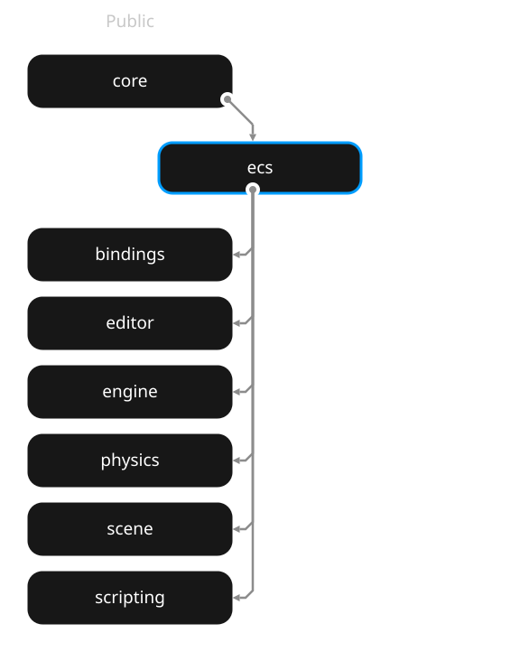

[Engine](../engine.md)

# ECS
<!-- doc-template:module -->

|---|---|
| Type | Module |
| Namespace | `conjure::ecs` |
| Include Folder Path | `engine/include/conjure/ecs` |
| Source Folder Path | `engine/src/ecs` |

<!-- doc-content:purpose:start -->
`conjure::ecs` is the entity component system: archetype storage in 16 KiB structure-of-arrays chunks, a
name-keyed component registry, queries and typed views, deferred structural changes through command buffers, a
stage-packing system scheduler, typed in-memory archives and JSON serialisation. This chapter is for people
changing the module or building on its internals (scene, scripting bindings, the engine loop): how the data is
laid out, the algorithms behind each public operation, the threading contract, the extension points and the
tests. Headers live under `engine/include/conjure/ecs/`, sources under `engine/src/ecs/`, tests under
`tests/ecs/`.

See `engine/src/ecs/README.md` for additional implementation notes.
<!-- doc-content:purpose:end -->

## Dependency Graph



## Headers

| File | Description | Provides |
|---|---|---|
| [archetype.h](ecs/archetype.md) | One component set and the chunks holding its entities. | [`archetype`](ecs/archetype/archetype.md)<br>[`archetype::archetype_edge`](ecs/archetype/archetype-archetype-edge.md)<br>[`archetype::row_location`](ecs/archetype/archetype-row-location.md)<br>[`chunk_layout`](ecs/archetype/chunk-layout.md) |
| [chunk_view.h](ecs/chunk-view.md) | Untyped per-chunk access. | [`chunk_view`](ecs/chunk-view/chunk-view.md) |
| [command_buffer.h](ecs/command-buffer.md) | Deferred structural changes. | [`command_buffer`](ecs/command-buffer/command-buffer.md)<br>[`command_buffer::instantiate_entry`](ecs/command-buffer/command-buffer-instantiate-entry.md)<br>[`command_buffer::record`](ecs/command-buffer/command-buffer-record.md)<br>[`flush_report`](ecs/command-buffer/flush-report.md) |
| [component.h](ecs/component.md) | Components. | [`component_id`](ecs/component/component-id.md)<br>[`component_info`](ecs/component/component-info.md)<br>[`component_mask`](ecs/component/component-mask.md)<br>[`component_mask::hasher`](ecs/component/component-mask-hasher.md)<br>[`component_ops`](ecs/component/component-ops.md)<br>[`component_serializer`](ecs/component/component-serializer.md)<br>[`component_type_cache`](ecs/component/component-type-cache.md) |
| [component_registry.h](ecs/component-registry.md) | Owns the <code><a href="ecs/component/component-info.html">component_info</a></code> of every registered type. | [`component_registry`](ecs/component-registry/component-registry.md)<br>[`dynamic_component_desc`](ecs/component-registry/dynamic-component-desc.md)<br>[`dynamic_field_desc`](ecs/component-registry/dynamic-field-desc.md) |
| [component_type_desc.h](ecs/component-type-desc.md) | <code>A</code> component type exported by a module. | [`component_type_desc`](ecs/component-type-desc/component-type-desc.md)<br>[`system_extension_desc`](ecs/component-type-desc/system-extension-desc.md) |
| [ecs.h](ecs/ecs.md) | Umbrella header of the ecs module. |  |
| [ecs_error.h](ecs/ecs-error.md) | Failure conditions reported by the ecs module. |  |
| [entity.h](ecs/entity.md) | Handle of one <code><a href="ecs/entity/entity.html">entity</a></code>: record index plus generation. | [`conjure::core::reflect::reflect_kind_override<conjure::ecs::entity>`](ecs/entity/conjure-core-reflect-reflect-kind-override-conjure-ecs-entity.md)<br>[`entity`](ecs/entity/entity.md)<br>[`entity_remap`](ecs/entity/entity-remap.md)<br>[`std::formatter<conjure::ecs::entity>`](ecs/entity/std-formatter-conjure-ecs-entity.md)<br>[`std::hash<conjure::ecs::entity>`](ecs/entity/std-hash-conjure-ecs-entity.md) |
| [entity_archive.h](ecs/entity-archive.md) | <code>A</code> typed copy of a set of entities, bound to the registry whose ids it uses. | [`archive_component`](ecs/entity-archive/archive-component.md)<br>[`archive_entry`](ecs/entity-archive/archive-entry.md)<br>[`archive_options`](ecs/entity-archive/archive-options.md)<br>[`entity_archive`](ecs/entity-archive/entity-archive.md) |
| [entity_handle.h](ecs/entity-handle.md) | An entity plus its world. | [`component_ref`](ecs/entity-handle/component-ref.md)<br>[`entity_handle`](ecs/entity-handle/entity-handle.md) |
| [log_category.h](ecs/log-category.md) | Declarations for <code><a href="core/log/log-category.html">log_category</a>.h</code>. |  |
| [observer.h](ecs/observer.md) | Observers. | [`observer_id`](ecs/observer/observer-id.md) |
| [query.h](ecs/query.md) | Queries. | [`query`](ecs/query/query.md)<br>[`query_desc`](ecs/query/query-desc.md) |
| [scheduler.h](ecs/scheduler.md) | The <code><a href="ecs/scheduler/scheduler.html">scheduler</a></code>. | [`scheduler`](ecs/scheduler/scheduler.md)<br>[`scheduler_desc`](ecs/scheduler/scheduler-desc.md)<br>[`stage_info`](ecs/scheduler/stage-info.md)<br>[`system_id`](ecs/scheduler/system-id.md)<br>[`system_timing`](ecs/scheduler/system-timing.md) |
| [serialization.h](ecs/serialization.md) | Serialisation. | [`unresolved_component`](ecs/serialization/unresolved-component.md)<br>[`unresolved_components`](ecs/serialization/unresolved-components.md) |
| [system.h](ecs/system.md) | Systems. | [`system_context`](ecs/system/system-context.md)<br>[`system_desc`](ecs/system/system-desc.md)<br>[`system_scratch`](ecs/system/system-scratch.md)<br>[`system_scratch::chunk_ref`](ecs/system/system-scratch-chunk-ref.md) |
| [system_phase.h](ecs/system-phase.md) | The phases of one engine frame, in execution order. | [`frame_info`](ecs/system-phase/frame-info.md) |
| [view.h](ecs/view.md) | Typed views. | [`detail::view_arg_traits`](ecs/view/detail-view-arg-traits.md)<br>[`detail::view_arg_traits<maybe<ComponentType>>`](ecs/view/detail-view-arg-traits-maybe-componenttype.md)<br>[`maybe`](ecs/view/maybe.md)<br>[`view`](ecs/view/view.md)<br>[`view_access`](ecs/view/view-access.md) |
| [world.h](ecs/world.md) | The <code><a href="ecs/world/world.html">world</a></code>. | [`iteration_scope`](ecs/world/iteration-scope.md)<br>[`world`](ecs/world/world.md)<br>[`world::entity_record`](ecs/world/world-entity-record.md)<br>[`world::flush_entry`](ecs/world/world-flush-entry.md)<br>[`world::flush_slot`](ecs/world/world-flush-slot.md)<br>[`world_desc`](ecs/world/world-desc.md)<br>[`world_stats`](ecs/world/world-stats.md) |
| [world_hash.h](ecs/world-hash.md) | Deterministic state hash. |  |

## Breakdown

<!-- doc-content:breakdown:start -->
### Contents

- [1. Shape of the module](#1-shape-of-the-module)
- [2. Data layout](#2-data-layout)
- [3. Algorithms](#3-algorithms)
- [4. Observers](#4-observers)
- [5. Threading model](#5-threading-model)
- [6. Extension points](#6-extension-points)
- [7. Failure handling](#7-failure-handling)
- [8. Tests](#8-tests)
- [9. Open items](#9-open-items)
- [Related](#related)

### Shape of the module

Static library `conjure_ecs` (alias `conjure::ecs`), namespace `conjure::ecs`, `PUBLIC_DEPS conjure::core` and
nothing else; registered with `conjure_register_static_library()` so it is whole-archived into `conjure_shared`
([Module system](../extensions/module-system.md) 1.1). Log category `LOG_ECS`, error category `"ecs"`
(`ecs_error`, `make_error`).

| Header | Main types | 📘 Wiki page |
|---|---|---|
| `entity.h` | `entity`, `NULL_ENTITY`, `ARCHIVE_LOCAL_GENERATION`, `entity_remap`, `std::hash` / `std::formatter` / `reflect_kind_override` specialisations | [Entities and components](../../api/ecs/entities-and-components.md) |
| `component.h` | `component_id`, `component_flags`, `component_ops`, `component_serializer`, `component_info`, `component_mask`, `component_name<T>` / `CONJURE_COMPONENT`, `component_type_cache<T>`, `make_component_ops<T>`, `derive_component_flags<T>`, `default_component_bytes<T>`, the limits | same |
| `component_registry.h` | `component_registry`, `dynamic_component_desc`, `dynamic_field_desc` | same |
| `world.h` | `world`, `world_desc`, `world_stats`, `iteration_scope` | same |
| `entity_handle.h` | `entity_handle`, `component_ref<T>` | same |
| `component_type_desc.h` | `component_type_desc`, `system_extension_desc`, `describe_component<T>()` | same |
| `archetype.h` | `archetype` (read-only), `chunk_layout`, `CHUNK_SIZE`, `CHUNK_ALIGNMENT`, `COLUMN_ALIGNMENT`, `SMALL_CAPACITY_WARNING` | [Archives and serialisation](../../api/ecs/archives-and-serialization.md) |
| `chunk_view.h`, `query.h`, `view.h` | `chunk_view`; `query_desc`, `query`; `view<Ts...>`, `maybe<T>`, `view_access` | [Queries, views and systems](../../api/ecs/queries-views-and-systems.md) |
| `system_phase.h`, `system.h`, `scheduler.h` | `system_phase`, `frame_info`; `system_flags`, `system_desc`, `system_scratch`, `system_context`, `make_system<Ts...>`; `scheduler`, `scheduler_desc`, `system_id`, `stage_info`, `system_timing` | same |
| `command_buffer.h`, `observer.h` | `command_buffer`, `flush_report`; `component_event`, `component_observer_fn`, `entity_observer_fn`, `observer_id` | [Command buffers and observers](../../api/ecs/command-buffers-and-observers.md) |
| `world_hash.h` | `world_hash(const world &)` | same |
| `entity_archive.h`, `serialization.h` | `entity_archive`, `archive_entry`, `archive_component`, `archive_options`; `unresolved_components`, `make_default_serializer<T>`, `write_/read_component_json`, `write_/read_archive_json`, `component_to_json` / `component_from_json` | [Archives and serialisation](../../api/ecs/archives-and-serialization.md) |
| `ecs.h`, `ecs_error.h`, `log_category.h` | umbrella include, error codes, `LOG_ECS` | not user-facing |

Private files: `entity_allocator.{h,cpp}` (id reservation, the module's only mutex), `chunk.{h,cpp}` (one block
plus out-of-line metadata and column versions), `chunk_pool.{h,cpp}` (RAII over `core::memory::pool_allocator`),
`observer_table.{h,cpp}`, `scheduler_internal.h`, and the translation units named per header, with `world`
split into `world.cpp` (guards, lookups, archetype map, observers, stats, validate, clear),
`world_structural.cpp` (rows, create / destroy / add / remove, flush) and `world_archive.cpp` (instantiation).

### Data layout

### 2.1 Entities and records

`entity` is `{u32 index; u32 generation;}`. Generation 0 is never issued, so all-zero memory is `NULL_ENTITY`;
`ARCHIVE_LOCAL_GENERATION` (`0xFFFFFFFF`) marks an archive-local index and is never issued either. The world's
`std::vector<entity_record>` is indexed by `entity.index`: `archetype *owner`, `chunkIndex`, `row`,
`generation` (the current occupant's when `ALIVE`, the next to issue when `FREE`) and `entity_state`. The
`entity_allocator` keeps a LIFO free list of `{index, generation}` plus `mNextIndex`; `reserve(span)` is its only
locked method and never touches the record vector, `release` bumps the generation and retires an index whose next
generation would reach `ARCHIVE_LOCAL_GENERATION`, `return_unused` pushes reserved-but-unplaced slots back
unchanged. Records for new indices are appended on the owner thread (direct create or flush).

### 2.2 Component ids, masks and infos

Ids are dense `u16` (`MAX_COMPONENTS = 1024`), assigned per **name** in registration order and never reused for
the registry's lifetime, so a stale id cannot alias another type and every world on one registry agrees. Id 0 is
always `unresolved_components`. `component_mask` is `std::array<u64, 16>` (128 bytes): matching is 16 AND /
compare steps; `hash()` is FNV-1a 64 over the words. `component_info` (stable address for the registry's
lifetime: the vector is reserved to `MAX_COMPONENTS` and append-only, guarded by an atomic count) carries size,
alignment, flags, `component_ops`, `component_serializer`, the reflection `type_info *`,
`entityFieldOffsets`, `assetRefFieldOffsets` and `defaultValue` bytes. `register_component<T>` derives `TAG` for
empty types and `TRIVIAL` for trivially copyable ones (`derive_component_flags`), builds ops from the special
members only for non-trivial types (`make_component_ops`), and captures `default_component_bytes<T>` for trivial
types whose default constructor is not trivial (built in zeroed, type-aligned storage so padding is zero).
`id_of<T>()` reads `component_type_cache<T>`, one static atomic packing `registrySerial << 16 | id`; a serial
mismatch means "look the name up again". The static is per shared library but caches only a lookup result.

### 2.3 Archetypes and chunk layout

Every live entity, the component-less ones included, sits in exactly one `archetype`, found through the
world's `unordered_map<component_mask, archetype *>` or the archetype's edge list (`{id, withAdded,
withRemoved}`, linear search, filled lazily). The archetype list is append-only, so `archetype *` is stable for
the world's lifetime and queries cache it.

A chunk is one 16 KiB, 64-byte aligned block from the `chunk_pool` (a `pool_allocator` with
`world_desc::chunksPerSlab` blocks per slab, capped by `maxChunkSlabs`) containing pure data: the entity column
at offset 0, then one column per non-tag component ordered by descending alignment, each at
`align_up(previousEnd, max(alignment, COLUMN_ALIGNMENT))`. Metadata (`mCount`, one relaxed-atomic version per
column) lives out of line in `chunk`, so layout maths never deals with a header. `chunk_layout::compute` starts
at `capacity = CHUNK_SIZE / rowBytes` and decrements until the last column fits; `capacity == 0` is
`ARCHETYPE_TOO_LARGE`, below `SMALL_CAPACITY_WARNING` logs once. Capacity is maximal: `capacity + 1` never
fits (tested). Rows are packed by swap-remove; only the last used chunk is partial; one drained trailing chunk is
kept as a spare and a new row fills a partial chunk ahead of the spare before the spare itself (`open_chunk`).
Default construction zeroes the cell first so padding bytes are deterministic.

| Archetype | Rows per chunk |
|---|---|
| empty | 2048 |
| `{transform 64 B}` | 227 |
| `{transform 64 B, sprite 32 B, velocity 12 B, health 8 B}` | 132 (10 000 entities = 76 chunks) |

### Algorithms

### 3.1 Entity lifecycle and moves

`create_entity(mask)`: reserve one id, append a record if the index is new, `archetype::reserve_row` (the part
that can fail: `ARCHETYPE_TOO_LARGE`, `OUT_OF_MEMORY`), `push_row`, default-construct every column
(`defaultValue` or zero for trivial types, `ops.constructDefault` otherwise), stamp the chunk, write the record,
fire `ADDED` per set bit. `destroy_entity`: fire `REMOVED` per column then destroyed observers, destruct
non-trivial columns, `remove_row`, `release`, drain the deferred buffer. `remove_row(a, c, r)` relocates the
archetype's last row into the hole, updates that entity's record and stamps every column of chunk `c`.
`move_entity(e, dst)` reserves the destination row first (so `REMOVED` observers run only once the move can no
longer fail), relocates shared columns, default-constructs added ones, destructs removed ones, `remove_row`s the
source, stamps the destination chunk and fires `ADDED` for the added columns. `add_storage` / `finish_add` split
`add` so the typed template can construct the value in place between them.

### 3.2 Queries and change detection

`query::refresh()` scans `[mSeenArchetypeCount, archetype_count())` and keeps archetypes with
`mask.contains_all(with) && !mask.contains_any(without)`: O(new archetypes). `chunk_count`, `entity_count` and
`matches` call it first, so they (and `view::entity_count`) are non-const on purpose: `mMatches` and
`mSeenArchetypeCount` are not `mutable`, because a const accessor that refreshed would race when two threads read
one query (`scheduler::stages` follows the same rule, 3.4). Iteration skips empty archetypes and chunks,
holds an `iteration_scope` and, with a `changed` mask, visits a chunk only when one listed column's
version exceeds `sinceVersion` (`chunk_passes`). The world version starts at 1 and is bumped at the start of
every structural call, flush and system run. Non-const `chunk_view::get<T>`, `column_data(id, true)`,
`world::get<T>()`, `get_raw(.., true)`, `component_ref::write()`, `set` and `component_from_json` stamp the
column with the version current when the view was created (`stamp_version`); a row moving in or out stamps all
columns of the chunks involved. A system's `since_version()` is the version observed at the start of its previous
run, so it never sees its own previous writes made through its views (3.4); writes through `world().get<T>()`,
`set` or `component_ref` stamp the current world version and may pass it. Granularity is the chunk: no false negatives, at most one chunk of
false positives per write. A `view` whose pack or builder call names an unregistered type asserts and sets
`with = ~component_mask{}` so it matches nothing; an unregistered `maybe<T>` is simply absent.

### 3.3 Command buffer flush

Records live in a `core::memory::arena` as an intrusive list `{opcode, payloadLive, target, id, payloadSize,
instantiateIndex, payload *, next}`; payloads are move-constructed in and destroyed on apply or `clear()`.
Each buffer owns up to `RESERVE_BLOCK` (64) reserved ids refilled from the allocator; unused ids survive `clear()`
and return on destruction. `world::flush` (owner thread, unlocked): `bump_version`, extend the record vector for
reserved indices, then:

1. **Plan.** One pass over the records. The flush-stamped slot table `mFlushSlots` (`{stamp, plan}` indexed by
   entity index, never cleared) maps each touched entity to a dense plan entry accumulating a destroy flag,
   `addMask`, `removeMask` and the payload list. `ADD` sets add and clears remove; `REMOVE` sets remove, clears
   add and drops pending payloads of that component; `SET` appends a payload; `DESTROY` wins. Commands on
   entities neither alive nor reserved are skipped (`DEBUG` log, `flush_report::skipped`).
2. **Apply.** `INSTANTIATE` records first (so later commands on their roots find live entities), then per entity
   `finalMask = (current | add) & ~remove`: a reserved entity is placed directly (no empty-archetype hop), a live
   one takes one `move_entity` when the mask changed, observers fire for the delta only, payloads apply in record
   order (`ADD` copies into the fresh column, `SET` on a non-trivial component is destruct + copy-construct).
   Destroys run last. A placement that fails counts all of that entity's commands as skipped and releases a
   reserved-only id with a bumped generation. A record table that cannot grow skips (and counts) every command.
3. `clear()` resets the arena. The ids of an instantiation that never applied (a failed `instantiate_now`, or a
   buffer cleared or destroyed unflushed) go through `world::release_reserved` with a bumped generation, because
   the root was already handed to the caller; `release_reserved` grows the record table first when the world
   never saw the index, so the table and the free list agree on its next generation. That writes `mRecords`, so
   off the owner thread `clear()` asserts and skips the release: the ids stay reserved (leaked, never aliased)
   rather than racing the owner on the table. An entry a flush applied has no ids left and is skipped.

An `ADD` without a payload (an untyped `add_raw` with no bytes) only sets the add bit: an entity that holds the
component at flush keeps its value and, its mask being unchanged, fires no observer. Callers rely on that as an
idempotent "ensure present"; passing the default bytes resets the value.

### 3.4 Scheduler

`scheduler_stages.cpp`: `resolve_edges` turns `after` / `before` names into predecessor lists (unknown names
ignored with one `DEBUG` log each: only the names of the system `add_system` passes as `logFor` are logged, so
later additions, `finalise()` and the lazy rebuilds stay silent), `topological_order` is Kahn's algorithm with
registration order as the tiebreak (a cycle is detected incrementally in `add_system`, which fails with
`SYSTEM_CYCLE` and adds nothing),
then greedy append-only packing: a system joins the current stage when no predecessor is in it, it is not
`EXCLUSIVE`, the stage is not exclusive, and for every member `s`: `(writes & (s.reads | s.writes)).none() &&
(reads & s.writes).none()`. Stages are rebuilt lazily after `add_system`, `remove_system` and `set_enabled`;
`finalise()` builds every phase now. `stages(phase)` rebuilds a dirty phase before returning it (an empty span
when that fails), which allocates, so it is non-const like the query counters (3.2).
`system_desc::resolveAccess` (filled by `make_system`) is called at `add_system` to merge pack-derived masks into
`reads` / `writes`, so a `system_desc` needs no registry at construction.

Access sets follow the registry. `refresh_access()` (`scheduler.cpp`) opens `run_phase`,
`finalise()` and `stages()`: it compares `component_registry::count()` with `mResolvedComponentCount` and
returns on equality (one atomic load per call, no allocation). After a growth it calls the hook of every live
system that has one, disabled ones included, marks the phase of each system whose masks changed as dirty (one
`DEBUG` log naming the system) and stores the count read before the pass. Ids are append-only, so the count is
a complete change signal and a hook can only add bits; it must give the same answer for the same registry and
own what it captures. Only the dirty flag is set, never the stages: a nested `run_phase` (an `EXCLUSIVE`
system that registered a component) may be in here while the outer phase walks its stages, and that phase is
rebuilt before its next run. The pass is skipped while the world is locked for iteration, because the systems
of a running stage read their masks on other threads; the next unlocked call runs it. `add_system` resolves the new
system only and leaves the stored count alone. The engine's `ecs_module_consumer` builds the hook from a module
record's read and write names, so a component of an optional dependency joins the access set when that module loads;
a name unknown at attach is one `WARN` there, never a failed load.

A system name is unique within its phase. `add_system` asks `find_system(phase, name)` before it
takes a record and returns `NAME_CONFLICT` when a live system of the phase carries the name, so `resolve_edges`
never finds two systems for an `after` / `before` name. The lookup is a linear walk over the records: live ones
only, disabled ones included, never the null name, so unnamed systems are not compared, and `resolve_edges`
treats a null entry as an unknown name instead of binding it to the first unnamed system. The engine's
`ecs_module_consumer::validate` uses the same lookup (and compares the records of the set with each other), which
turns a clash into a failed module load instead of a system dropped at attach. That lookup sees the systems the
scheduler holds when the module loads, and the engine adds its own at startup step 18, after the startup modules
(step 15): a startup module that takes an engine system's name keeps it, and the engine's `add_system` is the
one refused (an `ERROR` from the subsystem; scene, physics and scripting stop at the first refused system, so
the ones they add after it are missing too, and startup continues).

`scheduler.cpp`: `run_phase` walks the stages; an exclusive stage bumps the version and runs on the caller
with the world unlocked, then flushes; every other stage takes an `iteration_scope`, schedules its systems as
jobs (main-thread systems last, on the caller; everything inline when `jobs == nullptr` or
`parallelSystems == false`), waits, releases the scope and flushes each system's buffer in stage order.
`run_system` bumps the version, builds a `system_context` (world, frame, `sinceVersion`, `runVersion`, the
system's buffer, jobs, desc, `system_scratch`, chunk parallelism switches), runs, records `sinceVersion` and the
elapsed microseconds. The query carries the context (`bind_context`) in every configuration: its chunk views stamp
`run_version()` (not the current world version, which a structural call in an `EXCLUSIVE` system or a sibling's
run may have bumped), so a system never sees its own view writes through its next `since_version()`. The world's
own `get<T>()` / `set` / `component_ref::write()` know no context and stamp `version()`, so a system's writes
through `context.world()` are visible to its next run whenever the version moved on during this one. Debug validation
(compiled out in Distribution, `CONJURE_ASSERTS_ENABLED`): `system_context::view()` checks `with | optional`
against `reads | writes` and `writes` against the declared writes, and every `chunk_view` of a bound query asserts
on a non-const span of an undeclared component, naming the system.

`system_context::dispatch_chunks` (`system.cpp`) flattens the matched chunks into `system_scratch::chunks`,
groups them into grains of `max(1, minEntitiesPerJob / capacity)` chunks, takes one `command_buffer` per grain
from `system_scratch::grainBuffers` (grown on demand, arenas retained across frames), runs
`jobs->parallel_for` or an inline loop, and appends the grain buffers to the system buffer **in grain order**
after the join. Application order is therefore independent of the worker count; entity id values reserved inside
grains are not.

### 3.5 Archives, serialisation and the hash

`entity_archive::capture` copies every non-`TRANSIENT` component with `ops.copy` (or `memcpy`) and rewrites
each `entityFieldOffsets` entry: inside the set to `entity::archive_local(index)`, outside to `NULL_ENTITY`
unless `keepExternalReferences`; a reflection-less `remapEntities` hook gets the captured entities as an
`entity_remap` on which capture called `index_targets()`, so each of its lookups is a binary search.
`world::instantiate_batch` refuses a command buffer of another world (`INVALID_ARGUMENT`, asserted), validates
once (`ARCHIVE_CORRUPT` before anything is created; the private `command_buffer::push_instantiate` relies on its
two callers having validated), resolves each entry's archetype once, reserves `copies * entries` ids in one call,
places all copies of an entry together (`place_rows`), copies payloads, builds an `entity_remap` per copy and
rewrites entity fields
(custom `remapEntities` hooks included), then fires `ADDED` last. A placement that fails part-way discards the
rows placed so far (`discard_placed`) and returns every id unused. With a command buffer the ids are reserved and
the roots returned at record time; the copy runs first in the flush.

`serialization.cpp` writes `{"entities":[{"components":{"<name>":{...}}}]}`. The default serialiser walks
`core::reflect::type_info`: scalars, strings, `string_id`, `uuid`, math types, enums and `std::array` through
`core::reflect`; nested structs, entity fields (local index / `null` / `{"external":"i:g"}`) and `ASSET_REF`
fields (uuid in the first 16 bytes of the handle, rest zeroed on read; the scene bind pass resolves them)
here. Unknown names on load go into `unresolved_components` verbatim and are re-emitted, except a preserved entry
whose name now resolves to a non-transient component the entity holds: the live component is written in its place
(the read side stays strict and refuses a name listed twice). `write_archive_json` gathers the keys of one entity
(live components and preserved entries alike) into a buffer it reuses for the whole archive, sorts them by name in
the byte order of the UTF-8 text and writes them in that order: component ids follow registration
order, which changes with the features and modules a build loads, and a file must not. It is the order of
`core::json`'s canonical form; an unknown name a file listed twice keeps its file order. Malformed JSON fails the
whole load with `SERIALIZATION_FAILED` and an `<entity index>/<component>/<field path>: detail` message. A failed
`write_archive_json` returns with the writer as it was at the failure (partial, unbalanced): a caller such as the
scene serialiser nests the archive in its own object, so balancing the archive's scopes alone could not make the
output whole. Dynamic types serialise through their runtime description with the same walker.

`world_hash` visits archetypes in ascending order of mask hash and entities in chunk order; per entity it hashes
the id, then per component in id order the name hash combined with: the reflected fields for trivial types with a
description (padding excluded), the raw bytes for trivial types without one, the canonical JSON for non-trivial
types (serialised into one lazily built `json::writer` reset per component, so the call allocates as the writer
grows rather than per component; a failing serializer contributes a constant), nothing more for tags. Hashes
combine in visiting order, so row order inside an archetype is part of the hash: a swap-remove or an archetype
move reorders rows, and equal content reached through different structural histories can hash differently
(fixes the order instead of making the combine commutative). An `ASSET_REF` field of a
described type wider than a uuid contributes its leading uuid alone, never its bound slot pointer, so the hash is
the same in every process and whether or not references
are bound; an undescribed trivial type hashes every byte, pointers included. Entity ids and TRANSIENT components
(`transform_state::lastUpdateRun` among them) are hashed, so recorded hashes compare only at equal frame counts and
when no id came from a command buffer on a parallel grain or a concurrently running system. Allocation-free below
64 archetypes for trivial worlds.

### Observers

`observer_table` stores component observers per `(id, event)` and destroyed observers, each slot generational
(`observer_id{index, generation}`, generation 0 never issued). Delivery is synchronous on the owner thread
inside the structural call: `ADDED` after the value is in place (also after a flush payload or an archive copy),
`REMOVED` before the data is destroyed and only once the move can no longer fail, destroyed observers before the
components go. `mInObserver` makes any direct structural call assert and return `STRUCTURE_LOCKED`. Observers
enqueue into `mDeferred`; `end_structural` of the outermost call (`mStructuralDepth == 0`) swaps it with
`mDeferredFlushing` and flushes in a loop until nothing new was enqueued (1024 passes assert: a cycle in caller
data). An observer may register or remove observers: one registered during a delivery is first invoked by the
next one. `clear()` fires observers; the destructor does not. The table keeps an interest mask per event with an
observer count per `(event, id)`, so `fire_component` returns before the slot scan for a component nobody
observes; the check runs per call, so an observer registered by a handler for an earlier bit of one mask still
fires for a later bit. Because `add<T>` / `add_raw` drain the deferred buffer before reading the component back,
an `ADDED` observer that removes it again or destroys the entity makes the completed add return nullptr.

### Failure handling

Contract violations assert in Debug and Development and still return their code; every path stays defined in
Distribution. `world::validate()` checks records against rows, chunk counts, packing (every chunk before the last
non-empty one is full, at most one spare), column alignment and bounds, free-list consistency, the archetype map
and the pool's live block count, naming the first violation.

| Situation | Behaviour |
|---|---|
| dead or null entity to `is_alive` / `has` / `get` / `mask_of` | false / nullptr / empty, no assert |
| dead entity to `destroy` / `add` / `remove` / `set` / `add_raw` / `remove_raw` | `ENTITY_NOT_ALIVE` |
| add present / remove missing / unknown id | `COMPONENT_ALREADY_PRESENT` / `COMPONENT_NOT_PRESENT` / `UNKNOWN_COMPONENT` |
| structural call while locked, off the owner thread, or from an observer | assert + `STRUCTURE_LOCKED` / `WRONG_THREAD` |
| registration: duplicate name with another layout (for a dynamic type, other fields too), 1025th type, > 4096 bytes, bad alignment, unreflected field kind | `NAME_CONFLICT`, `COMPONENT_LIMIT_REACHED`, `COMPONENT_TOO_LARGE`, `BAD_ALIGNMENT`, `UNSUPPORTED_FIELD` |
| described record whose size and `TAG` flag disagree | `INVALID_ARGUMENT` |
| `instantiate` / `instantiate_batch` with a command buffer of another world | assert + `INVALID_ARGUMENT`, nothing reserved |
| a tag in a view pack, `chunk_view::get<Tag>()` / `get_optional<Tag>()` | does not compile (a tag has no column; `with<Tag>()`, `has(id)`) |
| `redefine_dynamic` with live instances | `COMPONENT_IN_USE` |
| archetype capacity 0 / pool cap reached | `ARCHETYPE_TOO_LARGE` / `OUT_OF_MEMORY` from the structural call; nothing changes |
| command on an entity dead at flush | skipped, `DEBUG` log, `flush_report::skipped` |
| system cycle / unknown name in `after` or `before` | `SYSTEM_CYCLE`, not added / ignored with one `DEBUG` log when the system is added |
| a system name its phase already holds | `NAME_CONFLICT`, not added (unnamed systems and other phases never conflict) |
| a system names a component type that is not registered yet (`make_system` pack, `resolveAccess`, a module record's name lists) | the bit is left out and set by the next `finalise()` / `run_phase` / `stages()` after the type is registered; a module record additionally logs one `WARN` per such name at attach |
| undeclared write inside a system (Debug) | assert naming system and component |
| archive local index out of range / foreign registry | `ARCHIVE_CORRUPT`, nothing created |
| unknown component name on load / malformed JSON | preserved in `unresolved_components` with an `INFO` log / `SERIALIZATION_FAILED` with the field path, whole load fails |
| `command_buffer` destroyed non-empty | `WARN`, payloads destroyed, unused ids returned, the ids of a pending instantiation released with a bumped generation |
| `command_buffer` holding a pending instantiation cleared or destroyed off the owner thread | assert, those ids stay reserved (leaked, never aliased) |
| `observe` with an unregistered id, an event past `REMOVED` or an empty callable | assert + invalid `observer_id` |

### Open items

From: a binary archive format for cooked scenes (additive through `component_serializer`);
entity-granular dirty bits (scene uses a tag where chunk granularity costs too much); cross-frame system
pipelining or render-thread hand-off (the engine loop decides, stages expose the metadata); first-fit packing
into earlier stages (append-only greedy keeps ordering intuitive); reusing component ids after a registry-wide
zero-instance check; shared or global components, relationships beyond scene's parent and children, reactive
queries; deterministic entity id values from parallel spawning (needs a per-grain reservation protocol).

### Related

- module README: `engine/src/ecs/README.md`
- handbook: [Data-oriented design](../architecture-and-design/data-oriented-design.md), [Module system](../extensions/module-system.md),
  [Core module](core.md), [Testing and Benchmarks](../development/testing-and-benchmarks.md)
- 📘 API: [Entities, components and systems](../../api/ecs/index.md) and its four topic pages
<!-- doc-content:breakdown:end -->

## Threading Model

<!-- doc-content:threading:start -->
| Rule | Detail |
|---|---|
| One owner thread per world | captured at construction, changed with `set_owner_thread()` while unlocked; structural calls, `flush`, `observe`, `run_phase`, `clear` belong to it (`WRONG_THREAD` + assert elsewhere) |
| `iteration_scope` | an atomic depth counter taken from any thread; while locked any thread may read records (`is_alive`, `has`, `mask_of`, `get` const) and read or write columns of chunks it was handed; structural calls are refused (`STRUCTURE_LOCKED`) |
| Version stamps | relaxed atomic stores, so concurrent stamping of one chunk is defined |
| The only mutex | `entity_allocator::reserve`, hit once per 64 ids by command buffers and once per archive instantiation |
| `command_buffer` | single-threaded; `parallel_for_chunks` gives every grain its own and merges in grain order |
| `component_registry` | every method takes its mutex except `info`, `is_registered`, `count`, `types` (atomic count over the pre-reserved vector); `id_of<T>` is a lock-free cache hit after the first lookup; `on_registered` fires on the registering thread after the lock is released |
| Systems | `run_system` may run on a job thread; it touches the world only through the locked-iteration API and its own buffer |
| Unlocked readers | `world_hash`, `entity_archive::capture`, `validate()`, `stats()` read without locking: call them while no structural change is in flight |

Ownership: the registry outlives every world (worlds attach and detach themselves); the world owns records,
archetypes, chunks (through the pool) and observers; `command_buffer` owns payloads and reserved ids;
`entity_archive` owns component bytes; the scheduler owns `system_record`s (desc, buffer, scratch, timings) and
holds non-owning `world &` and `job_system *`; `query`, `view`, `entity_handle` and `component_ref` are
non-owning values that re-validate on use. `std::shared_ptr` appears only for archives referenced by buffers.
<!-- doc-content:threading:end -->

## Extension Points

<!-- doc-content:extensions:start -->
| Point | Mechanism |
|---|---|
| C++ component types | `CONJURE_COMPONENT` + `CONJURE_REFLECT_STRUCT`, `register_component<T>(flags)`; non-trivial types get ops from their special members |
| Custom lifecycle or serialisation | `component_ops` / `component_serializer` function pointers in `component_info` (today filled by the registry; a custom-hook registration path is additive) |
| Module extension records | `component_type_desc` (`"ecs.component"`, `describe_component<T>()`, applied by `register_described`, reflection deep-copied so the module may unload) and `system_extension_desc` (`"ecs.system"`, read and write name lists copied by the engine's `ecs_module_consumer` into the system's `resolveAccess` hook, which the scheduler resolves at `add_system` and after every registry growth (3.4)); detach uses `remove_system` / `remove_from_all` ([Module system](../extensions/module-system.md)) |
| Script-defined types | `register_dynamic` (always `DYNAMIC \| TRIVIAL`, alignment 1..16, fields of primitive, math or `entity` kinds, the registry owns the `type_info`); `redefine_dynamic` keeps the id, refuses while `has_instances` (`COMPONENT_IN_USE`) or on a name change, and re-lays out the now empty archetypes containing the type (an archetype whose rows no longer fit gets capacity 0). Hot reload: serialise (`component_to_json`) -> `remove_from_all` -> `redefine_dynamic` -> `add_raw` -> `component_from_json` |
| Bindings | `add_raw` / `set_raw` / `get_raw` / `remove_raw` / `has_raw`, `query::chunk(i)` + `chunk_view::column_data` under `lock_iteration()`, `version()` to invalidate cached spans, `entity::to_u64` / `from_u64` |
| Frame integration | `system_phase` (phase list defined by the engine loop, header by this module), `frame_info`, `run_phase_filtered` with `RUNS_WHILE_PAUSED`, `scheduler::finalise()` at startup and after module loads |
| Hierarchy and cascades | not in the ECS: scene builds them from `observe(parent, REMOVED)`, `observe_destroyed`, the deferred buffer and `changed<T>` |
<!-- doc-content:extensions:end -->

## Testing

<!-- doc-content:testing:start -->
`tests/ecs/` builds `conjure_ecs_tests`: one `test_<header>.cpp` per public header plus the topic files
`test_entity_allocator`, `test_component_mask`, `test_chunk_layout`, `test_world_entities`,
`test_world_components`, `test_change_detection`, `test_parallel_iteration` and `test_dynamic_components`.
`ecs_test_fixture.h` provides the test component types (`position`, `velocity`, `health`, tags, the non-trivial
`name_component` and `tracked`, the `alignas(8)` `link`, `nested_component`, `wide_component`,
`huge_component`), `ecs_fixture` (registry + world, `validate()` in the destructor), `make_zero_capacity_archetype`
(an archetype laid out with capacity 0 through `redefine_dynamic`, for the failure paths of placement, flush and
instantiation) and `for_each_job_mode` (SUBCASEs `inline` with `jobs == nullptr` and `parallel` on at least four
workers). Pool exhaustion is tested through `world_desc::maxChunkSlabs`; death tests use
`conjure::testing::expect_assert`; the parallel cases assert order independence through `world_hash`. Review
fixes carry `regression - review <n> ...` cases. Benchmarks live in `tests/benchmarks/bench_ecs.cpp`
(`ecs.iterate_100k`, `ecs.spawn_destroy_10k`, `ecs.query_changed_10k`) under the excluded label `benchmark`.

```
python tools/build.py --build-dir build/mod_ecs --target conjure_ecs_tests --test -R ecs
build/mod_ecs/bin/conjure_ecs_tests
```
<!-- doc-content:testing:end -->

<!-- doc-legacy-anchors:start -->
<a id="1-shape-of-the-module"></a>
<a id="2-data-layout"></a>
<a id="3-algorithms"></a>
<a id="4-observers"></a>
<a id="5-threading-model"></a>
<a id="6-extension-points"></a>
<a id="7-failure-handling"></a>
<a id="8-tests"></a>
<a id="9-open-items"></a>
<a id="ecs-module"></a>
<!-- doc-legacy-anchors:end -->
