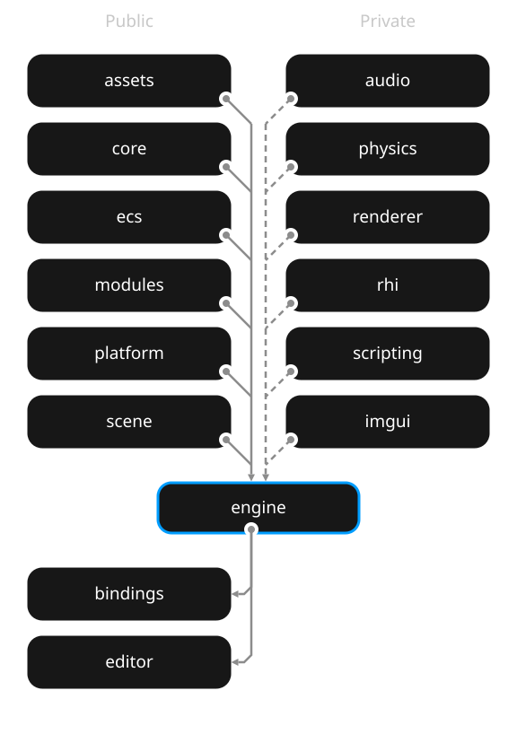

[Engine](../engine.md)

# Engine
<!-- doc-template:module -->

|---|---|
| Type | Module |
| Namespace | `conjure::engine` |
| Include Folder Path | `engine/include/conjure/engine` |
| Source Folder Path | `engine/src/engine` |

<!-- doc-content:purpose:start -->
`conjure::engine` (target `conjure_engine`, alias `conjure::engine`) is the module that owns every other
module object and runs the frame: `application` with its twenty startup steps and reverse unwind, the frame loop
over the ECS scheduler phases, the subsystem adapters that bind platform, rhi, assets,
ecs, scene, audio, physics, renderer, scripting and modules into one process, the layer stack, `project.json`,
the export pipeline and the module consumers. This chapter is for people changing the engine or adding a
subsystem.

See `engine/src/engine/README.md` for additional implementation notes.
<!-- doc-content:purpose:end -->

## Dependency Graph



## Headers

| File | Description | Provides |
|---|---|---|
| [application.h](engine/application.md) | The <code><a href="engine/application/application.html">application</a></code>: one object that owns every module object (through <code><a href="engine/application.html">engine_services</a></code>), starts them in the documented order with reverse unwind on failure, drives one frame per <code>step_frame()</code> and exposes the <code><a href="engine/engine-context/engine-context.html">engine_context</a></code> service table. | [`application`](engine/application/application.md) |
| [application_desc.h](engine/application-desc.md) | The application descriptor: the final, validated configuration plus the loaded project and an optional clock override. | [`application_desc`](engine/application-desc/application-desc.md) |
| [check_registry.h](engine/diagnostics/check-registry.md) | Self-verifying samples: scripts report named checks through the <code>Conjure.Diagnostics.Check</code> binding and the test harness asserts <code>all_passed()</code> after the run. | [`diagnostics::check_record`](engine/diagnostics/check-registry/diagnostics-check-record.md)<br>[`diagnostics::check_registry`](engine/diagnostics/check-registry/diagnostics-check-registry.md) |
| [command_line.h](engine/command-line.md) | The command line: <code>parse_command_line()</code> turns the arguments into a set of optional overrides, <code>apply_command_line()</code> lays them over an <code><a href="engine/engine-config/engine-config.html">engine_config</a></code>, and <code>application_desc::from_command_line()</code> orders the whole merge (defaults &lt; --headless defaults &lt; <code>project.json</code> &lt; the remaining flags). | [`command_line_options`](engine/command-line/command-line-options.md) |
| [debug_overlay_layer.h](engine/debug-overlay-layer.md) | The frame statistics overlay: compiled in Debug and Development only; the header is empty in Distribution so it still compiles alone. | [`debug_overlay_layer`](engine/debug-overlay-layer/debug-overlay-layer.md) |
| [engine_config.h](engine/engine-config.md) | The engine configuration: plain section structs with camelCase fields merged from <code>defaults()</code>, <code>project.json</code> and the command line by <code>application_desc::from_command_line</code> and validated once. | [`assets_settings`](engine/engine-config/assets-settings.md)<br>[`audio_config`](engine/engine-config/audio-config.md)<br>[`audio_group_setting`](engine/engine-config/audio-group-setting.md)<br>[`engine_config`](engine/engine-config/engine-config.md)<br>[`jobs_settings`](engine/engine-config/jobs-settings.md)<br>[`memory_settings`](engine/engine-config/memory-settings.md)<br>[`modules_settings`](engine/engine-config/modules-settings.md)<br>[`pacing_settings`](engine/engine-config/pacing-settings.md)<br>[`physics_config`](engine/engine-config/physics-config.md)<br>[`rendering_settings`](engine/engine-config/rendering-settings.md)<br>[`scripting_settings`](engine/engine-config/scripting-settings.md)<br>[`time_settings`](engine/engine-config/time-settings.md)<br>[`window_settings`](engine/engine-config/window-settings.md) |
| [engine_context.h](engine/engine-context.md) | The non-owning service table: what layers, subsystems, plugins and bindings reach the engine through. | [`engine_context`](engine/engine-context/engine-context.md) |
| [engine_error.h](engine/engine-error.md) | Failure conditions reported by the engine module. |  |
| [engine_phase.h](engine/engine-phase.md) | Helpers over the frame phases. |  |
| [engine_subsystem.h](engine/engine-subsystem.md) | Subsystem adapters: the one interface the engine uses to start, register, step and stop every module object, so the startup unwind is uniform. | [`engine_subsystem`](engine/engine-subsystem/engine-subsystem.md) |
| [engine_time.h](engine/engine-time.md) | Frame time. | [`engine_time`](engine/engine-time/engine-time.md) |
| [engine_version.h](engine/engine-version.md) | The engine version, taken from the generated conjure/core/<code>build_info.h</code> so <code>project.json</code>&#x27;s &quot;<code>engine_version</code>&quot; and the module manifests agree with the build. |  |
| [exit_code.h](engine/exit-code.md) | Process exit codes of the executables. |  |
| [export.h](engine/export.md) | The export pipeline: the one owner of <code>conjure_editor --export &lt;dir&gt;</code> and the editor&#x27;s <code>project.export</code> command. | [`export_pipeline`](engine/export/export-pipeline.md)<br>[`export_report`](engine/export/export-report.md)<br>[`export_settings`](engine/export/export-settings.md) |
| [fixed_step_clock.h](engine/fixed-step-clock.md) | The fixed-step accumulator: a pure value type without a clock. | [`fixed_step_clock`](engine/fixed-step-clock/fixed-step-clock.md)<br>[`fixed_step_result`](engine/fixed-step-clock/fixed-step-result.md) |
| [frame_memory.h](engine/frame-memory.md) | Per-frame scratch memory: one <code><a href="core/memory/frame-allocator/memory-frame-allocator.html">core::memory::frame_allocator</a></code> with per-thread blocks, reset by the main thread at <code>FRAME_BEGIN</code> with no scheduler job in flight (every job of frame <code>N</code>-1 completed at <code>FRAME_END</code>, so the reset is safe by construction). | [`frame_memory`](engine/frame-memory/frame-memory.md)<br>[`frame_memory_stats`](engine/frame-memory/frame-memory-stats.md) |
| [frame_stats.h](engine/frame-stats.md) | Frame statistics: one <code><a href="engine/frame-stats/frame-sample.html">frame_sample</a></code> per frame committed at step 15 into a ring of <code>HISTORY_SIZE</code> samples. | [`frame_sample`](engine/frame-stats/frame-sample.md)<br>[`frame_stats`](engine/frame-stats/frame-stats.md) |
| [game_layer.h](engine/game-layer.md) | The game bootstrap layer: pushed by <code>conjure_runtime</code>. | [`game_layer`](engine/game-layer/game-layer.md) |
| [imgui_layer.h](engine/imgui-layer.md) | The Dear ImGui context owner: compiled only in editor builds (<code>CONJURE_BUILD_EDITOR</code>, never in Distribution); the header is empty otherwise so it still compiles alone. | [`imgui_layer`](engine/imgui-layer/imgui-layer.md)<br>[`imgui_layer_stats`](engine/imgui-layer/imgui-layer-stats.md) |
| [layer.h](engine/layer.md) | Layers: hooks for executables (editor workspace, ImGui bracket, debug overlay, game bootstrap). | [`layer`](engine/layer/layer.md) |
| [layer_stack.h](engine/layer-stack.md) | The layer stack: owns the layers below <code>mOverlayBegin</code> and the overlays above it. | [`layer_stack`](engine/layer-stack/layer-stack.md) |
| [log_category.h](engine/log-category.md) | The engine module&#x27;s log category (&quot;engine&quot;), defined in engine/src/engine/<code><a href="core/log/log-category.html">log_category</a>.cpp</code>. |  |
| [project.h](engine/project.md) | <code><a href="engine/project/project.html">project</a>.json</code>: schema version 1, <code>snake_case</code> keys. | [`project`](engine/project/project.md)<br>[`project_description`](engine/project/project-description.md)<br>[`project_module_entry`](engine/project/project-module-entry.md) |

## Breakdown

<!-- doc-content:breakdown:start -->
### Contents

- [1. Shape of the module](#1-shape-of-the-module)
- [2. Startup and shutdown](#2-startup-and-shutdown)
- [3. The frame loop](#3-the-frame-loop)
- [4. Subsystem adapters](#4-subsystem-adapters)
- [5. Module consumers and services](#5-module-consumers-and-services)
- [6. Configuration, project and command line](#6-configuration-project-and-command-line)
- [7. Export pipeline](#7-export-pipeline)
- [8. Threading model](#8-threading-model)
- [9. Failure handling](#9-failure-handling)
- [10. Extension points](#10-extension-points)
- [11. Tests](#11-tests)
- [12. Open items](#12-open-items)
- [Related](#related)

### Shape of the module

`engine/src/engine/CMakeLists.txt` declares `conjure_add_module(engine... PUBLIC_DEPS conjure::core conjure::ecs
conjure::platform conjure::assets conjure::scene conjure::modules PRIVATE_DEPS conjure::rhi [renderer] [physics]
[audio] [scripting])`; the optional libraries compile in under their `CONJURE_WITH_*` option, `imgui_layer.cpp`
only with `CONJURE_BUILD_EDITOR`, `debug_overlay_layer.cpp` outside Distribution. `modules` is a public dependency
because `engine_context` and `application` carry `CONJURE_MODULE_SERVICE`.

| Header | Main types | 📘 Wiki page |
|---|---|---|
| `application.h`, `application_desc.h` | `application`, `application_state`, `simulation_mode`, `application_desc` | [Running the engine](../../api/engine/running-the-engine.md) |
| `engine_config.h`, `command_line.h`, `project.h` | `engine_config` and the settings structs, `command_line_options`, `project`, `project_description` | same |
| `engine_context.h`, `exit_code.h`, `engine_error.h`, `engine_version.h` | `engine_context`, `exit_code`, `engine_error`, the version constants | same |
| `engine_subsystem.h`, `layer.h`, `layer_stack.h`, `game_layer.h`, `imgui_layer.h`, `debug_overlay_layer.h` | the adapter interface and the layers | [The frame, layers and time](../../api/engine/frame-layers-and-time.md) |
| `engine_time.h`, `fixed_step_clock.h`, `engine_phase.h`, `frame_stats.h`, `frame_memory.h` | the clock, the fixed-step accumulator, the phase helpers, statistics, scratch memory | same |
| `export.h` | `export_pipeline`, `export_settings`, `export_report` | [Export and diagnostics](../../api/engine/export-and-diagnostics.md) |
| `diagnostics/check_registry.h` | `check_registry`, `check_record` | same |
| `log_category.h` | `LOG_ENGINE` | not user-facing |

Private: `frame_loop.{h,cpp}` (frame steps 1-16), `frame_pacer.{h,cpp}`, `main_thread_queue.{h,cpp}`,
`engine_services.{h,cpp}` (every module object as a `unique_ptr`, declared in startup order so destruction is the
reverse), `executable_path.{h,cpp}`, `export_commands.{h,cpp}` (the dotnet command lines of export step 3),
`builtin_modules.{h,cpp}`, `subsystems/*_subsystem.{h,cpp}`, `subsystems/renderer_components.h` and `audio_components.h`
(the `CONJURE_COMPONENT` names of the renderer and audio components), `subsystems/model_prefab_converter.{h,cpp}`,
`module_consumers/*`.

### Startup and shutdown

`application::initialise()` runs the startup sequence in order: log sinks and level, `validate()`, the job system
(`resolve_worker_count`: `AUTO_WORKER_COUNT` = hardware minus one clamped to [1, 16], 0 = inline), frame memory,
the vfs mounts (`project://`, `assets://`, `engine://` next to the executable, `cooked://` for an exported folder;
`modules://<name>/` joins at step 15), then the adapters in the order platform, rhi, assets, ecs, scene, audio,
physics, renderer, scripting, modules (a module entry may add subsystems through the `application` service while
step 15 runs; they start right behind it), the user subsystems added before `initialise()` (step 16), every
`post_startup` (the asset scan and import happen here,; the scripting handshake and game assembly load), every
`register_systems` followed by `scheduler::finalise()`, the layers' `on_attach`, the startup scene. A startup scene
that does not load fails a runtime's `initialise()` with `STARTUP_SCENE_FAILED`; an editor engine
(`engine_config::editor`) logs a warning and starts over an empty world. Either way the error is kept in
`application::startup_scene_failure()` until the next `initialise()` (the editor's `--exec` output opens with it). The first failure shuts the started adapters down in reverse (detaching the layers first when
the scene failed) and the application returns to `CREATED`. `shutdown()` is idempotent: `jobs.wait_idle()`,
`device.wait_idle()`, `scene_manager::unload_all()`, `asset_manager::collect()`, layers, adapters in reverse, core.
The assets adapter is stopped before the ecs adapter because `ecs::entity_archive` dereferences its registry in its
destructor (section 12).

### The frame loop

`frame_loop::run_frame()` runs the frame sequence: `engine_time::begin_frame` (the first frame uses the fixed delta,
every later one the clock, the forced delta or the `step_frame(delta)` override, clamped to
`maxFrameDeltaSeconds`), `frame_memory::reset`, the event pump with top-down layer dispatch and `input::end_frame`,
the main-thread queue, `subsystems.begin_frame` and `layers.on_frame_begin`, `FRAME_BEGIN`, the fixed loop
(`fixed_step_clock::advance` gives the step count and the interpolation alpha; `step_fixed(n)` overrides it),
`UPDATE`, `layers.on_update`, `LATE_UPDATE`, `TRANSFORM`, `SYNC`, `layers.on_imgui` / `on_imgui_end`, `EXTRACT`
(only with a renderer), `render_frame`, `FRAME_END`, `subsystems.end_frame`, `layers.on_frame_end`,
`layers.apply_pending`, the pacer, `frame_stats::commit`. Each phase receives one `ecs::frame_info` from
`make_frame_info(time)`; `inFixedStep` is true only inside the three fixed phases. `PAUSED` runs `UPDATE` and
`LATE_UPDATE` through `run_phase_filtered(RUNS_WHILE_PAUSED)`; `STEP_ONCE` and `step_fixed` leave the mode
`PAUSED` afterwards. `frame_memory::reset()` refuses while a phase is marked in flight.

### Subsystem adapters

| Adapter | Creates | Owns per frame |
|---|---|---|
| `platform_subsystem` | the window (`glfw` or `null`) and the `input` | the event pump, `skip_next_mouse_delta` after a cursor-mode change |
| `rhi_subsystem` | the device (`AUTO` tries the platform default then the other compiled backend), the swapchain (not headless), the shader library | resize handling (retry once, then `RUNTIME_FAILURE`) |
| `assets_subsystem` | importer registry, `asset_manager`, `asset_database` (development) or `pack_reader` (cooked), the file watcher and `hot_reload_controller` when `assets_settings::hotReload` is set (off in `headless_defaults()`: the watcher's stat pass allocates on a job thread) | `begin_frame` (manager begin + update + hot reload), `end_frame` |
| `ecs_subsystem` | `component_registry`, `world`, `scheduler` | nothing per frame; the scheduler runs the phases |
| `scene_subsystem` | `scene_manager`, the layer table from `project.json` | registers the four scene systems, loads the startup scene, `time.interpolatePhysics` -> `transform_system::set_interpolation_enabled` |
| `audio_subsystem` | `audio_engine` (`engine::audio_config` mapped field by field onto `audio::audio_settings`, `NULL_DEVICE` -> null backend) | registers the audio components and `engine.audio_sync` (SYNC) / `engine.audio_finish_one_shots` (FRAME_END); owns the component voices through an `entity -> voice_id` record and releases each when it ends, is replaced by a `PLAY` or loses its component (a `REMOVED` observer on `audio_source`), and resets a component whose handle names a voice its entity does not own |
| `physics_subsystem` | `physics_world` from `physics::physics_settings::from_json(project.physics, extensions.physics_layers)`; `engine::physics_config` supplies `enabled`, and `gravity` / `maxBodies` when the section does not name them | attaches the world, registers the physics systems and asset types, forwards `RELOADED`, and after a scene unload (`on_before_unload`) runs `collect_shapes()` at the next `end_frame` |
| `renderer_subsystem` | `renderer`, `debug_draw` | registers the renderer components and `engine.render_sync` / `engine.render_extract`, drives `upload_*` / `release_*` from asset events, converts `model_asset` to prefabs |
| `scripting_subsystem` | `script_runtime` over the .NET host or the null host, `hot_reload_controller` | `initialize` + `load_game_assembly` in `post_startup` (after the bindings filled the table), the six scripting systems, `destroy_all` on `on_before_unload` |
| `modules_subsystem` | `module_manager` with the three consumers, the manifest-only static modules, the project's manifests and search paths | `apply_pending` per frame; `allowSharedLibraries` for a windowed host or a headless host with a project; an `EDITOR` host with a project shadow-copies binaries into `<project>/.conjure/module_cache`; the folder is shared and numbered from 1, so on Windows only one editor per project can load a native game module (a second editor's copy over the locked binary is `BINARY_COPY_FAILED`) |

The renderer and audio component types are registered whenever the libraries are compiled, even with rendering
or audio disabled, so a headless server still loads scenes that carry them.

### Module consumers and services

`ecs_module_consumer` turns `ecs::component_type_desc` / `system_extension_desc` records into `register_described` and
`scheduler::add_system` calls, counts live uses and strips instances on unload (ids stay stable per name, a layout
change is refused at `validate()`). `validate()` also returns `REGISTRATION_CONFLICT` for a system whose name its
phase already holds in the scheduler (`scheduler::find_system`) or that the module registers twice in one phase
. The check sees only the systems added before the module loads: the engine adds
its own at startup step 18, after the startup modules (step 15), so a startup module can still take an engine
system's name, and the engine's later `add_system` is then the one refused with `NAME_CONFLICT` (an `ERROR` in the
log; the scene, physics and scripting registrations stop at their first refused system, so the systems after it
are missing too; startup continues). A system record's `reads` / `writes` name lists become the system's
`resolveAccess` hook, which the scheduler calls when the system is added and again whenever the registry has
gained component types, so a system may name a component of an optional
dependency: `attach()` logs one `WARN` per name that is still unknown once the module's own components are
registered (`... module 'm': system 's' names component 'c' (reads[0]), which is not registered ...`, the name
printed as `#<hash>` when the module never interned it), the module loads, and the access is added when a
component of that name is registered. A misspelt name stays a warning and the system keeps running without that
access, so treat the warning as a defect unless the name belongs to a module that is not loaded.
`assets_module_consumer` validates importer and asset-type records and mounts module content as
`modules://<name>/` (`module_content_file_system`); `scripting_module_consumer` records a module's managed
assemblies (appending them to the game load context is section 12); the scripting subsystem clears its runtime
pointer (`set_runtime(nullptr)`) before it destroys the runtime, so a later managed reload is a no-op instead of a
use-after-free. Services a module entry may require: `engine::engine_context`, `engine::application` (during step
15 only); `ecs::world`, `assets::asset_database` and `scene::scene_manager` are reached through the context.

### Configuration, project and command line

`engine_config` is merged by `application_desc::from_command_line` in the fixed order defaults, `--headless`
(`headless_defaults()` before everything else), `project.json` (`project::apply_to`, which leaves headless, frame count,
jobs, memory, pacing and log settings alone, and under `headless` also the null backends, the window size, the disabled
scripting and the disabled asset hot reload), the flags, `validate()`. Scripting is the one headless default a flag
brings back: `--scripting` sets `scripting.enabled` after the project, so `--headless --scripting` runs C# (and fails
with `SCRIPT_RUNTIME_NOT_FOUND` without.NET while `scripting.required` is true), a plain `--headless` boot needs no
.NET, and `--scripting` with `--no-scripting` is `BAD_ARGUMENTS`. When a headless run leaves a scripted
project's scripts off, `scripting_subsystem` logs an INFO line that names the flag
(`scripting_subsystem::headless_holds_scripts_back`; scripted means scripting enabled and a game assembly named, so
a `project.json` without a `scripting` section gets the plain line). A build without `CONJURE_WITH_SCRIPTING` logs
a WARN instead of starting a subsystem it does not have (`asks_for_missing_scripting_module`,
`engine/src/engine/scripting_request.h`). The sections of `engine_config` are `*_settings` structs except
`physics_config` and `audio_config`, named apart from `physics::physics_settings` and `audio::audio_settings`, which
they feed.

`project` parses schema version 1 with snake_case keys, keeps unknown top-level keys in `extensions` (never over a
member `extensions` already has), writes every float as the shortest decimal that reads back as the same `f32`,
converts `fixed_hz` to a delta, stores the raw `physics` section for `physics::physics_settings::from_json` and
resolves relative paths against the root; `module_manifests()` lists the game module and every
`<search path>/*/module.json`. `--jobs <n|auto>` maps to `jobs_settings::workerCount` (0 = inline, `AUTO_WORKER_COUNT`
otherwise); unknown flags are returned in `unrecognisedArguments` for the executable. A value token starting with `--`
is a missing value, the last `--audio` wins, and `--rhi <real backend>` with `--headless` only warns (a headless run
renders on the null device).

### Export pipeline

`export_pipeline::run` performs six export steps through the context's project, database, module manager
and jobs: the native game module in Distribution through CMake, `asset_cooker::cook` into `cooked/content.cpak` +
`manifest.json`, `dotnet publish` / `dotnet build` into `managed/`, `module_manager::export_layout`, the copy of the
Distribution `conjure_runtime`, `conjure_shared` and `shaders/` (with the licence notices, and from an MSVC build
also `nethost.dll` and the Visual C++ runtime DLLs, both below), and `project.json` with `cooked: true`.
`EXPORT_FAILED` names the step; the steps before it keep their output, and step 5 copies file by file
(`std::filesystem::copy_file`, so a folder where a file belongs is an error), keeping the files copied before the one
that failed. The output may not be the project directory itself (step 6 would replace the source `project.json`) nor
lie inside the assets root (the next scan would import it): both are `BAD_ARGUMENTS`. The editor's `--export` and
`project.export` call it; `tests/integration/test_export_roundtrip.cpp` and `tests/runtime/test_runtime_boot.cpp`
prove the round trip.

Step 5 also ships the Visual C++ runtime: `copy_msvc_runtime_libraries` in `export_pipeline.cpp` copies every
`vcruntime140*.dll` and `msvcp140*.dll` that lies directly in the distribution directory (regular files only, no
subfolders), matching the names on their native characters without regard to ASCII case and listing them in
`export_report::copiedFiles` in byte order. The files get there through `runtime/CMakeLists.txt`, which copies the
toolchain's redistributable ones next to `conjure_runtime` in an MSVC Distribution build (🛠 Handbook:
[Runtime](runtime.md) section 4). The debug runtime (a `d` directly after the `140` or at the end of the name) is
not copied: it must not be redistributed, so it stays behind and one warning names it. The copy runs on every
platform, so `tests/engine/test_export.cpp` covers it with fake DLLs everywhere; only the warning for a directory
without a library to copy is limited to a pipeline built against Microsoft's standard library and its DLL runtime
(`CONJURE_PLATFORM_WINDOWS && CONJURE_STDLIB_MSVC` and the `ABI_RUNTIME_DYNAMIC_CRT` bit of
`modules::ABI_SIGNATURE_RUNTIME_FLAGS`; a static-runtime build imports none).

Step 5 ships the licence notices too: `THIRD_PARTY_NOTICES.txt` (`export_pipeline::NOTICES_FILE_NAME`) is
copied from the distribution directory after the runtime libraries, byte for byte. The build writes it there
(`cmake/ConjureNotices.cmake`, 🛠 Handbook: [Runtime](runtime.md) section 4). A directory without the file, or with a
folder of that name, is exported with one warning in `export_report::warnings`; an export that copies no runtime says
nothing, because it places no engine binary in the folder. `tests/engine/test_export.cpp` holds the copy, the
warning and the failure on a folder in the output; `notices.up_to_date` and `notices.tool` are registered in
`tests/engine/CMakeLists.txt` (🛠 Handbook: [Setup and First Run](../getting-started/setup-and-first-run.md) section 11).

### Failure handling

As 06 6: an invalid configuration fails `initialise()` before anything is created; a subsystem failure unwinds
in reverse; a resize failure retries once; `render_frame` device loss logs, calls `on_device_lost()` and quits
with `DEVICE_LOST`; any other `render_frame` error is logged once per distinct message and three consecutive
failures quit with `RUNTIME_FAILURE` (`application::inject_render_failure(error, frames)` drives it in tests,
`rhi::device::simulate_device_loss()` the loss); the spiral-of-death guard drops the leftover fixed time with one
WARN per interval; frame-arena overflow falls back to the heap and counts; a missing.NET runtime is fatal when
`scripting.required`, else a WARN; a required module that does not load is `MODULE_LOAD_FAILED`.

### Open items

Recorded in and `engine/src/engine/README.md`: a Debug test executable
still sees one debug-iterator block per frame (`assets::detail::completion_queue::drain`) and the prefab churn
of `test_prefab_spawn_destroy` 20 blocks per frame in Development (`prefab::instantiate_many`), both outside this
module; off-screen rendering without a swapchain (`validate()` refuses a real backend headless, `renderer_subsystem` drops swapchain views) is one task
shared with the renderer; `script_runtime` has no entry point for the assemblies `scripting_module_consumer`
records; `executable_path.{h,cpp}` duplicates a platform shim core could own; `ecs::world`, `asset_database` and
`scene_manager` are not module services because the service tag lives in `modules`; the Debug allocation-epoch
check of is not implemented; `bench_engine_frame.cpp` (empty-frame overhead) is owed.

### Related

- README: `engine/src/engine/README.md`
- 📘 API: [Engine: the application and the frame](../../api/engine/index.md)
- 🛠 Handbook: Architecture, [Bindings module](bindings.md), [Editor module](../editor/editor.md), [Runtime](runtime.md), [Testing and Benchmarks](../development/testing-and-benchmarks.md)
<!-- doc-content:breakdown:end -->

## Threading Model

<!-- doc-content:threading:start -->
Everything the engine does itself happens on the main thread: the pump, the phases, the layer hooks,
`render_frame`, the resize. The scheduler fans `PARALLEL` systems over `core::jobs` and the main thread executes
jobs while it waits. A steady-state frame allocates nothing in Development, inline or with workers (the
`engine.full_frame_10k_*` gates of ): the main-thread queues are drained only when they hold
a task, `layer_stack::apply_pending` returns early when nothing is queued, the extraction keeps its camera list
as a member and sorts it without `std::stable_sort`'s buffer, and the asset watcher is opt-in
(`engine/src/engine/README.md` "Allocation-free frames"). `post_to_main_thread()` is the one thread-safe entry: tasks run at frame step 4, a task
posted during the drain waits a frame. `modules_subsystem` keeps a mutex-guarded process-wide list of the
applications whose modules are running to answer "inside a frame" for the module manager's refusal hook. No
render thread exists in v1.
<!-- doc-content:threading:end -->

## Extension Points

<!-- doc-content:extensions:start -->
- `engine_subsystem`: executables add adapters with `application::add_subsystem()` before `initialise()`, module
  entries through the `application` service during step 15 (the bindings' `scripting_bindings_subsystem` is the
  reference implementation).
- `layer`: `push_layer` / `push_overlay` on the layer stack, applied at frame boundaries once running.
- Module records consumed here: `ecs::component_type_desc`, `ecs::system_extension_desc`,
  `assets::importer_extension_desc`, `assets::asset_type_extension_desc`, managed assembly paths.
- `check_registry` for self-verifying content; `engine_context` as the service table every binding and editor
  command reaches the engine through.
<!-- doc-content:extensions:end -->

## Testing

<!-- doc-content:testing:start -->
`tests/engine/` (`conjure_engine_tests`, label `engine`) mirrors the public headers one to one and adds the
topic files of 06 10 (`test_startup_order`, `test_phase_order`, `test_frame_pacer`, `test_main_thread_queue`,
`test_application_headless`, `test_render_transform`, `test_render_failure`) plus one file per adapter with
behaviour of its own and the module consumers. `engine_test_support.h` provides `headless_config()` /
`inline_config()`, probe subsystems and layers that record their calls, `write_project` and the phase probes.
The cross-module scenarios (600 headless frames, the physics stack, determinism at 0 / 2 / 8 workers, the export
round trip, physics interpolation, project boot, render failure) live in `tests/integration/` over
`conjure::testing::headless_engine`; `tests/benchmarks/bench_full_frame_10k.cpp` holds the 10,000-entity frame
scenarios.

```
python tools/build.py --build-dir build/mod_engine --target conjure_engine_tests --test -R engine
```
<!-- doc-content:testing:end -->

<!-- doc-legacy-anchors:start -->
<a id="1-shape-of-the-module"></a>
<a id="10-extension-points"></a>
<a id="11-tests"></a>
<a id="12-open-items"></a>
<a id="2-startup-and-shutdown"></a>
<a id="3-the-frame-loop"></a>
<a id="4-subsystem-adapters"></a>
<a id="5-module-consumers-and-services"></a>
<a id="6-configuration-project-and-command-line"></a>
<a id="7-export-pipeline"></a>
<a id="8-threading-model"></a>
<a id="9-failure-handling"></a>
<a id="engine-module"></a>
<!-- doc-legacy-anchors:end -->
