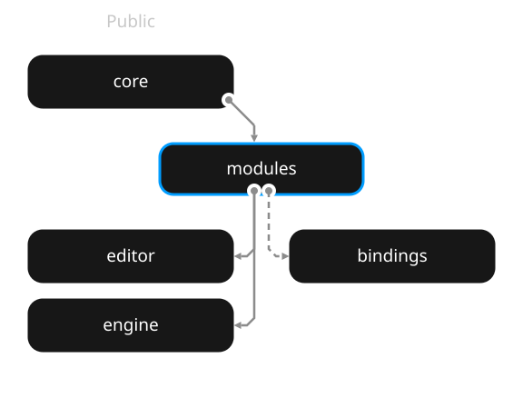

[Engine](../engine.md)

# Modules
<!-- doc-template:module -->

|---|---|
| Type | Module |
| Namespace | `conjure::modules` |
| Include Folder Path | `engine/include/conjure/modules` |
| Source Folder Path | `engine/src/modules` |

<!-- doc-content:purpose:start -->
`conjure::modules` (target `conjure_modules`, alias `conjure::modules`) is the plugin system: manifests, the C ABI
handshake, load / unload / reload in dependency order, registration records and the consumers that apply them.
It depends on `conjure::core` only, sits in beside `ecs`, `platform`, `rhi`, `assets` and `audio`, and is
consumed by the `engine` module, which owns the one `module_manager` of a process. This chapter covers the
internals an engine programmer needs: how a load proceeds, what the records hold, how reloads keep state, how the
umbrella shared library the whole scheme depends on is built, and how the suite tests all of it without a GPU or
a window.

See `engine/src/modules/README.md` for additional implementation notes.
<!-- doc-content:purpose:end -->

## Dependency Graph



## Headers

| File | Description | Provides |
|---|---|---|
| [module_abi.h](modules/module-abi.md) | The <code>C</code> front door of a shared module. | [`conjure_module_abi_signature`](modules/module-abi/conjure-module-abi-signature.md)<br>[`conjure_module_info`](modules/module-abi/conjure-module-info.md) |
| [module_consumer.h](modules/module-consumer.md) | One area&#x27;s view of module registrations. | [`module_consumer`](modules/module-consumer/module-consumer.md)<br>[`reload_context`](modules/module-consumer/reload-context.md) |
| [module_context.h](modules/module-context.md) | What a module sees of the host. | [`module_context`](modules/module-context/module-context.md) |
| [module_entry.h](modules/module-entry.md) | Declaring a module. | [`static_module_desc`](modules/module-entry/static-module-desc.md) |
| [module_error.h](modules/module-error.md) | Failure codes of the module system. |  |
| [module_events.h](modules/module-events.md) | Events the module manager publishes on the engine&#x27;s <code><a href="core/event-bus/event-bus.html">core::event_bus</a></code>. | [`module_load_failed_event`](modules/module-events/module-load-failed-event.md)<br>[`module_loaded_event`](modules/module-events/module-loaded-event.md)<br>[`module_unloaded_event`](modules/module-events/module-unloaded-event.md)<br>[`module_unloading_event`](modules/module-events/module-unloading-event.md) |
| [module_manager.h](modules/module-manager.md) | The module manager: discovers manifests, resolves dependencies, loads, unloads and reloads modules in order and hands registrations to consumers. | [`module_manager`](modules/module-manager/module-manager.md)<br>[`module_manager::pending_operation`](modules/module-manager/module-manager-pending-operation.md)<br>[`module_manager_desc`](modules/module-manager/module-manager-desc.md) |
| [module_manifest.h](modules/module-manifest.md) | The parsed manifest. | [`module_dependency`](modules/module-manifest/module-dependency.md)<br>[`module_manifest`](modules/module-manifest/module-manifest.md) |
| [module_registrar.h](modules/module-registrar.md) | The object a module entry registers through. | [`module_registrar`](modules/module-registrar/module-registrar.md) |
| [module_registration_set.h](modules/module-registration-set.md) | Everything one module entry registered. | [`extension_record`](modules/module-registration-set/extension-record.md)<br>[`module_lifecycle`](modules/module-registration-set/module-lifecycle.md)<br>[`module_registration_set`](modules/module-registration-set/module-registration-set.md) |
| [module_registry.h](modules/module-registry.md) | Read-only view of every registered module. | [`module_registry`](modules/module-registry/module-registry.md) |
| [module_resolver.h](modules/module-resolver.md) | Dependency resolution: a pure function from registered modules to a deterministic load order plus per-module failures. | [`resolution_failure`](modules/module-resolver/resolution-failure.md)<br>[`resolution_input`](modules/module-resolver/resolution-input.md)<br>[`resolution_result`](modules/module-resolver/resolution-result.md) |
| [module_service.h](modules/module-service.md) | Host services modules may ask for. | [`service_id`](modules/module-service/service-id.md)<br>[`service_table`](modules/module-service/service-table.md) |
| [module_types.h](modules/module-types.md) | Handles, enumerations and flag sets of the module system. | [`binary_triplet`](modules/module-types/binary-triplet.md)<br>[`module_id`](modules/module-types/module-id.md)<br>[`std::formatter<conjure::modules::binary_triplet>`](modules/module-types/std-formatter-conjure-modules-binary-triplet.md)<br>[`std::formatter<conjure::modules::module_id>`](modules/module-types/std-formatter-conjure-modules-module-id.md)<br>[`std::formatter<conjure::modules::module_state>`](modules/module-types/std-formatter-conjure-modules-module-state.md) |
| [module_version.h](modules/module-version.md) | Semantic versions and version ranges of the module system. | [`semantic_version`](modules/module-version/semantic-version.md)<br>[`std::formatter<conjure::modules::semantic_version>`](modules/module-version/std-formatter-conjure-modules-semantic-version.md)<br>[`std::formatter<conjure::modules::version_range>`](modules/module-version/std-formatter-conjure-modules-version-range.md)<br>[`version_range`](modules/module-version/version-range.md) |
| [modules.h](modules/modules.md) | Umbrella header for module authors: everything an entry function needs. |  |

## Breakdown

<!-- doc-content:breakdown:start -->
### Contents

- [1. Purpose and position](#1-purpose-and-position)
- [2. Public headers](#2-public-headers)
- [3. Internals](#3-internals)
- [4. Data layout](#4-data-layout)
- [5. Threading](#5-threading)
- [6. Extension points](#6-extension-points)
- [7. Build: the umbrella shared library](#7-build-the-umbrella-shared-library)
- [8. Failure handling](#8-failure-handling)
- [9. Tests and fixtures](#9-tests-and-fixtures)
- [10. Open items](#10-open-items)
- [Related](#related)

### Purpose and position

The module does five things: find modules through `module.json`, prove a binary is safe to load before any of its
code runs, load / unload / reload in dependency order on the main thread between frames, collect what a module
registers as plain data, and hand that data to *consumers* which validate first and attach only when every
consumer agreed. Nothing here runs per frame except one relaxed atomic load in `module_manager::apply_pending()`.

Three constraints shape everything below: hosts and plugins link one umbrella
shared library `conjure_shared` so a single copy of every engine global exists (section 7); a module exports a C
front door (`conjure_module_describe`, `conjure_module_entry`) and plain C++ flows once the ABI signature matched;
and registration is data in a `module_registration_set`, applied by consumers, never by the module calling engine
APIs. Component identity is by name (`core::string_id`), never by a template static, so a type registered by a
module is indistinguishable from an engine type at attach time.

### Public headers

| Header (`conjure/modules/`) | Main types | Tests |
|---|---|---|
| `module_types.h` | `module_id`, the enumerations, `module_platform_flags`, `module_feature_flags`, `binary_triplet`, `host_*()` facts, names and parsers | `test_module_types.cpp` |
| `module_version.h` | `semantic_version`, `version_range`, `parse_version`, `parse_version_range`, `host_engine_version` | `test_module_version.cpp` |
| `module_error.h` | `module_error` (32 codes), `module_error_name`, `make_module_error`; category `"modules"` | `test_module_error.cpp` |
| `module_manifest.h` | `module_manifest`, `module_dependency`, `parse_module_manifest`, `load_module_manifest`, `write_module_manifest`, `module_binary_path`, `decorate_binary_name` | `test_module_manifest.cpp` |
| `module_abi.h` | `conjure_module_abi_signature`, `conjure_module_info`, `make_abi_signature`, `host_abi_signature`, `compare_abi`, `CONJURE_MODULE_ABI_VERSION` | `test_module_abi.cpp` |
| `module_entry.h` | `static_module_desc`, `module_entry_function`, `CONJURE_DECLARE_MODULE`, `CONJURE_DECLARE_STATIC_MODULE`, `detail::entry_thunk` | `test_module_entry.cpp` |
| `module_registration_set.h` | `extension_record`, `module_lifecycle`, `module_registration_set`, `extensions_of<T>` | `test_module_registration_set.cpp` |
| `module_registrar.h` | `module_registrar` | `test_module_registrar.cpp` |
| `module_service.h` | `service_id`, `make_service_id`, `CONJURE_MODULE_SERVICE`, `service_table` | `test_module_service.cpp` |
| `module_context.h` | `module_context` | `test_module_context.cpp` |
| `module_consumer.h` | `reload_context`, `module_consumer` | `test_module_consumer.cpp` |
| `module_events.h` | the four event structs | `test_module_events.cpp` |
| `module_resolver.h` | `resolution_input`, `resolution_failure`, `resolution_result`, `resolve_load_order` | `test_module_resolver.cpp` |
| `module_registry.h` | `module_registry` | `test_module_registry.cpp` |
| `module_manager.h` | `module_manager_desc`, `module_manager` | `test_module_manager*.cpp`, lifecycle, reload, requests, shadow copy, export |
| `modules.h` | umbrella for module authors (entry, context, registrar, service) | `test_modules.cpp` |

Private (`engine/src/modules/`): `log_category.{h,cpp}` (`LOG_MODULES`), `module_record.h`, `module_loader.{h,cpp}`
(`detail::open_module_binary`), `shadow_copy.{h,cpp}`, `manifest_paths.h` (`detail::is_base_name`,
`detail::stays_inside_root`), one `.cpp` per public header with out-of-line code.

### Internals

### 3.1 The ABI handshake

`make_abi_signature()` is `constexpr` and reads no compiler-defined macro itself: compiler and standard library ids
come from `conjure/core/platform_detect.h`; the compiler major, the runtime facts (dynamic CRT, ASan, UBSan) and
the public-header hash come from the generated `conjure/modules/abi_identity.h` (section 7.1). `module_abi.h`
prefers `CONJURE_COMPILER_VERSION_MAJOR`, `CONJURE_RUNTIME_DYNAMIC_CRT` and `CONJURE_SANITIZER_ADDRESS` when core
defines them (so a module built against the installed SDK describes *its* translation unit rather than the engine
build's) and falls back to the generated values until then. `CONJURE_DECLARE_MODULE` bakes the signature into a
`static constexpr conjure_module_info` returned by `conjure_module_describe()`, a data getter and the only module
code that runs before the comparison.

`compare_abi()` checks `structSize` first, so a module built against another layout is refused before any other
field is read, then `magic`, `abiVersion` and the rest in declaration order; the error names the field, the expected
and the actual value and asks for a rebuild. `CONJURE_TEST_ABI_VERSION_OVERRIDE` and
`CONJURE_TEST_ENGINE_VERSION_OVERRIDE` exist for the mismatch fixtures only.

### 3.2 One load, step by step

```
load_one(record):
  static module      -> entry = desc.entry (may be null: manifest-only module)
  manifest-only      -> entry = null
  shared binary      -> detail::open_module_binary: allowSharedLibraries? exists? shadow copy?
                        dynamic_library::load, both symbols, describe(), compare_abi, name == manifest.name
  context = module_context(id, host, engineVersion, manifest, root, services)
  begin_entry(registrar); status = entry(context); end_entry()
                      -> ENTRY_FAILED when status != OK or fail() was called (every reason listed); close
  consumers.validate  -> REGISTRATION_CONFLICT (nothing applied); close
  consumers.attach    (add order)
  LOADED; load order; link dependents; restore a pending reload snapshot; onActivated; module_loaded_event
```

`load(id)` resolves the transitive closure of the module's unloaded dependencies with `resolve_load_order()`
(Kahn's algorithm, name tie-breaks, `GAME` as late as the graph allows) and stops at the first failure;
`load_all()` resolves every candidate and continues past failures, returning the first error. Before each
`load_one` the manager re-checks every non-optional dependency named in the manifest: one that is not `LOADED`
(it failed in this very pass, after resolution accepted it) fails the dependent with `DEPENDENCY_FAILED`, so a
module never ends up `LOADED` without a dependency it declared. When a module becomes `LOADED` it is linked both
ways: with the loaded modules it depends on and with the already loaded modules whose manifests name it (an optional
dependency arriving after its dependent), so `HAS_DEPENDENTS` and the reload cascade hold whichever side loaded
first.

### 3.3 Unload, fault and reload

`unload` pre-checks (`HAS_DEPENDENTS`, every consumer's `can_detach`) are side-effect free. Then: `onDeactivating`,
`module_unloading_event`, detach in reverse consumer order, context and registration set destroyed (so retained
subscriptions and descriptor strings die before the binary), the binary closed (unless `keepBinariesResident`), the
generation incremented, `module_unloaded_event` with the old id and the name. A consumer still reporting live uses
after `detach()` puts the record in `FAULTED`: its binary stays resident and every later operation on the id returns
`FAULTED`. A leaked DLL beats a `dlclose` of unknown state. That error is the stored fault itself, unwrapped, and a
refused request (`apply_one`) does not overwrite it, so `last_error(id)` keeps naming the consumer that faulted.

`reload(id, FULL)` computes the cascade (the module plus its transitive loaded dependents, reverse load order),
pre-checks every member, then per member `onDeactivating`, `module_unloading_event{ reloading = true }`, `detach(id,
&snapshot)`, close. Forward: `load_one` (a fresh shadow copy), `restore(id, snapshot)` per consumer, `onActivated`.
A load failing inside the cascade leaves that module `FAILED` and the rest `UNLOADED`, every snapshot kept in the
record's `pendingSnapshot` until the next successful load restores it. `MANAGED_ONLY` skips close and open and runs
only consumers with `participates_in_managed_reload()`, but the lifecycle callbacks bracket it exactly like a full
reload. The id stays valid across any reload.

### 3.4 Shadow copies

Windows locks a loaded DLL. With `module_manager_desc::shadowCopyBinaries` the loader copies the binary and its
`.pdb` / `.dSYM` to `<shadowCopyDirectory>/<name>/<loadCount + 1>/` and opens the copy, so a rebuild can overwrite
the original while the module is loaded. The cache is emptied when the manager is constructed (locked entries,
another process's loaded module, are skipped with a WARN) and a copy directory is removed once its library closed.
The code is plain `std::filesystem` and runs identically on every platform; the shadow-copy tests check the
Windows lock behaviour only where the platform locks files.

`keepBinariesResident` never closes a binary: on unload the handle and its shadow copy stay, and when a later load
opens a new image the previous handle moves into the record's `residentBinaries` (plain assignment would unload
it, since `core::dynamic_library`'s move assignment closes the handle it replaces). Every resident image is released
when the manager is destroyed.

### 3.5 Registration set and consumers

`module_registrar::register_extension()` appends a trivially copyable descriptor into one byte buffer
(`extensionStorage`), aligned per record, and an `extension_record { point, offset, size, alignment }` into
`extensions`. `extensions_of<Desc>()` walks the records, matching `Desc::EXTENSION_POINT` *and* `sizeof(Desc)` (a
record of another size under the same point is skipped, so two descriptor versions never alias) and returns
pointers into the storage. The set also carries `managedAssemblies` (manifest entries first, then
`register_managed_assembly()` additions, deduplicated), `lifecycle` and `errors` (any entry rejects the load).
`register_managed_assembly()` applies the manifest's `"managed"` rule (`detail::stays_inside_root`, a private
`manifest_paths.h`): a path that leaves the module root asserts and lands in `errors`, because `export_layout`
writes the full list into the exported manifest, which must parse again in the shipped game.

Consumers are non-owning pointers held in add order. The manager calls `validate()` on all of them before the
first `attach()`, so a veto is free of side effects; `attach()` cannot fail. Ownership is per *type*: consumers
record `(what they attached -> module_id)` through `module_registry::note_ownership()` and the manager calls
`forget_ownership()` on unload. No hot path carries a module tag; "is this module in use?" is answered from
archetype metadata by the ECS consumer, O(archetypes).

### 3.6 Service table and context

`service_table` wraps a `core::flat_map<service_id, void *>`; `service_id` is the FNV-1a 64 hash of the qualified
interface name that `CONJURE_MODULE_SERVICE(name)` declares as `SERVICE_ID` (with `SERVICE_NAME` for messages).
`provide()` asserts on a duplicate and keeps the first. The table is immutable while anything is `LOADED`
(`provide_service` asserts otherwise), hence readable from job threads. `module_context` holds non-owning pointers
to the manifest and the table, the registrar pointer bound by `begin_entry()` / `end_entry()` (outside the entry
`registrar()` asserts and returns a registrar over a scratch set so a stray call cannot corrupt the real one), and
a `std::vector<core::event_subscription>` that `retain()` fills and the destructor releases.

### 3.7 Static modules

`CONJURE_DECLARE_STATIC_MODULE(identifier, json, entry)` defines a function returning a function-local
`static constexpr static_module_desc`; `detail::static_entry<EntryFunction>()` yields `nullptr` for a `nullptr`
argument or `&detail::entry_thunk<EntryFunction>`, the C-signature adapter, otherwise. `add_static_module()` parses
the embedded manifest text and keeps a pointer to the descriptor, which must therefore outlive the manager. The
 `engine` module adds one manifest-only static module per built-in library (`conjure.ecs`, `conjure.renderer`,
...) so game modules can depend on them; the built-ins register their types through the
engine's subsystem adapters, never through a module entry.

### Data layout

`module_record` (`engine/src/modules/module_record.h`) is the manager's per-module state; records live in the
registry, are never destroyed while the manager exists and keep their slot across unloads (the generation inside
`id` is what changes):

| Field | Purpose |
|---|---|
| `id`, `name`, `state`, `manifest`, `rootDirectory` | identity and manifest |
| `binaryPath`, `loadedBinaryPath` | derived binary path; the shadow copy actually opened |
| `staticDesc` | non-null for static modules |
| `library`, `residentBinaries` | the open `core::dynamic_library`; earlier images kept by `keepBinariesResident` |
| `registrations`, `context`, `pendingSnapshot` | the set, the `module_context`, a reload snapshot awaiting a successful load |
| `dependencies`, `dependents` | `small_vector<module_id, 8>` of *loaded* modules either side |
| `lastError`, `loadOrder`, `loadCount` | diagnostics; `loadCount` also indexes shadow copies |

`module_registry` hides `registry_state` behind a `unique_ptr`: the record vector (slot reuse by index), the
load-order vector, a name map and the ownership table `(point, key) -> module_id`. Getters taking an id assert on
an invalid or stale id and return an empty value, so a stale handle never dereferences another module's record.
`module_manager` keeps `mDesc`, `mRegistry`, `mServices`, the consumer vector, the pending-operation vector with
`std::atomic<bool> mHasPending`, the event bus pointer and `mNextLoadOrder`.

### Build: the umbrella shared library

### 7.1 `cmake/ConjureSharedLibrary.cmake`

`conjure_finalize_engine()` runs once from the root `CMakeLists.txt` right after `add_subdirectory(engine)` and
creates two targets. `conjure_abi_identity` writes `${PROJECT_BINARY_DIR}/generated/include/conjure/modules/
abi_identity.h` with `CONJURE_ABI_HEADER_HASH` (the first 64 bits of a SHA-256 over the relative path and SHA-256
digest of every header in every library's `CONJURE_PUBLIC_HEADERS` property, sorted by path; recomputed at build
time whenever one changes), `CONJURE_ABI_COMPILER_MAJOR` and `CONJURE_ABI_RUNTIME_DYNAMIC_CRT` / `_ASAN` / `_UBSAN`.
`conjure_shared` (alias `conjure::shared`) is a `SHARED` library from one generated empty source that whole-archives
every library in the global property `CONJURE_STATIC_LIBRARIES` (`$<LINK_LIBRARY:WHOLE_ARCHIVE,...>` plus a
`LINK_LIBRARY_OVERRIDE_<lib>` per library so transitive plain links agree); third-party static libraries follow
transitively and are not whole-archived. It compiles with `CONJURE_SHARED_EXPORTS`; consumers get
`CONJURE_SHARED_IMPORTS`, the engine include directories, every library's interface compile definitions,
`conjure::platform_defines` and glm. Run paths are `$ORIGIN` / `@loader_path`.

### 7.2 What is exported

Exactly the declarations that carry `CONJURE_API` (`conjure/core/api.h`), on every platform. Every engine static
library is compiled with `CONJURE_SHARED_EXPORTS`, `CXX_VISIBILITY_PRESET hidden` and `VISIBILITY_INLINES_HIDDEN`
(`conjure_apply_export_settings()` in `cmake/ConjureModule.cmake`), so the whole-archived objects carry their own
`dllexport` / `visibility("default")` attributes and nothing is generated at build time (no module definition file,
no `WINDOWS_EXPORT_ALL_SYMBOLS`). The third-party archives the modules link privately get hidden visibility as well
(`conjure_hide_thirdparty_symbols()`), so a Linux or macOS build exports no yyjson, GLFW, miniaudio, Jolt, cgltf, stb
or NVRHI symbol; Dear ImGui is the one exception, exported through `IMGUI_API` for the editor and `EDITOR_UI`
modules. The annotation rules: every class, struct or free function of a public header whose definition lives in a
`.cpp`, every `extern` variable (the modules' log categories use `CONJURE_DECLARE_ENGINE_LOG_CATEGORY`, which is
`extern CONJURE_API`) and every explicit template specialisation with out-of-line members; nested classes carry their
own macro (MSVC does not export them with the enclosing class) and a friend declaration of an exported free function
carries it too. Templates, inline and constexpr functions, enums and aggregates without out-of-line methods need
nothing. Three CTest entries, registered in `tests/modules/CMakeLists.txt` under the labels `exports` and `style`,
keep this honest:

| Entry | Command | Checks |
|---|---|---|
| `exports.check_annotations` | `python tools/check_exports.py` | every header under `engine/include/conjure/<module>/`; a declaration that needs the macro and lacks it is a finding (`python tools/check_exports.py <module>` checks one module) |
| `exports.count_shared_library` | `python tools/check_exports.py --count-exports <conjure_shared> --limit 52428` | the export count read back from `dumpbin /EXPORTS` or `nm` (5,283 in Debug with every library; a Windows DLL holds at most 65,535) |
| `exports.check_tool` | `python tools/check_exports.py --self-test` | the checker over embedded headers and tool output |

The fixture `module_surface` links a slice of the public surface through the import side as well, so a missing
annotation also fails the build. Tests that link the static libraries directly define neither macro and see an
empty `CONJURE_API`.

### 7.3 `conjure_add_game_module()` and `LINK_ENGINE_SHARED`

`conjure_add_game_module(<target> MANIFEST <module.json> SOURCES... [NAME <name>] [OUTPUT_ROOT <dir>] [DEPS...]
[DEFINES...] [EDITOR_UI])` (`cmake/ConjureModule.cmake`) builds a plugin: a `SHARED` library linking
`conjure::shared` privately, hidden visibility, `CONJURE_MODULE_NAME="<name>"`, output name from the manifest's
`"binary"`, output directory `<root>/bin/<platform>-<arch>-$<LOWER_CASE:$<CONFIG>>/` and a `$ORIGIN` run path.
`OUTPUT_ROOT` places fixture outputs in the build tree. `conjure_add_test_module(...
LINK_ENGINE_SHARED)` (`cmake/ConjureTesting.cmake`) links a test executable against `conjure::shared` and
`conjure::test_support_shared` instead of the static libraries; see [Creating a module](../extensions/creating-a-module.md)
for the author's view.

### Failure handling

Every failure is a `module_error` returned as `core::error` in category `"modules"`, with a message naming the
module and, where relevant, expected and actual values, so the editor can show it verbatim; the full list by stage
is on the 📘 API page [Loading and managing modules](../../api/modules/loading-and-managing.md#failure-modes).
Rules: every failure before the entry is side-effect free except a closed handle; a failed entry or validation
closes the binary and applies nothing; unload pre-checks are side-effect free; `FAULTED` is the only non-recoverable
state and it is contained to one record. Crashes inside module code are not caught (the engine never catches):
the editor builds modules out of process, auto-saves before a reload and stops play mode first. `discover()`
returns `MANIFEST_NOT_FOUND` for a directory that does not exist or cannot be listed, never passing an unreadable
directory for an empty one. `DEPENDENCY_MISSING` names the actual cause: unregistered, `SKIPPED` on this
platform, or `FAULTED` (with its error).

### Open items

- `platform_detect.h` does not yet define `CONJURE_COMPILER_VERSION_MAJOR`, `CONJURE_RUNTIME_DYNAMIC_CRT` and
  `CONJURE_SANITIZER_ADDRESS` (requested from core); until then the signature reports the engine build's values.
- The consumers themselves (`ecs_module_consumer`, assets, scripting, editor) and `builtin_modules.cpp` landed
  with ([Engine module](engine.md) 5, [Editor module](../editor/editor.md) 7); `tests/integration/test_module_plugin.cpp`
  loads the fixture `tests/integration/fixtures/sample_plugin` through a headless application. The benchmark
  `bench_module_reload` is not written yet.

### Related

- README: `engine/src/modules/README.md`
- handbook: [Module system](../extensions/module-system.md), [Creating a module](../extensions/creating-a-module.md),
  [Importing and distributing modules](../extensions/importing-and-distributing-modules.md),
  [Building and Configuration](../development/building-and-configuration.md), [Testing and Benchmarks](../development/testing-and-benchmarks.md), [Core module](core.md)
- 📘 API: [Modules and plugins](../../api/modules/index.md), [Writing a module](../../api/modules/writing-a-module.md),
  [Loading and managing modules](../../api/modules/loading-and-managing.md)
<!-- doc-content:breakdown:end -->

## Threading Model

<!-- doc-content:threading:start -->
Every `module_manager` mutator and every consumer callback runs on the main thread with no jobs in flight:
`CONJURE_ASSERT(core::jobs::is_main_thread())` and, when `isInsideFrame` is set, `CONJURE_ASSERT(!isInsideFrame())`;
a violated precondition returns `core::error_code::INVALID_STATE` (or returns early for the `void` operations,
keeping the request queue). `request_*` is main thread only and drops a request made elsewhere. `apply_pending()`
costs one `mHasPending.load(std::memory_order_relaxed)` when idle; requests made while applying wait for the next
call. `module_registry` and `service_table` are immutable between sync points and may be read from job threads.
`dlopen` runs module static initialisers on the main thread. Module code never creates threads.
<!-- doc-content:threading:end -->

## Extension Points

<!-- doc-content:extensions:start -->
| Point | How |
|---|---|
| New descriptor kind | the consuming area defines a trivially copyable struct with `static constexpr core::string_id EXTENSION_POINT` and a `module_consumer` that reads it with `extensions_of<T>()`; nothing in this module changes |
| New host service | `CONJURE_MODULE_SERVICE(qualified::name)` in the interface, `manager.provide_service(object)` before loading |
| Host policy | `module_manager_desc`: host kind, features, binary config, shared libraries on or off, shadow copies, resident binaries, default unload policy, frame hook |
| Managed reload | a consumer returning true from `participates_in_managed_reload()` takes part in `reload_scope::MANAGED_ONLY` |
<!-- doc-content:extensions:end -->

## Testing

<!-- doc-content:testing:start -->
`tests/modules/` builds `conjure_modules_tests` with `conjure_add_test_module(modules ... LINK_ENGINE_SHARED)`, plus
seven fixture plugins through `conjure_add_game_module()` and four manifest-only fixtures, all under
`${PROJECT_BINARY_DIR}/test_modules/<name>/` (`CONJURE_TEST_MODULE_DIR`), so the tree a test discovers looks
exactly like a project's `modules/` directory:

| Fixture | Proves |
|---|---|
| `module_alpha` | a component, a system and a probe descriptor, lifecycle counters, a log line through the host logger (one engine copy), a retained subscription through `fixtures::host_event_service` |
| `module_beta` | depends on alpha `^1.0.0`; a panel record and a managed assembly added by the entry |
| `module_bad_abi`, `module_bad_version` | `ABI_MISMATCH` on `abiVersion` / `engineVersionMajor`, entry never runs |
| `module_wrong_name`, `module_no_symbol`, `module_bad_entry` | `NAME_MISMATCH`, `ENTRY_SYMBOL_MISSING`, `ENTRY_FAILED` with both reasons |
| `module_managed_only`, `module_wrong_platform`, `module_cycle_a/b` | manifest-only load, `SKIPPED`, `DEPENDENCY_CYCLE` |

`tests/modules/fixtures/fixture_descriptors.h` stands in for the consuming areas' descriptor types;
`fake_consumer.h` records every consumer call as `"<call>:<consumer>:<module>"`; `static_fixtures.h` builds
manifests and static modules with counting entries (`REGISTERING_ENTRY`, `FAILING_ENTRY`, `FLAKY_ENTRY`,...) for
the `dlopen`-free manager tests; `shared_fixtures.h` locates the built plugins. One test file per public header
plus the topic files (`test_module_manager_static`, `_shared`, `test_module_lifecycle_order`,
`test_module_reload`, `test_module_requests`, `test_module_shadow_copy`, `test_module_export_layout`,
`test_dynamic_library`). The suite also covers regressions: a dependency
failing at load time fails its dependents, resident binaries across reload and unload, entry-registered assemblies
in the exported layout, a retained host subscription dying with the module, a fault inside a reload cascade, the
`unload_all` error path, an optional dependency linked after its dependent, and a `request_*` made off the main
thread.

```
python tools/build.py --build-dir build/mod_modules --target conjure_modules_tests --test -R modules
python tools/check_exports.py modules
```

> [!NOTE]
> `LINK_ENGINE_SHARED` leaves the test support's global `operator new` replacement out of the executable (it
> would release memory allocated inside `conjure_shared` through the wrong deallocator), so `memory_guard` and
> `allocation_scope` count nothing here; the suite asserts "no growth" through the registry (record count,
> generations, `load_count`) instead.
<!-- doc-content:testing:end -->

<!-- doc-legacy-anchors:start -->
<a id="1-purpose-and-position"></a>
<a id="10-open-items"></a>
<a id="2-public-headers"></a>
<a id="3-internals"></a>
<a id="4-data-layout"></a>
<a id="5-threading"></a>
<a id="6-extension-points"></a>
<a id="7-build-the-umbrella-shared-library"></a>
<a id="8-failure-handling"></a>
<a id="9-tests-and-fixtures"></a>
<a id="modules-module"></a>
<!-- doc-legacy-anchors:end -->
