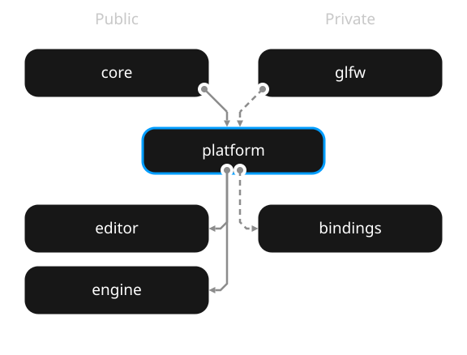

[Engine](../engine.md)

# Platform
<!-- doc-template:module -->

|---|---|
| Type | Module |
| Namespace | `conjure::platform` |
| Include Folder Path | `engine/include/conjure/platform` |
| Source Folder Path | `engine/src/platform` |

<!-- doc-content:purpose:start -->
Platform provides window creation, event delivery, and frame-based input state. Its
[`window`](platform/window/window.md) interface has a GLFW backend for native windows and a
[`null_backend`](platform/null-backend/null-backend.md) for headless execution. Both produce the same
[`event`](platform/event.md#symbol-event) stream, which [`input`](platform/input/input.md) converts into an
[`input_state`](platform/input-state/input-state.md) snapshot.

Window and input ownership remain with the caller. The module supplies the operating-system boundary;
rendering and application behaviour consume its interfaces. For application setup, see
[Windows and events](../../api/platform/windows-and-events.md) and [Input](../../api/platform/input.md).
<!-- doc-content:purpose:end -->

## Dependency Graph



## Headers

| File | Description | Provides |
|---|---|---|
| [backend.h](platform/backend.md) | Which implementation sits behind a <code><a href="platform/window/window.html">platform::window</a></code>: the real <code>GLFW</code> 3.4 window or the virtual <code>null</code> window used by every headless test and server build. |  |
| [button_action.h](platform/button-action.md) | What happened to a key or button. |  |
| [event.h](platform/event.md) | The event stream a window produces once per frame. | [`close_event`](platform/event/close-event.md)<br>[`content_scale_changed_event`](platform/event/content-scale-changed-event.md)<br>[`cursor_enter_event`](platform/event/cursor-enter-event.md)<br>[`drop_files_event`](platform/event/drop-files-event.md)<br>[`focus_event`](platform/event/focus-event.md)<br>[`framebuffer_resized_event`](platform/event/framebuffer-resized-event.md)<br>[`gamepad_axis_event`](platform/event/gamepad-axis-event.md)<br>[`gamepad_button_event`](platform/event/gamepad-button-event.md)<br>[`gamepad_connection_event`](platform/event/gamepad-connection-event.md)<br>[`key_event`](platform/event/key-event.md)<br>[`minimise_event`](platform/event/minimise-event.md)<br>[`mouse_button_event`](platform/event/mouse-button-event.md)<br>[`mouse_move_event`](platform/event/mouse-move-event.md)<br>[`mouse_scroll_event`](platform/event/mouse-scroll-event.md)<br>[`text_event`](platform/event/text-event.md) |
| [gamepad.h](platform/gamepad.md) | Gamepad buttons and axes: the SDL game controller layout <code>GLFW</code> exposes as <code>GLFW_GAMEPAD_BUTTON_</code>* / <code>GLFW_GAMEPAD_AXIS_</code>*. |  |
| [input.h](platform/input.md) | The backend-independent <code><a href="platform/input/input.html">input</a></code> accumulator. | [`input`](platform/input/input.md)<br>[`input_stats`](platform/input/input-stats.md) |
| [input_state.h](platform/input-state.md) | Everything a frame may ask about input. | [`gamepad_state`](platform/input-state/gamepad-state.md)<br>[`input_state`](platform/input-state/input-state.md)<br>[`key_bitset`](platform/input-state/key-bitset.md) |
| [key.h](platform/key.md) | Keyboard keys and modifier flags. |  |
| [log_category.h](platform/log-category.md) | The platform module&#x27;s log category (&quot;platform&quot;), defined in engine/src/platform/<code>platform.cpp</code>. |  |
| [monitor.h](platform/monitor.md) | Monitors as <code>window::monitors()</code> reports them. | [`monitor_info`](platform/monitor/monitor-info.md)<br>[`video_mode`](platform/monitor/video-mode.md) |
| [mouse_button.h](platform/mouse-button.md) | Mouse buttons: <code>GLFW_MOUSE_BUTTON_</code>* numbering, eight buttons. |  |
| [native_handle.h](platform/native-handle.md) | Opaque per-OS window handles for the rhi: the <code>D3D12</code> swapchain needs the HWND, MoltenVK the NSWindow. | [`native_window_handle`](platform/native-handle/native-window-handle.md) |
| [null_backend.h](platform/null-backend.md) | The virtual window: no OS call of any kind, constructible without a display server, deterministic. | [`null_backend`](platform/null-backend/null-backend.md)<br>[`null_backend::drop_range`](platform/null-backend/null-backend-drop-range.md) |
| [platform.h](platform/platform.md) | Umbrella header of the platform module: window, events, input and the backend queries. |  |
| [platform_error.h](platform/platform-error.md) | Error codes of the platform module. |  |
| [window.h](platform/window.md) | The abstract <code><a href="platform/window/window.html">window</a></code>. | [`window`](platform/window/window.md)<br>[`window_desc`](platform/window/window-desc.md) |

## Breakdown

<!-- doc-content:breakdown:start -->
### Ownership and backend selection

[`create_window()`](platform/window.md#function-create-window) validates a
[`window_desc`](platform/window/window-desc.md), enforces one live window per process, and returns an owning
`std::unique_ptr` to [`window`](platform/window/window.md). Destroying that object releases the backend's
window resources. Description validation rejects an unknown backend, an overlong title, and zero windowed
dimensions; backend creation reports unavailable builds, initialisation failures, and invalid monitor selection.

`engine/src/platform/platform.cpp` implements the factory and backend queries. The null backend is always
built. `CONJURE_PLATFORM_GLFW` adds the GLFW implementation and its private library dependency; public
platform interfaces depend on Core. The generated [dependency graph](#dependency-graph) shows the module's
direct dependencies and consumers.

GLFW implementation details stay under `engine/src/platform/glfw/`. `glfw_context` manages process-wide
initialisation, error reporting, and joystick/monitor callback dispatch. `glfw_window` owns the native window
and its event buffers. The null backend keeps equivalent state in memory and exposes simulation operations
for tests and headless tools.

### Event buffering and lifetime

[`window::pump_events()`](platform/window/window.md#function-pump-events) returns the next event batch as a
span. Each backend separates pending events from the delivered batch. Events raised synchronously by a
window setter remain pending until the next pump; pumping must not discard them before delivery.

Both backends coalesce framebuffer changes into one
[`framebuffer_resized_event`](platform/event/framebuffer-resized-event.md) at the end of the batch. A
minimised window reports a zero-sized framebuffer. Window size uses logical coordinates, while framebuffer
size uses drawable pixels; their ratio is the content scale.

> [!WARNING]
> The delivered event span and the paths inside a [`drop_files_event`](platform/event/drop-files-event.md)
> refer to backend-owned storage. Consume or copy them before the next call to
> [`pump_events()`](platform/window/window.md#function-pump-events).

The backends retain vector capacity between pumps. Dropped file paths use owned strings, with delivered
spans repaired after the buffers are swapped. This separates event lifetime from callback timing and avoids
steady-state event-buffer allocations when retained capacity is sufficient.

### Input accumulation and publication

[`input::apply()`](platform/input/input.md#function-apply) handles input events from a pumped batch.
[`input::inject()`](platform/input/input.md#function-inject) uses the same internal state machine for tests
and editor input. A press sets the held and pressed states; a release clears held and sets released.
Repeated presses, duplicate releases, and invalid transitions are counted instead of creating new edges.
Losing focus releases held input.

[`input::end_frame()`](platform/input/input.md#function-end-frame) publishes the accumulated state,
increments its frame index, and clears transient edges, mouse movement, scroll, and text in the pending
state. [`snapshot()`](platform/input/input.md#function-snapshot) returns the last published snapshot.

The following helper publishes input from a batch already obtained by the caller. The caller also dispatches
window events from that same batch, including close requests and framebuffer changes.

```cpp
#include "conjure/platform/input.h"
#include <span>

void publish_input(
    conjure::platform::input &accumulator,
    std::span<const conjure::platform::event> events) {
    for (const auto &value : events) {
        static_cast<void>(accumulator.apply(value));
    }
    accumulator.end_frame();
}
```

> [!IMPORTANT]
> Apply the complete input batch before publishing it. Consumers that need pressed/released edges should
> read the published [`input_state`](platform/input-state/input-state.md) before the next publication.

### Native integration and backend differences

[`native_window_handle`](platform/native-handle/native-window-handle.md) exposes the platform handle needed
by the rendering backend without putting operating-system types in the public interface. GLFW-specific
native handle access is isolated in `glfw_native.cpp`. Vulkan surface creation is isolated in
`glfw_vulkan.cpp`; the null backend reports that Vulkan presentation is unsupported.

GLFW fullscreen support uses the selected monitor's current mode. Leaving fullscreen restores the last
confirmed windowed size and position. A window created fullscreen without an explicit position is centred
on the monitor work area when it first returns to windowed mode.

Cursor capture, raw mouse motion, window positioning, clipboard access, and per-window icons depend on
backend and display-server support. Operations that return a result report unavailable features explicitly.
For example, Wayland does not provide the same positioning and cursor-warp controls as Win32 or X11.

> [!NOTE]
> The null backend has no display-server dependency. It stores clipboard, monitor, focus, visibility, and
> cursor state locally, making event and input tests deterministic without opening a native window.
<!-- doc-content:breakdown:end -->

## Threading Model

<!-- doc-content:threading:start -->
> [!IMPORTANT]
> Create, destroy, query, and modify windows on the main thread. Input mutation and
> [`end_frame()`](platform/input/input.md#function-end-frame) also belong to the main thread. These paths
> assert the main-thread requirement in Debug and Development builds.

GLFW callbacks execute while the main thread pumps events or performs an operation that raises them
synchronously. They append pending events or record state changes; application code consumes the delivered
batch after pumping.

[`snapshot()`](platform/input/input.md#function-snapshot) may be read by other threads between publications.
Coordinate readers with publication, and do not retain its reference across the next
[`end_frame()`](platform/input/input.md#function-end-frame).
<!-- doc-content:threading:end -->

## Extension Points

<!-- doc-content:extensions:start -->
Implement another backend through [`window`](platform/window/window.md), register its backend kind, and
connect it to the factory and backend queries in `platform.cpp`. Keep native headers and handles inside the
backend implementation. Preserve the event lifetimes and resize behaviour described in
[Event buffering and lifetime](#event-buffering-and-lifetime).

Extend the shared backend conformance tests when adding behaviour. Add headless scenarios through
[`null_backend`](platform/null-backend/null-backend.md) simulation methods so input and frame handling can
be checked without an interactive display.
<!-- doc-content:extensions:end -->

## Testing

<!-- doc-content:testing:start -->
`tests/platform/CMakeLists.txt` registers the public-header tests and topic suites. The main behaviour tests are:

| Suite | Coverage |
|---|---|
| `test_backend_conformance.cpp` | Shared window behaviour across null and GLFW backends, including resize delivery, fullscreen restoration, clipboard, and icons. |
| `test_input.cpp` | Input transitions, publication, injection, focus loss, and input diagnostics. |
| `test_null_backend.cpp` | Headless window state and simulated events. |
| `test_window_events.cpp` | Frame handling of resize, minimise, focus, close, and dropped-file events. |

Run the platform target and its tests from the repository root:

```bash
python tools/build.py --target conjure_platform_tests --test -R platform
```

> [!TIP]
> The normal suite runs headlessly. To exercise GLFW conformance on a machine with a display, set
> `CONJURE_TEST_WINDOW=1` before running the test executable with `-ts="platform/backend_conformance"`.
> Those window tests skip when real-window testing is not enabled.
<!-- doc-content:testing:end -->

<!-- doc-legacy-anchors:start -->
<a id="1-shape-and-position"></a>
<a id="10-tests"></a>
<a id="11-open-items"></a>
<a id="2-public-headers"></a>
<a id="3-the-glfw-backend"></a>
<a id="4-event-double-buffering-and-resize-coalescing"></a>
<a id="5-the-input-state-machine"></a>
<a id="6-the-null-backend"></a>
<a id="7-threading-and-ownership"></a>
<a id="8-extension-points"></a>
<a id="9-failure-handling"></a>
<a id="platform-module"></a>
<!-- doc-legacy-anchors:end -->
