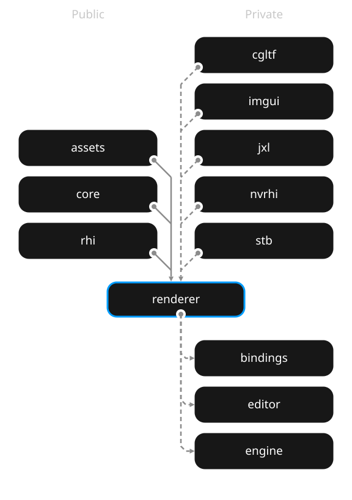

[Engine](../engine.md)

# Renderer
<!-- doc-template:module -->

|---|---|
| Type | Module |
| Namespace | `conjure::renderer` |
| Include Folder Path | `engine/include/conjure/renderer` |
| Source Folder Path | `engine/src/renderer` |

<!-- doc-content:purpose:start -->
`conjure::renderer` (target `conjure_renderer`, alias `conjure::renderer`) is the module that turns a
`render_scene` into one command list per frame through a render graph over `conjure::rhi`. It owns the GPU
mirrors of its asset types, the off-screen render targets and, in editor builds, the Dear ImGui backend. This
chapter is for people changing the module or wiring it into the engine: the frame, the graph, the resource cache,
threading, implementation details and the tests.

See `engine/src/renderer/README.md` for additional implementation notes.
<!-- doc-content:purpose:end -->

## Dependency Graph



## Headers

| File | Description | Provides |
|---|---|---|
| [camera.h](renderer/camera.md) | Cameras and projection helpers. | [`camera`](renderer/camera/camera.md) |
| [components.h](renderer/components.md) | Component data for the ECS. | [`camera_component`](renderer/components/camera-component.md)<br>[`environment_component`](renderer/components/environment-component.md)<br>[`light_component`](renderer/components/light-component.md)<br>[`mesh_renderer_component`](renderer/components/mesh-renderer-component.md)<br>[`post_process_component`](renderer/components/post-process-component.md)<br>[`render_settings_component`](renderer/components/render-settings-component.md)<br>[`resolved_render_settings`](renderer/components/resolved-render-settings.md)<br>[`scene_settings_candidate`](renderer/components/scene-settings-candidate.md)<br>[`scene_settings_choice`](renderer/components/scene-settings-choice.md)<br>[`sprite_component`](renderer/components/sprite-component.md) |
| [debug_draw.h](renderer/debug-draw.md) | The engine-owned facade: immediate shapes (drawn for one frame) and timed shapes (kept for <code>durationSeconds</code>). | [`debug_draw`](renderer/debug-draw/debug-draw.md)<br>[`debug_draw::timed_entry`](renderer/debug-draw/debug-draw-timed-entry.md)<br>[`debug_draw_buffer`](renderer/debug-draw/debug-draw-buffer.md)<br>[`debug_vertex`](renderer/debug-draw/debug-vertex.md) |
| [environment_asset.h](renderer/environment-asset.md) | Image-based lighting environments. | [`cubemap_data`](renderer/environment-asset/cubemap-data.md)<br>[`environment_asset`](renderer/environment-asset/environment-asset.md)<br>[`environment_bake_options`](renderer/environment-asset/environment-bake-options.md)<br>[`environment_importer`](renderer/environment-asset/environment-importer.md)<br>[`environment_loader`](renderer/environment-asset/environment-loader.md)<br>[`equirect_image`](renderer/environment-asset/equirect-image.md) |
| [gltf_importer.h](renderer/gltf-importer.md) | glTF 2.0 import: .gltf / .glb -&gt; CPU meshes, materials, textures and a model node tree. | [`gltf_asset_importer`](renderer/gltf-importer/gltf-asset-importer.md)<br>[`gltf_import_options`](renderer/gltf-importer/gltf-import-options.md)<br>[`gltf_import_result`](renderer/gltf-importer/gltf-import-result.md)<br>[`gltf_importer`](renderer/gltf-importer/gltf-importer.md) |
| [gpu_ids.h](renderer/gpu-ids.md) | Handles to GPU mirrors of assets and to render targets. | [`detail::gpu_id`](renderer/gpu-ids/detail-gpu-id.md)<br>[`gpu_environment_tag`](renderer/gpu-ids/gpu-environment-tag.md)<br>[`gpu_material_tag`](renderer/gpu-ids/gpu-material-tag.md)<br>[`gpu_mesh_tag`](renderer/gpu-ids/gpu-mesh-tag.md)<br>[`gpu_texture_tag`](renderer/gpu-ids/gpu-texture-tag.md)<br>[`render_target_tag`](renderer/gpu-ids/render-target-tag.md)<br>[`std::hash<conjure::renderer::detail::gpu_id<Tag>>`](renderer/gpu-ids/std-hash-conjure-renderer-detail-gpu-id-tag.md) |
| [imgui_renderer.h](renderer/imgui-renderer.md) | The Dear ImGui render backend. | [`imgui_render_stats`](renderer/imgui-renderer/imgui-render-stats.md)<br>[`imgui_renderer`](renderer/imgui-renderer/imgui-renderer.md)<br>[`imgui_renderer::create_tag`](renderer/imgui-renderer/imgui-renderer-create-tag.md) |
| [jpeg_xl.h](renderer/jpeg-xl.md) | JPEG XL (ISO/IEC 18181) in the renderer: the signature check the image decoder routes by and an RGBA8 encoder for screenshots and tools. | [`jpeg_xl_encode_options`](renderer/jpeg-xl/jpeg-xl-encode-options.md) |
| [light.h](renderer/light.md) | Lights as the extraction contract carries them. | [`light`](renderer/light/light.md) |
| [limits.h](renderer/limits.md) | Fixed budgets of the renderer. |  |
| [log_category.h](renderer/log-category.md) | Log category of the renderer module: uploads, fallbacks, graph validation, device loss. |  |
| [material_asset.h](renderer/material-asset.md) | The one PBR material model: glTF metallic-roughness with glTF defaults. | [`material_asset`](renderer/material-asset/material-asset.md)<br>[`material_desc`](renderer/material-asset/material-desc.md)<br>[`material_importer`](renderer/material-asset/material-importer.md)<br>[`material_loader`](renderer/material-asset/material-loader.md) |
| [mesh_asset.h](renderer/mesh-asset.md) | The CPU mesh asset. | [`cpu_geometry_view`](renderer/mesh-asset/cpu-geometry-view.md)<br>[`mesh_asset`](renderer/mesh-asset/mesh-asset.md)<br>[`mesh_geometry`](renderer/mesh-asset/mesh-geometry.md)<br>[`mesh_loader`](renderer/mesh-asset/mesh-loader.md)<br>[`mesh_streams`](renderer/mesh-asset/mesh-streams.md)<br>[`packed_vertex_attributes`](renderer/mesh-asset/packed-vertex-attributes.md)<br>[`submesh`](renderer/mesh-asset/submesh.md) |
| [model_asset.h](renderer/model-asset.md) | The glTF node tree: what the scene module turns into a prefab. | [`model_asset`](renderer/model-asset/model-asset.md)<br>[`model_loader`](renderer/model-asset/model-loader.md)<br>[`model_node`](renderer/model-asset/model-node.md) |
| [render_scene.h](renderer/render-scene.md) | The extraction contract: the engine&#x27;s <code>EXTRACT</code> systems fill a <code><a href="renderer/render-scene/render-scene.html">render_scene</a></code>, the renderer renders it. | [`mesh_instance`](renderer/render-scene/mesh-instance.md)<br>[`render_scene`](renderer/render-scene/render-scene.md)<br>[`render_scene_pair`](renderer/render-scene/render-scene-pair.md)<br>[`render_view`](renderer/render-scene/render-view.md)<br>[`view_render_settings`](renderer/render-scene/view-render-settings.md) |
| [render_settings.h](renderer/render-settings.md) | What the project and scene layers resolve, one member per <code><a href="renderer/render-settings.html#symbol-render-settings-group">render_settings_group</a></code> (80 bytes). | [`environment_settings`](renderer/render-settings/environment-settings.md)<br>[`post_process_settings`](renderer/render-settings/post-process-settings.md)<br>[`render_defaults`](renderer/render-settings/render-defaults.md)<br>[`render_settings`](renderer/render-settings/render-settings.md)<br>[`render_settings_problem`](renderer/render-settings/render-settings-problem.md)<br>[`render_settings_reading`](renderer/render-settings/render-settings-reading.md)<br>[`shadow_settings`](renderer/render-settings/shadow-settings.md)<br>[`ssao_settings`](renderer/render-settings/ssao-settings.md) |
| [render_target.h](renderer/render-target.md) | Off-screen targets: the editor viewport and the AI agent&#x27;s screenshots render into one and read it back synchronously through <code>renderer::read_back</code>. | [`depth_read_back`](renderer/render-target/depth-read-back.md)<br>[`render_target`](renderer/render-target/render-target.md)<br>[`render_target_desc`](renderer/render-target/render-target-desc.md) |
| [renderer.h](renderer/renderer.md) | The <code><a href="renderer/renderer/renderer.html">renderer</a></code>: a render graph over the rhi that turns a <code><a href="renderer/render-scene/render-scene.html">render_scene</a></code> into one command list per frame. | [`pass_timing`](renderer/renderer/pass-timing.md)<br>[`render_stats`](renderer/renderer/render-stats.md)<br>[`renderer`](renderer/renderer/renderer.md)<br>[`renderer::create_tag`](renderer/renderer/renderer-create-tag.md)<br>[`renderer_desc`](renderer/renderer/renderer-desc.md) |
| [renderer_error.h](renderer/renderer-error.md) | Errors of the renderer module. |  |
| [shader_asset.h](renderer/shader-asset.md) | Shader programs. | [`shader_asset`](renderer/shader-asset/shader-asset.md)<br>[`shader_program_desc`](renderer/shader-asset/shader-program-desc.md) |
| [sprite_batch.h](renderer/sprite-batch.md) | The 2D <code><a href="renderer/sprite-batch/sprite.html">sprite</a></code> batcher: pure CPU, public so tests build batches by hand. | [`sprite`](renderer/sprite-batch/sprite.md)<br>[`sprite_batcher`](renderer/sprite-batch/sprite-batcher.md)<br>[`sprite_run`](renderer/sprite-batch/sprite-run.md)<br>[`sprite_vertex`](renderer/sprite-batch/sprite-vertex.md) |
| [texture_asset.h](renderer/texture-asset.md) | The CPU texture asset. | [`texture_asset`](renderer/texture-asset/texture-asset.md)<br>[`texture_import_settings`](renderer/texture-asset/texture-import-settings.md)<br>[`texture_importer`](renderer/texture-asset/texture-importer.md)<br>[`texture_loader`](renderer/texture-asset/texture-loader.md)<br>[`texture_mip`](renderer/texture-asset/texture-mip.md) |

## Breakdown

<!-- doc-content:breakdown:start -->
### Contents

- [1. Shape of the module](#1-shape-of-the-module)
- [2. The frame](#2-the-frame)
- [3. Resource cache and uploads](#3-resource-cache-and-uploads)
- [4. Assets and importers](#4-assets-and-importers)
- [5. Threading model](#5-threading-model)
- [6. Implementation details](#6-implementation-details)
- [7. Failure model](#7-failure-model)
- [8. Extension points and engine wiring](#8-extension-points-and-engine-wiring)
- [9. Tests](#9-tests)
- [10. Open items](#10-open-items)
- [Related](#related)

### Shape of the module

`engine/src/renderer/CMakeLists.txt`: `conjure_add_module(renderer... PUBLIC_DEPS conjure::core conjure::rhi
conjure::assets PRIVATE_DEPS nvrhi cgltf stb jxl [imgui])`, guarded by `CONJURE_WITH_RENDERER` and the presence of
`conjure::rhi` and `conjure::assets`. Never `ecs` or `scene`: the components in `components.h` are plain
reflected structs the engine's `renderer_subsystem` registers and extracts from. `imgui/imgui_renderer.cpp` is
compiled only with `CONJURE_BUILD_EDITOR` (never in Distribution). `conjure_renderer` depends on `conjure_shaders`
so `index.json` exists before the renderer is used.

| Area | Public headers | Private sources |
|---|---|---|
| Budgets, errors, logging | `limits.h`, `renderer_error.h`, `log_category.h` | `renderer_error.cpp`, `log_category.cpp` |
| Handles | `gpu_ids.h` | `gpu_resource_cache.*` (slot maps, fallbacks, graveyard) |
| Extraction contract | `render_scene.h`, `camera.h`, `light.h`, `render_settings.h` | one `.cpp` each |
| 2D and debug | `sprite_batch.h`, `debug_draw.h` | `sprite_batcher.cpp`, `debug_draw.cpp`, `passes/sprite_pass.cpp`, `passes/debug_draw_pass.cpp` |
| Assets | `mesh_asset.h`, `texture_asset.h`, `material_asset.h`, `model_asset.h`, `environment_asset.h`, `shader_asset.h`, `gltf_importer.h`, `jpeg_xl.h` | `assets/*.cpp`, `import/*` (tangents, mips, image decoding, JPEG XL codec, IBL bake, cgltf) |
| Components | `components.h` | `components.cpp` |
| The frame | `renderer.h`, `render_target.h` | `renderer.cpp`, `renderer_impl.h`, `render_graph.*`, `transient_pool.*`, `framebuffer_cache.*`, `binding_layouts.*`, `pipeline_cache.*`, `shader_program_loader.*`, `frame_resources.*`, `timer_ring.*`, `warn_latch.h`, `gpu_types.*`, `culling.*`, `draw_list_builder.*`, `exposure_math.*`, `shadows/*`, `passes/*` |
| ImGui | `imgui_renderer.h` | `imgui/imgui_renderer.cpp` |

Shaders live in `engine/shaders/` and are compiled by `conjure_add_shaders` (the permutation list in
`engine/shaders/CMakeLists.txt`) into `<build>/bin/shaders/index.json`. The structs in `shared/gpu_types.hlsli` are
mirrored in `gpu_types.h` with static-asserted sizes; the tests re-read the HLSL defines to keep the two in step.

What the renderer loads is a second list, and there is no third: the table behind
`shader_asset::built_in_programs()` (`assets/shader_asset.cpp`). `pipeline_cache` maps every graphics
and compute variant, and the blit, to one program of that table, and `imgui_renderer` takes the `imgui` program;
both resolve it through `shader_program_loader.h` (`shader_asset::find_built_in`, then `validate` against the
shader library, then one device shader per stage). No other renderer source names a shader blob.

> [!IMPORTANT]
> A new shader permutation needs three edits: the entry in `engine/shaders/CMakeLists.txt`, its row in the table
> of `assets/shader_asset.cpp`, and the variant that maps to it in `pipeline_cache.cpp` (`key_of`).
> `test_shader_asset` fails when the CMake list and the table disagree in either direction, `test_pipeline_cache`
> when a variant does not resolve or a table row is used by nothing.

### The frame

`renderer::render(scene)` does, in order:

1. `begin_frame`: acquire the back buffer (when a swapchain exists), open the frame command list, flush the queued
   asset uploads under the 64 MB budget, collect the graveyard.
2. `prepare`: build sprites and debug lines once (past `MAX_SPRITES_PER_FRAME`, `sprite_batcher` keeps every
   `SCREEN` sprite it can and drops the `WORLD` sprites last in sort order first), allocate the local-light shadow
   atlas scene-wide (importance measured from view 0; casters culled with `atlasLayerMask`, the union of the layer
   masks of the views without `SKIP_SHADOWS`, so the first shadowing view that renders it does not decide what
   the others see), then per view: cull on jobs, build instanced draw lists (opaque / masked sorted by
   material and mesh, blended far to near), sort the lights (directional first), build the cascades of the first
   shadowing sun (culled with the view's own mask), fill the view constants.
3. `render_view_graph`: one render graph per view, passes added only when they have work: `shadow_cascade_0..3`,
   `shadow_atlas`, `depth_prepass`, `light_cull`, `ssao_gtao`, `ssao_blur_h/v`, `forward_opaque`, `skybox`,
   `forward_blend`, `world_sprites`, `debug_draw`, `exposure_histogram`, `exposure_adapt`, `bloom_down_0..5`,
   `bloom_up_4..0`, `tonemap`, `screen_sprites` and `blit` (only when the target is not `RGBA8_SRGB`). The graph
   validates (a read before write asserts in Debug, logs an ERROR and skips the pass), culls backwards, computes
   lifetimes and takes its transients from the pool (no aliasing, NVRHI automatic barriers).
4. ImGui into the swapchain (editor builds).
5. `end_frame`: close, execute, present, evict idle transients and binding sets, fill `render_stats`.

`world_sprites` and `debug_draw` run before exposure, bloom and the tonemapper, so world sprites and debug lines
are post-processed like the 3D scene; `screen_sprites` runs after the tonemapper. A 2D project that wants its
sprites' authored colours sets the camera's `postProcess = false` (`NO_POST_PROCESS` on its view).

Conventions: reverse-Z everywhere (near = 1, far = 0, `GreaterOrEqual`), classic NVRHI binding sets with
`registerSpaceIsDescriptorSet`, a volatile constant buffer at `b0` and 16 bytes of push constants at `b1` in
space 0, the material set in space 1, matrices uploaded verbatim from glm and consumed with `mul(vector, matrix)`
under `-Zpr`.

### Resource cache and uploads

`gpu_resource_cache` keeps one slot map per mirror type plus the fallbacks (unit cube, white texture, magenta
unlit material, grey environment) and a graveyard. `upload_*` copies the payload at enqueue time, reserves
the slot under a mutex and returns the id; the GPU objects are created in `flush_uploads` at the start of the
next frame, never elsewhere. Releasing a texture only marks the materials that used it; the next flush rebinds
them. An entry released during a frame is retired (its GPU handles get an extra graveyard reference) and freed at
the next `collect()`, so every reference the frame resolved stays valid until the frame is submitted; the mirrors
live in heap entries whose addresses survive table growth, and `resolve_*` lock per call.

A render target's colour texture is an external entry (`register_external_texture`; the cache never destroys it).
`resize_render_target` builds the replacement target, waits for the GPU to go idle, then points the old entry at
the new texture with `replace_external_texture` and unregisters the replacement's own id, so `colour_texture()`
keeps its id across a resize. ImGui and the sprite pass resolve the id every frame (ImGui rebuilds its binding set
when the texture changes), so a handle taken before the resize follows it.

### Assets and importers

The five asset types (`mesh`, `texture`, `material`, `model`, `environment`) have CPU-only loaders (no device
in `finalise`) and four importers (glTF with cgltf, textures with stb and libjxl, `.cmat` JSON, `.hdr` with the CPU
IBL bake of ). `register_asset_types(types, importers, jobs)` registers them; the engine's `renderer_subsystem`
subscribes to `asset_manager` events and calls `upload_*` on LOADED / RELOADED and `release_*` on UNLOADED.
The glTF adapter makes the model the primary asset with meshes, materials and textures as sub-assets with stable
uuids and declared dependencies, so a blocking load of the model brings everything
(`tests/integration/test_assets_renderer_headless.cpp` proves the whole path on the null device).
A point or spot light without a glTF `range` gets `sqrt(intensity / GLTF_LIGHT_RANGE_CUTOFF)`, clamped to
`[GLTF_MIN_LIGHT_RANGE, GLTF_MAX_LIGHT_RANGE]` (`range_from_intensity` in `import/gltf_importer.cpp`), with a
warning; a sampler whose `wrapT` differs from `wrapS` is a warning (`texture_asset` holds one wrap mode). Any
change to what the importer produces bumps `GLTF_IMPORTER_VERSION` (2 since the derived range, 3 since
`generateTangents = false` took effect), which re-imports cached models. The same rule holds for the IBL bake:
`ENVIRONMENT_IMPORTER_VERSION` is 3 since the bake reads NaN and negative radiance as 0 and anything above
`MAX_ENVIRONMENT_RADIANCE` as that bound, integrating brighter-than-half radiance unclipped (only the stored
cubemaps clamp to 65504).

Tangents: the packed vertex always has one, and `import_mesh` decides where it
comes from. A mesh whose primitives all have a usable `TANGENT` (one per vertex) keeps them; a primitive without
gets one from the UV derivatives (`tangent_generation::FROM_UVS`, `detail::generate_tangents`) or, with
`generateTangents = false`, from the normal alone (`FROM_NORMAL`, `detail::normal_tangents` in
`import/tangent_generator.*`). A mesh with no `TANGENT` at all is left to `mesh_asset::from_geometry`. A mesh
with it on some primitives keeps it there with the option off and is filled in by `import_mesh` through
`detail::missing_tangents`; with the option on it keeps the whole-mesh rule from before and all its
tangents come from the UVs. A mixed mesh in which a primitive lacks `NORMAL` keeps none of the file's tangents
under either value: its normals are generated inside `from_geometry`. Nothing in the vertex, the material or the
shaders knows where a tangent came from, so `normal_tangent_warning` reports, once per mesh, the lit
normal-mapped materials that a primitive with normal-only tangents draws with. The warning is tied to the
option: a primitive without `TEXCOORD_0` gets the same tangents under the default and is not reported.

> [!IMPORTANT]
> A new caller of `from_geometry` gets `FROM_UVS` unless it says otherwise. Pass `FROM_NORMAL` only where the
> caller can also tell the user that normal maps will not work on the result, as the importer does.

Every source image goes through `import/image_loader.cpp`, which routes by signature: JPEG XL to libjxl
(`import/jpeg_xl_decoder.cpp`), the rest to stb_image. The JPEG XL decoder converts an `SRGB` texture's colour
profile to sRGB through skcms and keeps a `LINEAR` texture's samples as stored, puts PQ and HLG reference white
(203 nits) at 1.0, reduces deeper colour and alpha to their high byte like a 16-bit PNG, applies orientation,
divides premultiplied alpha out before converting, keeps the first animation frame, and checks the image size, the
extra channels and every layer's size from the headers while holding libjxl to a memory budget derived from the
image size, the same on any number of workers; the texture and environment importers run it on the job system.
`TEXTURE_IMPORTER_VERSION` is 2 since JPEG XL. The codec's internals (allocation and threading hooks, the colour
plan, libjxl's XYB-to-ICC limitation, the resource limits, the binary cost) are in
[JPEG XL](../project-reference/third-party-dependencies/jpeg-xl.md#9-the-renderers-codec).

### Implementation details

- `draw_list_builder` packs the opaque key as `[variant:8][material:22][mesh:22][submesh:4][depth:8]` and asserts the ranges;
  the material and mesh fields leave four bits for the submesh; the blended key
  carries a 24-bit depth.
- PCSS estimates its penumbra in world units; search and filter radii are clamped to 8 texels. The shadow raster
  bias is negated for reverse-Z. Shadow comparison samplers use `Less` to account for reverse-Z linearisation.
- `light::entityId` (never reflected) keeps a local light's atlas tile stable.
- The AO upsample is a 4-tap bilateral filter over the half-resolution AO and a half-resolution view depth
  (`ao_depth_half`, `t9` of the mesh view set).
- The exposure histogram meters the view's viewport rectangle only.
- `camera::ray_from_viewport` takes the aspect ratio the caller measured; `alpha_mode::SOLID` names glTF's
  opaque mode (`OPAQUE` is a Windows macro).

### Failure model

`renderer::create` fails at start-up with `SHADER_NOT_FOUND` (naming the shader key), `PIPELINE_CREATION_FAILED`
or `RESOURCE_CREATION_FAILED`; nothing is created mid-frame except a blit pipeline the first time a new target
format appears (outside frames). A program is validated whole before any of its shaders is created, so a stage
missing from `index.json` stops creation at the program that needs it; a blob file the index lists but the
directory lacks is found when that stage is loaded, with the same code. `render` fails only with
`rhi_error::DEVICE_LOST`; everything else about a scene is clamped and counted (views beyond `MAX_VIEWS`, lights
beyond `MAX_LIGHTS_PER_VIEW`, sprite and debug caps, atlas overflow). A stale gpu id draws the fallback and WARNs
once per id (for the first 1024 such ids).

Warnings of the frame path follow one rule: a WARN is logged when its condition
starts, not again while it lasts, and is armed again once a frame has seen the condition end. The condition is
"over the budget", never the count, so an overflow whose size moves every frame logs one line. The state is a
`warn_latch` (or a `view_warn_latch`, one bit per view index) in `renderer_state`, declared in
`engine/src/renderer/warn_latch.h`: `update(holds)` answers true exactly when the caller should log.

| Warning | Latch | Looked at | Counter that stays live |
|---|---|---|---|
| views beyond `MAX_VIEWS` | `viewOverflowWarning` | every frame not skipped at the acquire | `viewsSkipped` |
| lights beyond `MAX_LIGHTS_PER_VIEW` | `lightOverflowWarning` (one for all views) | when a view is prepared | `lightsDropped` |
| sprites beyond `MAX_SPRITES_PER_FRAME` | a flag inside the public `sprite_batcher` | every `build`, so every frame not skipped at the acquire (`clear` leaves it) | `spritesDropped`, `dropped_count()` |
| unknown render target | `unknownTargetWarning`, per view index | every view within `MAX_VIEWS` of such a frame | `viewsSkipped` |
| clamped camera | `invalidCameraWarning`, per view index | every view that is drawn | none |
| acquire refused, device not lost | `acquireFailureWarning` | every frame of a renderer with a swapchain, until the device is lost | `viewsSkipped` (all views) |
| present refused, device not lost | `presentFailureWarning` | every frame that reaches the present | none |

A latch learns only from a frame that looks: a frame skipped at the acquire touches no other latch, a frame
without views leaves the light and per-view latches alone, and a view index the scene does not have keeps its
state. Three warnings are not latched and are never armed again: a view of the swapchain on a headless renderer
(once per renderer, also when the scene stops and later resumes doing so), a stale gpu id (once per id, for the
first 1024 ids) and the timer ring's refused query (once per ring). Debug vertices and shadow tiles over their
budget are counted without a WARN. The rule is about WARNs: the render graph still logs an ERROR for each of its
first 8 skipped passes, and the transient pool an ERROR for every texture or buffer the device refuses. A new
frame-path warning takes a latch in `renderer_state`; do not compare counts. The two swapchain latches are tested
headless: `null_fault::ACQUIRE_OUT_OF_DATE` and `null_fault::PRESENT_FAILED` make the null swapchain refuse one
acquire or present without losing the device (`test_renderer_failures.cpp`).

### Open items

- Dear ImGui is pinned at 1.91.9b-docking; the `ImTextureData` texture protocol path of `imgui_renderer`
  (`IMGUI_HAS_TEXTURES`) is written but only compiles against >= 1.92, which names as the
  target version.
- `tests/benchmarks/bench_render_null_frame.cpp` (`renderer.null_frame_10k`, `engine.full_frame_10k_transform_render`)
  guards the 10k-instance frame on the null device.
- The real-device image of the `feature_test` early scene is a local check until the golden pipeline 
  exists.

### Related

- 📘 API: [Rendering](../../api/renderer/index.md)
- 🛠 Handbook: [RHI module](rhi.md), [Assets module](assets.md), [Building and Configuration](../development/building-and-configuration.md)
<!-- doc-content:breakdown:end -->

## Threading Model

<!-- doc-content:threading:start -->
`create`, `render`, `render_frame`, `begin_extract` / `end_extract`, `find_*`, render targets and `read_back`
belong to the render thread (the main thread in v1). `upload_*` and `release_*` may be called from any thread.
Culling and draw-list building run on `job_system::parallel_for` when a job system is given; the render thread
helps with queued jobs while it waits, so a job may call `upload_*` / `release_*` in the middle of `render()`,
which is why the cache never hands its mutex to the frame. No NVRHI object is created outside `flush_uploads`.

<a id="6-deviations-from-the-design"></a>
<!-- doc-content:threading:end -->

## Extension Points

<!-- doc-content:extensions:start -->
The `renderer_subsystem` has everything it needs: `renderer::register_asset_types(types, importers,
jobs)` for the asset manager, `components.h` `register_components(type_registry)` for the ECS registration (the
`CONJURE_COMPONENT` specialisations live in the subsystem), `begin_extract` / `end_extract` / `render_frame`
around the EXTRACT phase, `set_imgui_draw_data` / `imgui()` for `imgui_layer`, and `resize_swapchain` /
`on_device_lost` for the window and device events. `model_asset -> prefab` is the engine's job over
`scene::prefab_builder` (`add_node`, `add_component_json` by registered name).
<!-- doc-content:extensions:end -->

## Testing

<!-- doc-content:testing:start -->
`tests/renderer/` holds one file per public header plus the topic files (`culling`,
`draw_list_builder`, `cascade_builder`, `shadow_atlas_allocator`, `render_graph`, `transient_pool`,
`gpu_types`, `tonemap_reference`, `exposure_math`, `pipeline_cache`, `gpu_resource_cache`, `warn_latch`,
`renderer_null_frame`, `renderer_failures`, `renderer_gpu`). Everything runs on the null device; the `[gpu]`
cases use WARP and skip without `precondition::SOFTWARE_GPU_ADAPTER`. Test glTF, PNG, HDR, JPEG XL and ICC inputs
are generated in the tests (no binary assets); `test_jpeg_xl.cpp` covers the JPEG XL codec through the public
header and the private `import/jpeg_xl_codec.h`. `tests/integration/test_assets_renderer_headless.cpp` covers the
asset pipeline into the renderer.

The null command list only counts what it records, so `renderer_test_support` (`make_device`,
`make_headless_renderer`) creates the null device with `enableDebugLayer`: NVRHI's validation layer then logs
misuse (recording on a closed list, a draw without a graphics state, a binding set whose resource does not fit
its slot) as an ERROR, which fails every case holding a `log_capture`. The allocation gates use `make_raw_device` /
`make_raw_headless_renderer` instead, so they measure the renderer and not the validation layer's bookkeeping.

```
python tools/build.py --build-dir build/mod_renderer --target conjure_renderer_tests --test -R renderer
```
<!-- doc-content:testing:end -->

<!-- doc-legacy-anchors:start -->
<a id="1-shape-of-the-module"></a>
<a id="10-open-items"></a>
<a id="2-the-frame"></a>
<a id="3-resource-cache-and-uploads"></a>
<a id="4-assets-and-importers"></a>
<a id="5-threading-model"></a>
<a id="6-implementation-details"></a>
<a id="7-failure-model"></a>
<a id="8-extension-points-and-engine-wiring"></a>
<a id="9-tests"></a>
<a id="renderer-module"></a>
<!-- doc-legacy-anchors:end -->
