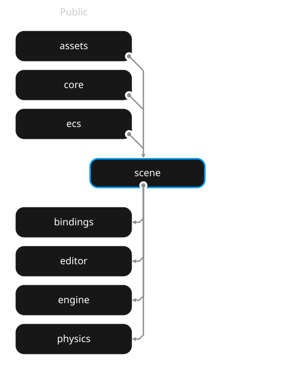

[Engine](../engine.md)

# Scene
<!-- doc-template:module -->

|---|---|
| Type | Module |
| Namespace | `conjure::scene` |
| Include Folder Path | `engine/include/conjure/scene` |
| Source Folder Path | `engine/src/scene` |

<!-- doc-content:purpose:start -->
`conjure::scene` (target `conjure_scene`, alias `conjure::scene`) is the module that turns one `ecs::world`
into an authored scene: the parent/child hierarchy with local, world and render transforms, names, tags, layers
and guids, `.scene.json` / `.prefab.json` files over the ECS archive pipeline, fully materialised prefab instances,
in-memory snapshots and the `scene_manager` that loads and unloads scene assets. This chapter is for people
changing the module or building on it (physics, the engine's scene subsystem, the editor): how the hierarchy is
stored, how one structural change becomes one flush, the propagation algorithm, the instantiation and link pass,
the file format, threading and tests.

See `engine/src/scene/README.md` for additional implementation notes.
<!-- doc-content:purpose:end -->

## Dependency Graph



## Headers

| File | Description | Provides |
|---|---|---|
| [components.h](scene/components.md) | The scene components. | [`children`](scene/components/children.md)<br>[`conjure::ecs::component_name<conjure::scene::depth_tag<Depth>>`](scene/components/conjure-ecs-component-name-conjure-scene-depth-tag-depth.md)<br>[`depth_tag`](scene/components/depth-tag.md)<br>[`detail::depth_tag_name`](scene/components/detail-depth-tag-name.md)<br>[`disabled`](scene/components/disabled.md)<br>[`guid`](scene/components/guid.md)<br>[`inactive`](scene/components/inactive.md)<br>[`interpolated_transform`](scene/components/interpolated-transform.md)<br>[`layer`](scene/components/layer.md)<br>[`local_bounds`](scene/components/local-bounds.md)<br>[`local_transform`](scene/components/local-transform.md)<br>[`name`](scene/components/name.md)<br>[`parent`](scene/components/parent.md)<br>[`prefab_instance`](scene/components/prefab-instance.md)<br>[`prefab_link`](scene/components/prefab-link.md)<br>[`render_world_transform`](scene/components/render-world-transform.md)<br>[`scene_component_ids`](scene/components/scene-component-ids.md)<br>[`tag`](scene/components/tag.md)<br>[`transform_dirty`](scene/components/transform-dirty.md)<br>[`transform_state`](scene/components/transform-state.md)<br>[`world_transform`](scene/components/world-transform.md) |
| [guid_index.h](scene/guid-index.md) | The guid -&gt; entity index of a scene. | [`guid_index`](scene/guid-index/guid-index.md) |
| [hierarchy.h](scene/hierarchy.md) | Read-only tree queries over a world&#x27;s parent / children / <code><a href="scene/components/depth-tag.html">depth_tag</a></code> components. | [`hierarchy`](scene/hierarchy/hierarchy.md) |
| [log_category.h](scene/log-category.md) | Declarations for <code><a href="core/log/log-category.html">log_category</a>.h</code>. |  |
| [prefab.h](scene/prefab.md) | Prefabs: fully materialised instances marked with <code><a href="scene/components/prefab-instance.html">prefab_instance</a></code> on the root and <code><a href="scene/components/prefab-link.html">prefab_link</a></code> on every entity (S9). | [`entity_diff`](scene/prefab/entity-diff.md)<br>[`prefab_asset`](scene/prefab/prefab-asset.md)<br>[`prefab_builder`](scene/prefab/prefab-builder.md)<br>[`prefab_builder::node`](scene/prefab/prefab-builder-node.md)<br>[`prefab_builder::node_component`](scene/prefab/prefab-builder-node-component.md)<br>[`prefab_diff`](scene/prefab/prefab-diff.md) |
| [register.h](scene/register.md) | Registration entry points the engine&#x27;s <code>scene_subsystem</code> calls: the component types (startup step 10), the two asset types with their importers, and the four systems. |  |
| [scene.h](scene/scene.md) | One authored <code><a href="scene/scene/scene.html">scene</a></code> over one <code><a href="ecs/world/world.html">ecs::world</a></code>: roots in order, the hierarchy and transform operations, names, tags, layers, guids, enabled state, the destroy queue and the archive instantiation shared by <code><a href="scene/scene/scene.html">scene</a></code> files, prefabs, duplication and snapshots. | [`instantiate_options`](scene/scene/instantiate-options.md)<br>[`instantiate_report`](scene/scene/instantiate-report.md)<br>[`root_entry`](scene/scene/root-entry.md)<br>[`scene`](scene/scene/scene.md)<br>[`scene::operation_scope`](scene/scene/scene-operation-scope.md)<br>[`scene::repair_entry`](scene/scene/scene-repair-entry.md)<br>[`scene_id`](scene/scene/scene-id.md) |
| [scene_error.h](scene/scene-error.md) | Failure conditions reported by the scene module. |  |
| [scene_manager.h](scene/scene-manager.md) | Scene residency (4.7, S11): the one scene over the world, the loaded scene records with their <code><a href="assets/asset-manager/asset-load-batch.html">asset_load_batch</a></code>, synchronous and deferred loads (replace or additive), unloads that cascade through the scene and release the assets, the layer names and the transform system the engine registers. | [`layer_table`](scene/scene-manager/layer-table.md)<br>[`load_request_id`](scene/scene-manager/load-request-id.md)<br>[`loaded_scene_info`](scene/scene-manager/loaded-scene-info.md)<br>[`scene_manager`](scene/scene-manager/scene-manager.md)<br>[`scene_manager::loaded_record`](scene/scene-manager/scene-manager-loaded-record.md)<br>[`scene_manager::pending_load`](scene/scene-manager/scene-manager-pending-load.md) |
| [scene_serializer.h](scene/scene-serializer.md) | Stateless file and archive operations over a scene. | [`prefab_document`](scene/scene-serializer/prefab-document.md)<br>[`scene_document`](scene/scene-serializer/scene-document.md)<br>[`scene_serializer`](scene/scene-serializer/scene-serializer.md) |
| [scene_snapshot.h](scene/scene-snapshot.md) | Everything needed to put a scene back the way it was. | [`scene_snapshot`](scene/scene-snapshot/scene-snapshot.md) |
| [transform_system.h](scene/transform-system.md) | Transform propagation: the body of <code>scene.propagate_transforms</code>. | [`propagation_stats`](scene/transform-system/propagation-stats.md)<br>[`transform_system`](scene/transform-system/transform-system.md)<br>[`transform_system::chunk_tally`](scene/transform-system/transform-system-chunk-tally.md)<br>[`transform_system::level_chunk`](scene/transform-system/transform-system-level-chunk.md)<br>[`transform_system::run_counters`](scene/transform-system/transform-system-run-counters.md) |

## Breakdown

<!-- doc-content:breakdown:start -->
### Contents

- [1. Shape of the module](#1-shape-of-the-module)
- [2. Hierarchy storage](#2-hierarchy-storage)
- [3. One structural change, one flush](#3-one-structural-change-one-flush)
- [4. Transform propagation](#4-transform-propagation)
- [5. Instantiation and the link pass](#5-instantiation-and-the-link-pass)
- [6. Files, prefabs and snapshots](#6-files-prefabs-and-snapshots)
- [7. Scene manager](#7-scene-manager)
- [8. Threading model](#8-threading-model)
- [9. Extension points](#9-extension-points)
- [10. Tests](#10-tests)
- [11. Open items](#11-open-items)
- [Related](#related)

### Shape of the module

`engine/src/scene/CMakeLists.txt` declares the module with `conjure_add_module(scene... PUBLIC_DEPS conjure::core
conjure::ecs conjure::assets)`, guarded by the presence of the two targets. There is no third-party dependency
and no include of the renderer, physics or scripting anywhere in the module: those modules read the
scene's `parent` and transform columns, and scripts travel through `script_component`'s own hooks.

| Header | Main types | 📘 Wiki page |
|---|---|---|
| `components.h` | the scene components and `scene_component_ids` | [Scenes and the hierarchy](../../api/scene/scenes-and-hierarchy.md) |
| `scene.h` | `scene`, `scene_id`, `root_entry`, `guid_policy`, `instantiate_options`, `instantiate_report` | same |
| `hierarchy.h`, `guid_index.h` | `hierarchy` (read-only tree queries), `guid_index` | same |
| `transform_system.h` | `transform_system`, `propagation_stats`, `compute_world_transform()` | same |
| `register.h` | `register_components`, `register_asset_types`, `register_systems`, the system and importer names | same |
| `scene_serializer.h` | `scene_document`, `prefab_document`, `scene_serializer` | [Scene files, prefabs and snapshots](../../api/scene/scene-files-and-prefabs.md) |
| `prefab.h` | `prefab_asset`, `prefab_diff`, `prefab::*`, `prefab_builder` | same |
| `scene_snapshot.h` | `scene_snapshot`, `capture`, `restore` | same |
| `scene_manager.h` | `scene_manager`, `load_mode`, `loaded_scene_info`, `layer_table` | same |
| `scene_error.h`, `log_category.h` | `scene_error` (17 codes), `LOG_SCENE` | not user-facing |

Private: `archive_tools.{h,cpp}` (typed reads, deep cloning and the hierarchy shape of an archive, asset reference
collection, `check_loadable`), `asset_ref_raw.h` (the `{uuid, slot}` view the bind pass writes, pinned by
`static_assert`s and a runtime self-test), `scene_json.{h,cpp}` (file headers), `scene_observers.cpp`,
`scene_link_pass.cpp` (`instantiate_archive`, hierarchy repair), `transform_propagation.cpp` (the chunk pass),
`scene_loader.{h,cpp}` (asset loaders), `prefab_importer.{h,cpp}` (importers), one `.cpp` per public header.

### Hierarchy storage

`parent {entity value; u32 siblingIndex}` is the single serialised truth (12 bytes: `entity` is 4-byte aligned,
so 's 16 does not apply; the C# mirror follows `type_info::layout_hash()`). `children` (TRANSIENT
`small_vector<entity, 4>`) is the cache, added to a parent on its first child and kept sorted with dense sibling
indices. Depth is one tag component per level (`depth_tag<D>`, `"conjure.scene.depth_DD"`, roots carry none), so
`scene.propagate_transforms` dispatches its level jobs with `job_system::parallel_for` one level at a time and
every parent is finished in the previous level's join. `scene` itself holds the ordered roots
(`root_entry {entity, owner}`), the guid index, the opaque settings document, the name, the destroy and repair
queues and a scratch `command_buffer`.

Membership of a loaded scene asset is "the root it hangs under": a root reparented under another scene's root
changes owner implicitly; detaching it again gives it the owner of the tree it came from.

### One structural change, one flush

`create_entity` builds the final mask (guid, name, `local_transform` and its companions, `transform_dirty`,
`parent`, depth tag, `inactive`) and creates once. `set_parent`, `set_enabled`, `add_transform` and the link pass
record depth retags, dirty and inactive changes into the scratch buffer and flush once, so every touched entity
moves at most once. Failures (`SELF_PARENT`, `HIERARCHY_CYCLE`, `HIERARCHY_TOO_DEEP`, `INVALID_ENTITY`,
`DUPLICATE_GUID`) are checked before anything changes. `transform_dirty` goes only to entities that carry a
`local_transform`: the propagation pass is its only remover and never visits a transformless entity. A
null-template `create_entities` is one structural operation (one `structure_version()` bump) and, like the
template path, leaves nothing behind and announces nothing when a creation fails.

Observers tolerate the raw ECS: `observe_destroyed` enqueues `destroy_entity(child)` per child so a subtree dies
without recursion; a raw `add/remove<parent>` unlinks where it can and queues a repair that
`scene.apply_hierarchy_changes` (TRANSFORM, EXCLUSIVE, before propagation) applies in the same frame with one WARN
per frame. `deferred_set_parent` (the bindings' locked-scope route) records the same commands plus a repair
entry that names the parent the flush installs; the entry waits while the caller's buffer is unflushed and is
applied silently by the first pass after it, counted against an expected-repairs counter. Repairs are applied one
flush each because `retag_subtree` and `refresh_inactive_subtree` decide from the live mask.

### Transform propagation

A chunk is recomputed when its `local_transform` column changed since the previous run (`since_version`), when
it carries `transform_dirty`, when a row's parent was recomputed this run (`transform_state::lastUpdateRun`,
written by the parent's level and read after the join), or when an interpolated pose is involved; a chunk that
needs nothing is left unstamped (`chunksSkipped`). Both matrices are written in one visit: `render` is the lerp of
`interpolated_transform` for the entity itself, `parentRender * local` below one, and the world matrix elsewhere;
the `INTERPOLATED_SUBTREE` bit carries the mode down the tree. A transformless ancestor contributes the identity
but does not cut the chain. Dirty tags are removed through the grain command buffers, so the second frame after a
structural change recomputes the moved rows once more and the pass is allocation-free from the third; the ECS
scheduler keeps its stage scratch in the phase state, so the whole TRANSFORM phase is gated with
`CONJURE_CHECK_NO_ALLOCATIONS` in the tests.

Grain jobs read their parents' columns through `world::get_raw(entity, id) const`, which is safe while the world is
locked (no structural change can move a row) as long as no grain writes that column at the same time; the level
join guarantees it.

### Instantiation and the link pass

`instantiate_archive` validates the archive, its shape (pre-order, depths, cycles), every `layer` index
(`detail::check_layers`: 32 or more is `BAD_FORMAT` naming the entry; 13 S15) and the guid policy before
anything exists, then runs `world::instantiate_batch` once with an `outEntities` vector, which reports every
created id copy-major in entry order (entries without components included, so an empty entity in a file is a
plain root). Guids are regenerated and rebound where the policy says so (both regenerate policies also give a
null guid a fresh one; `KEEP` leaves it null); the link pass gathers the children of every new internal node in
a side table, sorts them by the persisted sibling index, renumbers through the live `parent` links and records
the `children` component together with depth tags, companions, dirty and inactive tags and the root overrides
into one flush. Archive roots attach under `options.parent`, a live external parent or the root list. The bind
pass then resolves every `asset_ref` through `asset_manager::bind_slot` and lists the bound ids in the
report.

The `layer` component is a grouping label for `find_by_layer`, scripts and the editor. The renderer extraction
never reads it: a mesh's visibility is `mesh_renderer_component::layerMask & camera_component::layerMask`, and
sprites are not masked. The range check exists because `set_layer` is not the only writer: a file, a prefab or a
raw component write (the editor's `component.set` goes through `component_from_json`, which ignores the reflected
maximum) can carry any `u8`, and every archive reaches the world through `instantiate_archive`. Every capture
runs the same check with the captured entities, so the message names the entity: `capture`, `capture_subtree`
(and so `duplicate_subtree`, `build_document` and `save_subtree`) and `save_scene`. Without it, play/stop would
lose the scene (`restore` clears before it instantiates), the editor's undo of `entity.destroy` could not bring
the subtree back, and a saved file would fail to load.

### Files, prefabs and snapshots

Header keys `format`, `version`, `name`, `settings` (canonical), `roots` (guid strings), `archive`
(`ecs::write_archive_json` of every entity in hierarchy order, each entity's component keys in name order: UTF-8
byte order, as in the canonical cooked form, so a file does not depend on the component ids of the build that
saved it). Unknown components survive through `unresolved_components` and are written in the same order; save,
load, save is byte-identical. A file from before (keys in id order) is reordered once, by its next
save. `capture_subtree` drops the root's
`parent` (unless external references are kept) so entry 0 of a prefab is a true root; `parse_prefab` enforces a
single root at entry 0 (`BAD_FORMAT` for an empty archive, `PREFAB_MULTIPLE_ROOTS` otherwise, one helper shared
with `build_document`, `instantiate_many` and `revert` that formats its message only on failure) and unique entry
guids (`DUPLICATE_GUID`).

Prefab instances are fully materialised (S9): `prefab_instance` on the root, `prefab_link` on every entity.
`diff` matches entries by link guid, compares components as canonical JSON with the instance's local references
remapped to the asset's indices, and treats `parent` by parent guid plus sibling index. `revert` checks that the
asset still fits at the instance's place (archive, single root, depth limit, layer range) before it destroys
anything, then re-instantiates there with the old root guid; `apply` writes the link guids as entry guids (a
repeated link guid, as a duplicated entity carries, gets a fresh one) and drops the root marker; `unpack` stops at
nested instance roots unless recursive. `prefab_builder` produces a document from nodes and components by
registered name (also reserving `name` and `local_transform`, which come from `add_node`).

A `scene_snapshot` is the typed archive of every entity in hierarchy order plus the root order, owners, settings,
name and the structure version at capture (informational, not restored); `restore` clears the scene and
instantiates with `KEEP` guids, and `capture` refuses a layer of 32 or more (section 5), so a captured snapshot
never fails its restore that way.

The importers (`conjure.scene.scene_importer`, `conjure.scene.prefab_importer`) canonicalise the file and record
every asset reference as a dependency, so a `scene_manager::load` brings the referenced assets first. The asset
database picks them for `.scene.json` / `.prefab.json` through `importer_registry::find_for_path` (longest
registered suffix).

### Scene manager

`load` goes through `load_blocking` (dependencies first) and keeps the handle in the record's `asset_load_batch`;
`load_file` parses from a `vfs::file_system` and loads the referenced assets as a batch; `request_load` queues a
handle that `apply_pending_loads` (FRAME_BEGIN) applies once LOADED, in request order, dropping FAILED ones with
ERROR and `on_load_failed`. `unload` emits `on_before_unload` with the roots still alive (scripting runs
`destroy_all` there), destroys them in reverse, drops the handles and runs `collect()`. No record pointer is
held across an event, because a handler may load or unload scenes: the record is looked up again by id, and a load
whose scene a handler unloaded returns `SCENE_NOT_LOADED` without touching the newer scene in its slot.
`unload_all` fires the event once more with `SCENE_ID_AUTHORED` and the remaining roots when entities outlive the
records (authored content), before `scene::clear()`, and retires any scene a handler loaded meanwhile. REPLACE
first runs everything `instantiate_archive` would reject (`detail::check_loadable`, layer range included) so a
bad file leaves the current content in place, then unloads everything, takes the file's settings and name and
keeps guids; ADDITIVE regenerates colliding guids with one WARN. `info()` and `loaded_scenes()` gather a record's
roots on every call.

### Open items

- `tests/benchmarks/bench_scene.cpp` (`scene.transform_propagation_10k`, `scene.transform_propagation_10k_sparse`,
  `scene.snapshot_capture_restore_10k`, `scene.load_10k`) guards the propagation and snapshot budgets; the
  `set_parent_subtree_1k`, `instantiate_prefab_100` and `destroy_cascade_10k` scenarios are not
  written yet.
- A "physics wrote this" flag on `transform_state` would let the pass skip the redundant dirtying of bodies the
  physics pull just posed; deferred until measured.

### Related

- 📘 API: [Scenes, hierarchy and prefabs](../../api/scene/index.md)
- 🛠 Handbook: [ECS module](ecs.md), [Assets module](assets.md)
<!-- doc-content:breakdown:end -->

## Threading Model

<!-- doc-content:threading:start -->
`scene`, `scene_manager`, `guid_index`, the prefab functions and the serializer are owner-thread only (the
world's rules apply and return `WRONG_THREAD` / `STRUCTURE_LOCKED`); events fire on that thread.
`scene.propagate_transforms` is the only parallel code: grain jobs write `world_transform`,
`render_world_transform` and `transform_state` of their own rows, read their parents' columns through const
random access and add a local tally to relaxed counters once per job range. The asset loaders and importers run
on workers and touch only their inputs and `component_registry` lookups. Observers run synchronously inside
structural calls on the owner thread and only enqueue into the deferred buffer or push into scene-side queues.
<!-- doc-content:threading:end -->

## Extension Points

<!-- doc-content:extensions:start -->
- Any component on a scene entity is serialised by the ECS rules; a type whose state lives outside the ECS
  supplies `component_serializer` hooks through `component_type_desc::serializer` (what scripting does).
- `prefab_builder` lets a module turn its own data into a prefab without naming C++ types (the engine's
  `model_asset -> prefab` converter).
- `layer_table` and `transform_system::set_interpolation_enabled` are the engine's knobs (`project.json` layers,
  `interpolatePhysics`).
- `on_before_unload`, `on_loaded`, `on_load_failed`, `on_structure_changed`, `on_settings_changed` are the hooks
  for subsystems and the editor.
<!-- doc-content:extensions:end -->

## Testing

<!-- doc-content:testing:start -->
`tests/scene/` builds `conjure_scene_tests`: one `test_<header>.cpp` per public header plus `test_name_tag_layer`,
`test_transform_propagation` and `test_scene_serialisation`. `scene_test_fixture.h` provides the test components
(`test_asset_holder`, `test_entity_holder`, `test_speed`), `scene_fixture` (registry, world, asset manager over a
memory source, `scene_manager`, scheduler with the four scene systems, `step()`, validation in the destructor)
and `for_each_job_mode`. The 10k propagation is gated for allocations both through a direct `system_context` and
through the scheduler's whole TRANSFORM phase. The cross-module scenarios live in `tests/integration/`
(`test_assets_scene.cpp`, `test_scripting_scene.cpp`).

```
python tools/build.py --build-dir build/mod_scene --target conjure_scene_tests --test -R scene
```
<!-- doc-content:testing:end -->

<!-- doc-legacy-anchors:start -->
<a id="1-shape-of-the-module"></a>
<a id="10-tests"></a>
<a id="11-open-items"></a>
<a id="2-hierarchy-storage"></a>
<a id="3-one-structural-change-one-flush"></a>
<a id="4-transform-propagation"></a>
<a id="5-instantiation-and-the-link-pass"></a>
<a id="6-files-prefabs-and-snapshots"></a>
<a id="7-scene-manager"></a>
<a id="8-threading-model"></a>
<a id="9-extension-points"></a>
<a id="scene-module"></a>
<!-- doc-legacy-anchors:end -->
