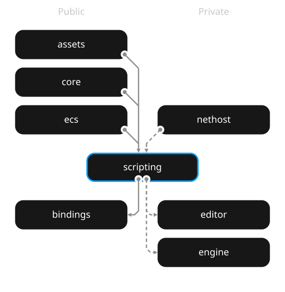

[Engine](../engine.md)

# Scripting
<!-- doc-template:module -->

|---|---|
| Type | Module |
| Namespace | `conjure::scripting` |
| Include Folder Path | `engine/include/conjure/scripting` |
| Source Folder Path | `engine/src/scripting` |

<!-- doc-content:purpose:start -->
`conjure::scripting` (target `conjure_scripting`, alias `conjure::scripting`) is the module that hosts C#
on the .NET 8 runtime: one CLR per process through `hostfxr`, the versioned native and managed API tables,
`script_component` entries owning managed instances by slot, the six exclusive script systems, hot reload through
a collectible load context with field preservation, `[EcsComponent]` mirrors registered into the component
registry, DOD `Span<T>` query scopes and `dotnet build` driven from the engine. This chapter is for people
changing the module or the managed SDK: the two tables, the runtime's re-entrancy rules, the component
registration, the managed build and tests.

See `engine/src/scripting/README.md` for additional implementation notes.
<!-- doc-content:purpose:end -->

## Dependency Graph



## Headers

| File | Description | Provides |
|---|---|---|
| [dotnet_script_host.h](scripting/dotnet-script-host.md) | The real host: one CLR per process, started on first use by the private <code>hostfxr_runtime</code> singleton; every <code>dotnet_script_host::initialise</code> re-runs the handshake (managed Initialize is idempotent), so hosts may be created and destroyed freely. | [`dotnet_script_host`](scripting/dotnet-script-host/dotnet-script-host.md) |
| [hot_reload.h](scripting/hot-reload.md) | Hot reload driver. | [`hot_reload_controller`](scripting/hot-reload/hot-reload-controller.md) |
| [log_category.h](scripting/log-category.md) | The scripting module&#x27;s log category (&quot;scripting&quot;): hosting, handshake, reload and managed faults. |  |
| [managed_build.h](scripting/managed-build.md) | Building managed projects at runtime. | [`build_diagnostic`](scripting/managed-build/build-diagnostic.md)<br>[`build_report`](scripting/managed-build/build-report.md)<br>[`build_request`](scripting/managed-build/build-request.md)<br>[`managed_build_runner`](scripting/managed-build/managed-build-runner.md)<br>[`managed_build_runner::shared_state`](scripting/managed-build/managed-build-runner-shared-state.md) |
| [native_api.h](scripting/native-api.md) | The <code>C</code> ABI shared with <code>Conjure.Managed</code>. | [`conjure_asset_info`](scripting/native-api/conjure-asset-info.md)<br>[`conjure_chunk_view`](scripting/native-api/conjure-chunk-view.md)<br>[`conjure_collision_record`](scripting/native-api/conjure-collision-record.md)<br>[`conjure_create_request`](scripting/native-api/conjure-create-request.md)<br>[`conjure_frame_block`](scripting/native-api/conjure-frame-block.md)<br>[`conjure_frame_stats_block`](scripting/native-api/conjure-frame-stats-block.md)<br>[`conjure_gamepad_state`](scripting/native-api/conjure-gamepad-state.md)<br>[`conjure_input_block`](scripting/native-api/conjure-input-block.md)<br>[`conjure_managed_api`](scripting/native-api/conjure-managed-api.md)<br>[`conjure_managed_component_desc`](scripting/native-api/conjure-managed-component-desc.md)<br>[`conjure_mat4`](scripting/native-api/conjure-mat4.md)<br>[`conjure_module_record`](scripting/native-api/conjure-module-record.md)<br>[`conjure_native_api`](scripting/native-api/conjure-native-api.md)<br>[`conjure_quat_xyzw`](scripting/native-api/conjure-quat-xyzw.md)<br>[`conjure_query_scope`](scripting/native-api/conjure-query-scope.md)<br>[`conjure_ray_query`](scripting/native-api/conjure-ray-query.md)<br>[`conjure_raycast_hit`](scripting/native-api/conjure-raycast-hit.md)<br>[`conjure_script_class_desc`](scripting/native-api/conjure-script-class-desc.md)<br>[`conjure_script_field_desc`](scripting/native-api/conjure-script-field-desc.md)<br>[`conjure_shape_query`](scripting/native-api/conjure-shape-query.md)<br>[`conjure_transform`](scripting/native-api/conjure-transform.md)<br>[`conjure_uuid`](scripting/native-api/conjure-uuid.md)<br>[`conjure_vec2`](scripting/native-api/conjure-vec2.md)<br>[`conjure_vec3`](scripting/native-api/conjure-vec3.md)<br>[`conjure_vec4`](scripting/native-api/conjure-vec4.md)<br>[`native_entry_descriptor`](scripting/native-api/native-entry-descriptor.md) |
| [native_api_hash.h](scripting/native-api-hash.md) | Generated by tools/<code>generate_native_api.py</code> from <code>native_api.inl</code>. |  |
| [null_script_host.h](scripting/null-script-host.md) | The <code>C</code>++ fake of the managed side. | [`null_host_recorder`](scripting/null-script-host/null-host-recorder.md)<br>[`null_host_recorder::apply_record`](scripting/null-script-host/null-host-recorder-apply-record.md)<br>[`null_host_recorder::collision_record`](scripting/null-script-host/null-host-recorder-collision-record.md)<br>[`null_host_recorder::create_record`](scripting/null-script-host/null-host-recorder-create-record.md)<br>[`null_host_recorder::destroy_record`](scripting/null-script-host/null-host-recorder-destroy-record.md)<br>[`null_host_recorder::phase_record`](scripting/null-script-host/null-host-recorder-phase-record.md)<br>[`null_script_host`](scripting/null-script-host/null-script-host.md)<br>[`null_script_host::slot_state`](scripting/null-script-host/null-script-host-slot-state.md) |
| [script_class_registry.h](scripting/script-class-registry.md) | The native copy of the script class schema. | [`script_class_info`](scripting/script-class-registry/script-class-info.md)<br>[`script_class_registry`](scripting/script-class-registry/script-class-registry.md)<br>[`script_class_registry::table`](scripting/script-class-registry/script-class-registry-table.md)<br>[`script_field_info`](scripting/script-class-registry/script-field-info.md) |
| [script_component.h](scripting/script-component.md) | The script component and its store. | [`script_component`](scripting/script-component/script-component.md)<br>[`script_entry`](scripting/script-component/script-entry.md)<br>[`script_entry_id`](scripting/script-component/script-entry-id.md)<br>[`script_set`](scripting/script-component/script-set.md)<br>[`script_store`](scripting/script-component/script-store.md)<br>[`script_store::set_slot`](scripting/script-component/script-store-set-slot.md) |
| [script_fields.h](scripting/script-fields.md) | The field blob: the single wire format of <code>apply_fields</code> and <code>collect_fields</code>. | [`field_blob_field`](scripting/script-fields/field-blob-field.md)<br>[`field_blob_reader`](scripting/script-fields/field-blob-reader.md)<br>[`field_blob_writer`](scripting/script-fields/field-blob-writer.md) |
| [script_host.h](scripting/script-host.md) | The host interface: the object that owns the managed side of the two ABI tables. | [`host_capabilities`](scripting/script-host/host-capabilities.md)<br>[`script_host`](scripting/script-host/script-host.md)<br>[`script_host_config`](scripting/script-host/script-host-config.md) |
| [script_runtime.h](scripting/script-runtime.md) | The native side of script execution. | [`collision_event`](scripting/script-runtime/collision-event.md)<br>[`script_runtime`](scripting/script-runtime/script-runtime.md)<br>[`script_runtime::deferred_reservation`](scripting/script-runtime/script-runtime-deferred-reservation.md)<br>[`script_runtime::faulted_slot`](scripting/script-runtime/script-runtime-faulted-slot.md)<br>[`script_runtime::pending_create`](scripting/script-runtime/script-runtime-pending-create.md)<br>[`script_runtime::query_scope_state`](scripting/script-runtime/script-runtime-query-scope-state.md)<br>[`script_runtime_config`](scripting/script-runtime/script-runtime-config.md)<br>[`script_runtime_stats`](scripting/script-runtime/script-runtime-stats.md) |
| [script_system.h](scripting/script-system.md) | The six <code>EXCLUSIVE</code> scripting systems. |  |
| [scripting.h](scripting/scripting.md) | Umbrella header of the scripting module. |  |
| [scripting_error.h](scripting/scripting-error.md) | Error codes of the scripting module. |  |

## Breakdown

<!-- doc-content:breakdown:start -->
### Contents

- [1. Shape of the module](#1-shape-of-the-module)
- [2. The two tables and the handshake](#2-the-two-tables-and-the-handshake)
- [3. The runtime](#3-the-runtime)
- [4. The component registration](#4-the-component-registration)
- [5. Hot reload](#5-hot-reload)
- [6. The managed side](#6-the-managed-side)
- [7. nethost on MSVC](#7-nethost-on-msvc)
- [8. Threading and destruction order](#8-threading-and-destruction-order)
- [9. Tests](#9-tests)
- [10. Open items](#10-open-items)
- [Related](#related)

### Shape of the module

`engine/src/scripting/CMakeLists.txt`: `conjure_add_module(scripting... PUBLIC_DEPS conjure::core conjure::ecs
conjure::assets PRIVATE_DEPS <nethost>)`, guarded by `CONJURE_WITH_SCRIPTING` and the presence of `conjure::ecs`
and `conjure::assets`; never `scene`. `managed/CMakeLists.txt` builds the C# projects with
`conjure_add_managed_project` (`cmake/ConjureManaged.cmake`) behind stamp files and makes `conjure_scripting`
depend on the SDK.

| Header | Main types | 📘 Wiki page |
|---|---|---|
| `script_runtime.h`, `script_component.h`, `script_class_registry.h`, `script_fields.h`, `script_system.h` | `script_runtime`, `script_component` / `script_store`, `script_class_registry`, the field blob, `register_script_systems` | [Scripts, components and the runtime](../../api/scripting/scripts-and-components.md) |
| `script_host.h`, `dotnet_script_host.h`, `null_script_host.h`, `native_api.h`, `native_api_hash.h`, `hot_reload.h`, `managed_build.h` | the hosts, the ABI records and tables, the generated hash, `hot_reload_controller`, `managed_build_runner` | [Hosting, the native API and hot reload](../../api/scripting/hosting-and-hot-reload.md) |
| `scripting.h`, `scripting_error.h`, `log_category.h`, `native_api.inl` | umbrella, `script_error` and `status_of`, `LOG_SCRIPTING`, the X-macro table (an input of `native_api.h`, not a header that compiles alone) | not user-facing |

Private: `hostfxr_api.h` (the only file that includes `nethost.h`, `hostfxr.h` and `coreclr_delegates.h`),
`hostfxr_runtime.{h,cpp}` (the process-wide CLR), `native_api_core.cpp` (the 20 core entries: log, class
registration, faults, entities, components, queries), and one `.cpp` per public header.

### The two tables and the handshake

`conjure_native_api` is filled by the engine (the core entries by `fill_core_native_entries` inside
`script_runtime::initialize`, the ten bindings groups by the `scripting_bindings_subsystem` before it);
`conjure_managed_api` is filled by `Conjure.Bootstrap.Initialize`. Both carry size, version and layout hash;
`validate_native_api` / `validate_managed_api` and the managed side compare them, so any drift is
`ABI_MISMATCH` at start-up. The entry list is the X-macro table `native_api.inl` (`CONJURE_NATIVE_FN(group,
name, ret, (args))`, 20 core entries then the `// --- bindings ---` marker); `tools/generate_native_api.py`
derives `native_api_hash.h`, `managed/Conjure.Managed/Generated/NativeApi.g.cs` and
`docs/generated/native_api_manifest.json`, and the CTest entry `conjure_scripting_api_generated_up_to_date`
fails when they are stale. The managed layouts (`LayoutHash.cs`) are the layouts `sizeof(T)` and `Span<T>` use:
fields at their natural alignment in declaration order, checked against `Unsafe.SizeOf<T>`; `Marshal.OffsetOf`
is never consulted because it widens `bool`.

### The runtime

One `script_runtime` per process (`script_runtime::active()` is what the component hooks and the core entries
reach). It owns the host, the class registry (staged then committed tables), the store, the 64-byte aligned
frame block, the pending create / destroy queues, the deferred command buffer and the query scopes.
`attach_world` wires the ADDED / REMOVED observers of `script_component` and adopts the sets the world's
entities already carry; `set_mode(PLAY)` creates every instance in one `create_instances` call.

Every managed call may run script code that calls back in: `OnCreate` may destroy its own entity, `OnDestroy`
may spawn scripted entities (the store reallocates), either may open a query scope. The runtime therefore
never holds a `script_set *` or `script_entry *` across a managed call, destroys the instance of a request whose
entry vanished during `create_instances` in the next flush iteration, and force-closes scopes left open by a
managed call. `OnCreate` / `OnDestroy` run inside the phase whose flush created them; the flushes of
`frame_begin`, `frame_end` and `set_mode` run no phase, so a query scope there is `NOT_IN_PHASE`. Collision
callbacks run as `FIXED_UPDATE`. `set_mode(EDIT)` / `destroy_all` end a play session: `STARTED` and `FAULTED` are
cleared so the next `PLAY` runs `OnStart` again (the started flag is for hot reload only).

### The component registration

`register_script_component` registers `script_component` through `component_registry::register_described` with
`component_type_desc {ops = script_component_ops(), serializer = script_component_serializer(), reflection =
nullptr}`: the copy hook deep-copies the set, destruct frees it, `writeJson` / `readJson` carry
`{"scripts":[{"class","hash","fields"}]}` and `remapEntities` rewrites `ENTITY` fields through the class schema.
The ECS consults the hooks for every archive, scene file, prefab, snapshot and `component_to_json` path, which
is how scripts cross the scene module without a dependency (`tests/integration/test_scripting_scene.cpp`).
All hooks resolve the runtime through `script_runtime::active()`. Without a live runtime, the copy hook drops
the set (WARN), destruct and `remapEntities` do nothing, and `readJson` as well as a `writeJson` of a component
that has a set fail with `INVALID_STATE`, so a save never silently writes an empty script list.

### Hot reload

`reload_game_assembly`: load new -> collect fields -> destroy -> unload -> swap registries -> recreate
(`OnCreate` again, `OnStart` not). A failed load leaves the running game untouched; a leaked load context is a
WARN (`ASSEMBLY_LEAKED` is logged and counted, not returned). `hot_reload_controller` debounces requests and
optionally polls the write time of the assembly and its `.pdb` (the load context reads both); a watched reload
that fails with `ASSEMBLY_LOAD_FAILED` is retried up to three times, one debounce window apart, because the build
may still be writing or locking the files. `scripting.frame_begin` ticks it. Plugin assemblies share the game
load context, so a leaky plugin prevents unloading the game assembly. Paths cross the ABI, the logs and the
`dotnet` command line as UTF-8 through the private `scripting_internal.h` (`detail::path_to_utf8`,
`detail::utf8_to_path`), never `path::string()`, which is the ANSI code page on Windows.

### The managed side

`managed/Conjure.Managed` is the SDK (`ScriptBehaviour`, `Entity`, `Transform`, `Input`, `Time`, `Log`,
`Physics`, `Audio`, `Prefab`, `Scene`, `Dod.ComponentQuery<T>`, `[EcsComponent]`, the interop layer and the
guard), `Conjure.Bootstrap` the assembly `hostfxr` loads (it owns the runtime config), `Conjure.TestScripts` the
scripts the `[dotnet]` tests drive (built as variants V1 / V2 / V3 for the reload tests) and
`Conjure.Templates/Game` the project a new game starts from. Every project lists its compile items explicitly and
the `conjure_managed_sources_match.*` CTest entries check that the csproj and the CMake lists agree.
`ComponentType<T>.Id` is cached per handshake generation so a new runtime with other component ids re-resolves;
`ScriptRuntime.Shutdown` forgets the native table.

### nethost on MSVC

The static `libnethost.lib` of the host pack is built against the static release CRT, which the engine's `/MD`
and `/MDd` objects cannot link (LNK2038). On MSVC `engine/src/scripting/CMakeLists.txt` links the `nethost.lib`
import library instead and copies `nethost.dll` next to the executables after each build of `conjure_scripting`;
other platforms link `libnethost.a` statically through `conjure::thirdparty::nethost` (`cmake/FindNetHost.cmake`).

### Open items

- describes `libnethost` as linked statically everywhere; on MSVC the import library
  is linked instead (section 7).
- `tests/benchmarks/bench_scripts_update_phase.cpp` (`scripting.update_10k`, `scripting.update_10k_dod`) holds
  the 2 ms scenario; the C# wiki pages are [The C# API](../../api/bindings/csharp-api.md).

### Related

- 📘 API: [Scripting](../../api/scripting/index.md)
- 🛠 Handbook: [ECS module](ecs.md), [Building and Configuration](../development/building-and-configuration.md)
<!-- doc-content:breakdown:end -->

## Threading Model

<!-- doc-content:threading:start -->
Everything is main-thread only: the CLR is started and every managed call is made from the thread
`core::jobs::is_main_thread()` names, and every native entry but `log_write` asserts on other threads and fails
softly. `managed_build_runner` is the one exception: the build process runs on a job and its report is posted
with `core::jobs::post_to_main_thread`. A `script_runtime` must be detached (or destroyed) before the `world` it
is attached to: the component hooks resolve the runtime through `active()` while the world frees its entities.
Declare the runtime after the world and `shutdown()` it before the world dies.
<!-- doc-content:threading:end -->

<!-- doc-content:extensions:start -->

<!-- doc-content:extensions:end -->

## Testing

<!-- doc-content:testing:start -->
`tests/scripting/` builds `conjure_scripting_tests` (one `test_<header>.cpp` per public header plus the topic
files of ) and `conjure_scripting_slow_tests` (the self-contained publish and the
test-scripts build, labels `scripting;dotnet;slow`, excluded by the default presets). The null-host cases run
everywhere; the `[dotnet]` cases start the real runtime from `bin/managed` and skip through
`precondition::DOTNET_RUNTIME` when no.NET 8+ runtime is installed. `scripting_test_support.h` provides
`scripting_fixture` (null host) and `dotnet_fixture` (the CLR with `Conjure.TestScripts` loaded).

```
python tools/build.py --build-dir build/<dir> --target conjure_scripting_tests --test -R "scripting|managed"
```
<!-- doc-content:testing:end -->

<!-- doc-legacy-anchors:start -->
<a id="1-shape-of-the-module"></a>
<a id="10-open-items"></a>
<a id="2-the-two-tables-and-the-handshake"></a>
<a id="3-the-runtime"></a>
<a id="4-the-component-registration"></a>
<a id="5-hot-reload"></a>
<a id="6-the-managed-side"></a>
<a id="7-nethost-on-msvc"></a>
<a id="8-threading-and-destruction-order"></a>
<a id="9-tests"></a>
<a id="extension-points"></a>
<a id="scripting-module"></a>
<!-- doc-legacy-anchors:end -->
